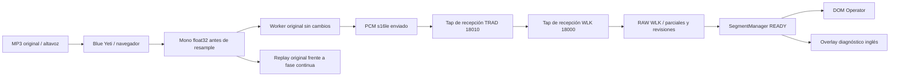

# TRAD — Sprint 2 / M4-B: Blue Yeti, PCM y latencia

20 de octubre de 2026, America/La_Paz. Prioridad EN→ES; congreso previsto para el
22 de octubre, 07:00. Primera entrega: instrumentación y ensayos sintéticos.

**Estado actualizado: análisis offline de los datos existentes completado (§17).
Hay evidencia suficiente para comparar reconocimiento, transporte, segmentación
y DSP del prefijo, con límites explícitos. No se promueven cambios a LIVE.**
El intento 03 confirmó Blue Yeti; el registro del navegador quedó parcial por
timeout, pero los taps conservaron el PCM completo y el cierre operativo.
El usuario descartó corregir el temporizador y autorizó continuar con esos datos.
No se corrigieron temporizador, metadata ni presupuesto, ni se abrió otra captura.
Servicios cerrados; LIVE intacto. 03 consumido, 04 sin usar. El análisis no convierte
el intento 03 en una captura completa validada ni aporta WER clínico.

## 1. Auditoría, preservación y aislamiento

Se leyeron S2-M4-ASR-DIAGNOSTIC.md, TRAD_LAB_REPORT.md, trad_lab/README.md,
BIDIRECTIONAL_MVP_REPORT.md e INSTALL_WINDOWS.md antes de editar. La observación
del usuario sobre errores de «57 new recommendations», «non-elevated blood
pressure» y «120 over 70» queda como evidencia comunicada, sin audio correlacionado
que permita adjudicar causa. El Blue Yeti no se considera defectuoso por defecto.

Rama de trabajo `sprint2/m1-rtx4070`. HEAD/main/RC resuelto conservados en
`64f82214b33fad4ee68295df1367249caeae3187`. Checkpoint aprobado verificado:
`codex/s2-m4-checkpoint`, commit `cd008ad436d8d2c13a739490e899d18e188df9b3`.
No staging, commits, tags, merge, reset, push ni deploy M4-B.

Run privado: `C:/live-captions/logs/trad_lab/m4b_20261020T123741Z`.

- `audit.json`: inventario previo de **159 archivos fuente**, hashes de `.env`
  sin su contenido, corpus, referencias Git y **280 archivos privados previos**.
- `pre_m4b_sources.zip`: respaldo de fuentes previo a M4-B, SHA-256
  `f6ac3f1f2c6344f2593d1f0f8f41325d1790779ed72208f22696c256e44a9bb1`.
  No contiene credenciales, runtime, entornos, pesos ni corpus. El manifiesto
  describe resultados privados mediante hashes; sus bytes permanecen en su sitio.
- Se verificaron el manifiesto de respaldo M4 y su manifiesto final. Las adiciones
  M4 fuera del checkpoint son `trad_lab/m4/`, `tests/test_trad_lab_m4.py` y
  `S2-M4-ASR-DIAGNOSTIC.md`; se preservan. Los 18 cambios versionados previos
  del MVP/M1 tampoco se sobrescriben.
- `final_validation.json`: comprobación final de preservación y fuentes nuevas.
  Los ZIP M3/M4 y sus resultados originales se conservan por hash.

Al auditar había WLK PID 23376 en 8000 y TRAD PID 32632 en 8010, con sus padres
venv 28780/23812. La consulta autenticada indicó `stopped`, sesión cerrada; GPU
1363 MiB usados/6586 libres. El usuario cerró manualmente esos servidores. La
revalidación encontró los cuatro puertos libres y 226 MiB usados/7723 libres,
55 °C. **Cerrar LIVE no se interpreta como autorización para arrancar M4-B.**

Plan ejecutable congelado:
`C:/live-captions/logs/trad_lab/m4b_20261020T123741Z/environment_final/plan.json`.
Contiene 84 archivos congelados verificados, con importación independiente PASS
y DeepL deshabilitado/sin clave (`isolated_import_final.json`).
La copia anterior `environment/` conserva la primera comprobación de importación;
el ensayo debe utilizar **environment_final**. Ambos son privados e independientes.

La copia contiene app, glosarios y herramientas. No copia `.env` original:
genera configuración sin secretos, conserva ajustes numéricos del proyecto de
SegmentManager/reliability/Operator/normalizador y configuración de captions,
fija DeepL OFF, inglés y WLK 18000. El proceso limpia variables heredadas de esas
familias antes de aplicar el plan. No se conocen posibles overrides de las
terminales históricas de LIVE: el plan describe la configuración del proyecto,
no certifica que reproduzca aquellos overrides. No cambia thresholds de ASR/VAD.
La identidad inglesa sigue sin glosario médico/fuzzy. Modelo/política: small,
Faster-Whisper/SimulStreaming con los defaults instalados; handshake por sesión.

## 2. Arquitectura de observación



`prepare.py` añade solo metadata al worklet **de la copia**. El mensaje float32
original y el flush conservan sus bytes/orden. `browser.js`, instalado por CDP
para nuevos documentos, observa esos mensajes y el WebSocket real. La corrección
de la sección 15 añade instalación en el documento efectivo del popup antes de
liberar `capture_start`; en esa ruta no se afirma preceder todo el código de app.
La captura baseline utiliza el worker original; el candidato solo entra al replay.

Se registran:

| Punto | Evidencia preparada |
|---|---|
| A: antes del resample | `pre.f32le`, seq, currentFrame, muestras, canales, sample rate efectivo, contexto y entrega al main thread |
| B: PCM enviado | `sent.s16le`, bytes exactos, seq, EOF, bufferedAmount |
| Transporte | `received.s16le` en TRAD y WLK; SHA por bloque/total, orden y límites de mensajes |
| Inicio y fuente | apertura CAPTURE/socket, handshake, primer bloque, track settings, SHA del MP3, petición de play, evento `playing`, media.currentTime y fin |
| ASR y segmentación | RAW de WLK antes de TRAD, snapshots completos recibidos por CAPTURE, parciales/revisiones, confirmado, READY/IDs/reason/timestamps |
| Presentación | MutationObserver de partial/confirmed/pending/ready/normalized/english en ambas ventanas; READY en overlay diagnóstico; oportunidades rAF/visibilidad |
| Control y fin | clicks START/STOP/CLEAR, respuestas de CLEAR/STOP filtradas, flush worklet/worker, EOF, terminal, dueño y sesión cerrada |

“Antes del resample” significa el mono que consume CAPTURE después del stack
Windows/Web Audio y posibles AGC/AEC/denoise del navegador. **No es el ADC crudo
ni todos los canales físicos del Yeti.** Se registran los ajustes efectivos de
track y contexto para describir esa diferencia. El worklet no escribe disco ni
espera red; la metadata añade carga de MessagePort que falta medir físicamente.

El overlay M4-B es un panel explícito de READY inglés en Operator. Con DeepL OFF,
el overlay operativo no recibe captions traducidos. Este panel no acredita OBS,
sus contratos de paginación/lectura ni latencia de español. CLEAR confirmado limpia
el panel diagnóstico; el contrato operativo sigue ejecutándose sin cambios.

## 3. Memoria, integridad, privacidad y autorización

Cola del navegador: 8 MiB más un paquete en vuelo menor de 180 k caracteres;
envío por lotes cada 50 ms, ACK tras escritura, timeout 5 s. Writer en hilo:
32 paquetes, máximo 256 KiB/paquete y 160 MiB JSON total por writer. Colector:
240 s incluyendo preparación manual. Telemetría GPU: máximo 600 filas cada 2 s.
Errores de cola, límites, escritura, ACK o secuencia invalidan la evidencia;
no se sustituyen muestras ni se presenta una captura parcial como PASS.

Los taps ASGI observan conexiones después de aceptación y devuelven mensajes
originales. No guardan scope, headers, cookies, URL/query ni subprotocolos. Se
filtran claves de credenciales y se conservan solo campos previstos de mensajes.
No se modifica nonce, auth, propietario, aislamiento de idioma ni handshake.
El navegador utiliza permisos de micrófono y controles normales, sin fake audio.

Solo `logs/trad_lab/` recibe audio/transcripciones; está excluido de Git. El
`.runtime` de la copia y el perfil Chrome contienen la autorización local normal:
no son artefactos para publicar. El perfil se retira tras cierre correcto. En
fallo se deja el navegador visible para STOP normal, sin reiniciar ni matar LIVE.
La evidencia de audio/texto no contiene headers/tokens. Los respaldos de fuentes
excluyen perfiles/runtime/resultados físicos.

Los launchers rechazan LIVE en 8000/8010, puertos de destino ocupados y copia
alterada. WLK comprueba pesos small cacheados, hash del decoder y reserva inicial
de 2200 MiB; HF offline, sin descargas/instalaciones. El observador OOM termina
solo el proceso experimental y conserva un estado bloqueado, sin ajustes/retry
automáticos. Un abort nativo podría perder la cola pendiente: invalida el ensayo.
Antes de arrancar se auditarán también otros procesos GPU; comprobar cuatro
puertos no prueba por sí solo ausencia universal de competidores.

## 4. Ensayo manual preparado

**Procedimiento y comandos históricos; no ejecutar para reanudar la revisión actual.
Consultar la sección 15 y obtener autorización física posterior.** Objetivo inicial: dos
repeticiones equivalentes; tercero reservado para contingencia. Cada intento
consume un claim, aunque resulte incompleto. Un colector por sesión/directorio.

Fuente exacta: `C:/TRAD-LAB/corpus/cardio_01/audio.mp3`, SHA
`59d1ec58514134f7bf326d824e33f61eb868713b71cad147395563104119a25d`.
Reproducción 0–100 s, que incluye hipertensión/recomendaciones ESC 2024.
Conservar el MP3; no sustituirlo por un WAV sin documentar. El panel verifica SHA.

Después de aprobación, en tres terminales dedicadas desde `C:/live-captions`:

```powershell
# Terminal 1, solo después de autorización M4-B:
$plan='C:\live-captions\logs\trad_lab\m4b_20261020T123741Z\environment_final\plan.json'
.\.venv-wlk\Scripts\python.exe -m trad_lab.m4b serve wlk --plan $plan --authorization 'M4-B aprobado hasta 3 sesiones'

# Terminal 2, definir el mismo $plan en esta terminal:
.\.venv\Scripts\python.exe -m trad_lab.m4b serve trad --plan $plan --authorization 'M4-B aprobado hasta 3 sesiones'

# Terminal 3, definir el mismo $plan; directorio nuevo para cada intento:
.\.venv-wlk\Scripts\python.exe -m trad_lab.m4b capture --plan $plan --out logs/trad_lab/m4b_20261020T123741Z/physical_01 --authorization 'M4-B aprobado hasta 3 sesiones'
```

El argumento de CLI es una interlock deliberada, no autorización humana en sí.
Comprobar health/modelo/GPU antes de START; health no acredita por sí solo handshake.

1. Fijar y anotar altavoz/salida Windows, volumen, distancia, orientación/patrón
   Yeti, ganancia, ajustes Windows y ruido. No cambiar entre repeticiones. Usar
   auriculares para escuchar resultados después, no como altavoz de referencia.
2. En el Chrome visible del colector permitir micrófono/popups. Actualizar
   dispositivos y seleccionar **Blue Yeti**, dirección **English → Español**.
   Seleccionar el MP3 original en el panel M4-B.
3. Pulsar START normal; conservar CAPTURE abierta. Esperar primer bloque PCM
   después del handshake y **cinco segundos de preroll**. El botón de reproducción
   permanece bloqueado hasta entonces y hasta validar el MP3.
4. Reproducir con el botón del panel. Se registra `playing`, no solamente el click;
   finaliza alrededor de 100 s. La notificación de navegador no prueba el instante
   acústico del altavoz: se contrastará con anchors del PCM capturado.
5. Esperar **cinco segundos de postroll**. Probar CLEAR en ese postroll para evitar
   confundir limpieza visual con pérdida de discurso. Pulsar STOP del propietario.
6. Esperar EOF, outcome completo y sesión cerrada. No cerrar CAPTURE a mano antes.
   El colector guarda y cierra su navegador tras el drenaje. Si anuncia evidencia
   inválida/incompleta, STOP normal y conservar el intento; no volver a START allí.
7. Repetir con `physical_02` y mismas condiciones. No consumir el tercero por
   reintento automático. Si hay OOM, detener y revisar evidencia antes de continuar.
8. Tras las sesiones aprobadas y STOP completo, Ctrl+C exclusivamente en las dos
   terminales de laboratorio. Verificar liberación de 18000/18010 antes de offline.

## 5. Análisis del mismo audio y puerta de referencia

`analyze` exige dueño/STOP cerrado completo, secuencias, offsets, hashes, un EOF
terminal, mono/tasa estable y continuidad de currentFrame. Compara bytes totales
y mensajes individuales CAPTURE→TRAD→WLK. Exporta WAV del PCM exacto y un WAV s16
de escucha del pre-f32; este último es derivado, el float32 original permanece.

Emparejar los `wire_NN` por sesión/orden/hash: intentos rechazados pueden consumir
un número. Esperar cierre de writers. Nunca asumir que ambos `NN` coinciden.

```powershell
# Sustituir CAPTURA/WIRE_TRAD/WIRE_WLK/COPIA por rutas del intento, no ejecutar ahora.
.\.venv-wlk\Scripts\python.exe -m trad_lab.m4b analyze --capture CAPTURA --trad WIRE_TRAD --wlk WIRE_WLK
.\.venv-wlk\Scripts\python.exe -m trad_lab.m4b align --capture CAPTURA
& 'C:\Program Files\nodejs\node.exe' trad_lab/m4b/replay.cjs CAPTURA/browser/pre.f32le CAPTURA/browser/events.jsonl COPIA/app/static/recorder_worker.js CAPTURA/replay
# Solo con todos los servicios cerrados:
.\.venv-wlk\Scripts\python.exe -m trad_lab.m4b offline --capture CAPTURA --out NUEVO_DIRECTORIO_PRIVADO
```

`align` compara anchors del MP3 con la captura pre-resample usando resample_poly
solo para análisis. Baja correlación queda inconclusa. Los anchors pueden localizar
preroll/deriva; no prueban completitud de todas las frases ni calidad acústica.
El inicio se revisará escuchando la primera frase y sus muestras, no solo duración.

`replay` respeta exactamente la partición registrada, usa el fuente del worker
original en VM y el candidato sobre el mismo f32. Offline exige que el replay
original tenga el SHA del PCM realmente transmitido antes de comparar small
float16/beam5 en ambas señales. Perfil idéntico, sin glosario/contexto médico/VAD.
Esto aísla el DSP para ese decoder offline; no iguala el decoder AlignAtt de WLK.
No hay inferencia concurrente con servidores. Se conservan hipótesis crudas.

Comparaciones previstas: MP3↔pre-f32 para frente acústico/navegador; pre↔PCM y
original↔candidato para DSP; sent↔recepciones para transporte; FW del sent↔WLK RAW
para camino ASR; RAW↔READY para segmentación; READY↔DOM/overlay para presentación.
Una diferencia localizada no identifica automáticamente su causa raíz.

**No se calcula WER clínico en las herramientas M4-B entregadas.** Las métricas
entre hipótesis se llaman discrepancias. La aceptación previa de los tres recortes
M4 no valida este nuevo recorte de 100 s ni el preroll/postroll físico. Antes de
puntuar precisión se alineará un TXT exacto con los límites realmente reproducidos
y se solicitará revisión humana si quedan dudas. No usar el TXT de la conferencia
completa frente a este clip ni corregir la referencia a partir del ASR.

## 6. Remuestreador experimental y resultados sintéticos

Se extendió el promedio continuo de tres muestras de M4 a integración rectangular
con unidades de tiempo enteras: una muestra de entrada ocupa 16000 unidades y una
celda de salida ocupa sample_rate unidades. Conserva fase/área entre bloques en
48/44.1/16 kHz; memoria de estado constante. EOF emite, si existe, una celda parcial
normalizada con cobertura explícita. Sin cero inventado, doble EOF ni descarte
silencioso de resto. La duración de contenedor se redondea por exceso menos de
una muestra de 16 kHz (62,5 µs); la cobertura temporal exacta se conserva en metadata.

| Entrada 60 s, bloques de hasta 128 | Worker original | Candidato | Esperado |
|---|---:|---:|---:|
| 16000 Hz | 960000 / 60 s | 960000 / 60 s | 960000 |
| 44100 Hz | 950907 / 59,4316875 s | 960000 / 60 s | 960000 |
| 48000 Hz | 967500 / 60,46875 s | 960000 / 60 s | 960000 |

**Demostrado:** dependencia temporal del worker original respecto a particiones
y corrección de conteo del candidato. A 44,1 kHz el ejemplo pierde duración;
a 48 kHz la incrementa. No significa que el micrófono haya perdido ese discurso:
es el reloj de muestras producido por ese algoritmo para esa partición.

**No demostrado:** mejora clínica, calidad anti-alias/voz, latencia física o
fiabilidad prolongada. Integración rectangular no equivale a un resampler de
alta calidad. El A/B sintético M4 ya mostró que conteo correcto no garantiza
mejor WER; no se promociona este reemplazo automáticamente.

## 7. Relojes, latencia y límites de interpretación

AudioWorklet aporta currentFrame/sampleRate; entrega a main thread usa
performance.now. Cada página conserva timeOrigin; Python usa perf_counter_ns.
Cada dos segundos se toma un bracket CDP: instante Python antes/después y reloj
del navegador dentro de la llamada. Se mapea por calibración cercana y se reporta
incertidumbre RTT/2; diferencias entre páginas suman las incertidumbres. Los taps
de servidor usan perf_counter_ns del mismo Windows. No se iguala Date.now a QPC.

El análisis prepara por segmento: disponibilidad en main thread del bloque
correspondiente al final temporal informado por WLK → hipótesis del segmento
completo, RAW confirmado, READY recibido, DOM de CAPTURE/Operator y overlay/rAF.
Usa correspondencia uno-a-uno del worker baseline; tiempos fuera de audio,
revisiones sin correspondencia léxica exacta o relojes ausentes quedan sin métrica.
Agrupa n/mediana/p95 por etapa y mide EOF→terminal con incertidumbre. También
registra primera hipótesis/confirmación global desde inicio de flujo, que incluye
preroll y **no es latencia desde inicio de voz**.

La correspondencia audio↔timestamp WLK debe verificarse en el ensayo; esos tiempos
son condicionales al timebase de WLK. El bloque disponible no es el ADC ni el
instante de habla en el altavoz. No se incluyen como medidos buffering acústico/OS,
deriva entre calibraciones, fotones de pantalla o proyector. MutationObserver es
actualización DOM; rAF visible es oportunidad de render, no prueba de pintado
físico. Ventanas ocultas no acreditan visibilidad. RTF offline se reporta separado.
Con DeepL OFF, ninguna cifra futura de esta fase será latencia total EN→ES.

**Resultados ASR/latencia física M4-B: pendientes; no hay cifras nuevas.**

## 8. Pruebas y validación automatizada

Pruebas sin servicios experimentales ni GPU:

**99 pruebas Python PASS, sin skips**, incluidas 11 específicas M4-B;
**seis suites JavaScript operativas PASS**, además de señal/observadores M4-B.
Compilación y `git diff --check` PASS. Replay por archivos PASS en las tres tasas.

- `test_signal.cjs`: **171 casos** de tasas/tamaños/particiones, oracle independiente
  por solapamiento de intervalos, identidad s16, EOF parcial/doble EOF, no finitos;
  conteo de 60 s en las tres tasas. Worklet con metadata conserva muestras y flush.
- `test_browser.cjs`: ejecuta los observadores reales en VM con superficies
  deterministas; separación metadata/Float32, mismos bytes WS/EOF, ausencia de
  tokens/query en la evidencia. No simula el pintado real ni el Yeti.
- Python M4-B: hashes/offsets/seq, corrupción/pérdidas/frame jump, fallo de límites,
  ACK, transparencias ASGI aceptada/rechazada y snapshots RAW, relojes distintos,
  ausencia de timestamps, análisis completo con WAV exacto y sin WER, bloqueo de
  autorización antigua y stop-on-OOM sintético sin texto sensible.
- Regresiones: laboratorio M3/M4, normalizador, SegmentManager, release y dirección
  de sesión; suites JS Operator/partial/overlay/reliability. Ver logs del run y
  conteo final en `final_validation.json`.
- Importación de Settings desde la copia sin arrancar lifespan/servidor: módulo
  dentro de la copia, DeepL disabled/sin clave, WLK 18000 y hashes congelados.

El primer intento unitario asyncio quedó bloqueado por el socketpair interno de
Windows dentro del sandbox; se diagnosticó y repitió con permiso de ejecución.
No fue un fallo ASR ni se arrancó un servicio M4-B para resolverlo.
El E2E real navegador↔GPU se deja para el permiso solicitado; no se atribuye a los
dobles sintéticos una validación de dispositivos o servicios aún no ejecutada.

## 9. Errores médicos y conclusiones abiertas

Revisar por escucha y texto alineado: 57, ESC 2024, non-elevated/elevated,
hypertension, 120 over 70 y demás cifras/unidades/negaciones. Conservar primer y
último pasaje del discurso. La observación física comunicada y las diferencias
M3/M4 orientan esa revisión; no se adjudican con otra hipótesis ASR como verdad.
Porcentajes/dígitos/palabras pueden cambiar WER por formato sin cambiar concepto;
también un WER bajo puede esconder una cifra clínica grave. No borrar esos casos
mediante glosario fuzzy ni equivalencias de scoring para obtener un PASS.

Se ha demostrado el defecto temporal sintético del worker y la propiedad de
conteo del candidato. Siguen abiertas captura física, DSP del navegador,
latencia/precisión AlignAtt, revisiones de RAW y efecto de segmentación en ese
audio. El OOM M4 no determina por sí solo el comportamiento de este servidor.

## 10. Inventario, propuesta mínima y rollback

Solo adiciones M4-B:

- `trad_lab/m4b/`: `prepare.py`, `server.py`, `capture.py`, `browser.js`, `tap.py`,
  `watchdog.py`, `analyze.py`, `align.py`, `offline.py`, `resampler.cjs`, `replay.cjs`,
  dos pruebas Node, entry point, init y README.
- `tests/test_trad_lab_m4b.py` y este informe.
- Copias, ZIP/manifiestos, resultados sintéticos y logs nuevos bajo el run privado.

Propuesta mínima tras revisión: considerar únicamente la fase continua del
resampler, conservando cuantización, protocolo, auth, EOF y SegmentManager. Antes
de promover: PCM íntegro y principio conservado, cifras/unidades adjudicadas,
ausencia de empeoramiento clínico relevante, latencia observable útil, controles
START/STOP/CLEAR y cierres correctos, regresiones y rollback revisados. El candidato
no está conectado al CAPTURE físico baseline de esta entrega.

Rollback actual: no requiere restaurar LIVE; sus fuentes no cambiaron. Tras STOP
completo cerrar solo procesos del laboratorio, conservar evidencia privada y
volver a los comandos/puertos operativos autorizados cuando corresponda. Para
recuperar archivos, comparar el ZIP/checkpoint en una carpeta vacía y restaurar
solo lo revisado; nunca reset hard/clean ni sobrescribir trabajo posterior.

**La primera entrega solicitó autorización M4-B de hasta tres sesiones. La
autorización fue recibida después; su condición de parada se aplicó en el primer
intento. No se inicia M5 ni se modifica LIVE.**

## 11. Ejecución autorizada y detención del primer intento

El usuario autorizó expresamente hasta tres sesiones (dos comparables y una de
contingencia), exclusivamente desde `environment_final`, con selección/reproducción
física bajo su intervención. Exigió detenerse ante pérdida de integridad, problemas
de permisos o aislamiento y no implementar cambios adicionales sin aprobación.
Esta autorización queda registrada en `environment_final/execution_authorization.json`;
el `plan.json` congelado conserva su texto histórico de autorización pendiente y
no se alteró para sustituir el registro posterior.

Se revalidaron los 84 archivos congelados, los 159 fuentes preexistentes y `.env`
original. Puertos 8000/8010/18000/18010 libres, GPU 227 MiB usados/7722 libres.
Se ejecutaron los entry points desde `environment_final/copy`, con sus entornos
Python existentes, sin cambiar archivos de configuración ni código:

| Proceso propio | Puerto | Launcher PID | Servidor PID | Verificación |
|---|---:|---:|---:|---|
| WLK experimental | 18000 | 15036 | 20240 | health ready, Faster-Whisper small, en, CUDA |
| TRAD experimental | 18010 | 16872 | 18124 | health OK, translator disabled, can_start, sesión cerrada |

WLK informó sus warnings instalados de CIF sin checkpoint y fallback interno
de kernels Triton a median kernel; no se modificaron paquetes, pesos, precisión
ni configuración para resolverlos. No se produjo CUDA OOM. La carga/inicialización
del motor no representa una inferencia física de la conferencia.

Se abrió el primer colector Chrome visible, launcher 27232, con salida privada:
`environment_final/copy/logs/trad_lab/physical_01`. El claim 01 queda consumido;
los otros dos no se utilizaron. **Sesiones físicas de audio iniciadas: cero.**

La evidencia solo contenía `clock_bracket`. Una comprobación CDP de solo lectura
confirmó `/operator`, puerto 18010, documento completo y OperatorUI presente,
binding CDP presente, pero `__m4bState` y el panel M4-B ausentes. El registro
autenticado del servidor seguía en `waiting`, `session_open=false`, DeepL disabled.
No existían streams pre/sent/received ni RAW/READY físicos que pudieran validarse.

Esto demuestra un fallo de activación de la instrumentación real del navegador;
no determina todavía su causa en la instalación/ejecución del script CDP. Las
pruebas sintéticas de la primera entrega no cubrían ese arranque real. No se
presenta esta ausencia como un defecto del Blue Yeti, ASR, resampler o SegmentManager.
La comprobación se detuvo antes de intentar arreglar/reinyectar o repetir.

Se notificó al usuario que no pulsara START. Tras verificar que no había sesión,
se cerró solo el Chrome del intento. El cierre causó la excepción CDP esperada
en el colector, cuyo `finally` cerró el writer; sus logs se conservan. Se verificó
la relación padre/hijo de los dos servidores y se envió Ctrl+C únicamente a sus
consolas. WLK registró shutdown completo. La comprobación posterior no encontró
los procesos Python propios ni listeners en los cuatro puertos; GPU 227 MiB
usados/7722 libres, 55 °C. No se abrió ni se detuvo un servicio LIVE.

Evidencia privada adicional:

- `environment_final/execution_result.json`: resultado, conteos, integridad de
  fuentes, PIDs propios, cierre y hashes de la evidencia de fallo.
- `physical_01/attempt_abort.json`, `browser/events.jsonl` y `browser/writer.json`:
  comprobación de ausencia de instrumentación y writer cerrado sin streams.
- Logs `wlk.*.log`, `trad.*.log`, `capture01.*.log`, telemetría GPU y registro de PIDs.
  El perfil Chrome queda privado, fuera del archivo de fuentes y de Git.

**No procede ejecutar ASR offline o WER/latencia sobre este intento:** no hay PCM
físico válido. Los resultados sintéticos anteriores mantienen su alcance; no
completan la comparación solicitada entre dos sesiones Blue Yeti.

Se conserva todo el código operativo y experimental congelado sin cambios. El
único documento de entrega actualizado es este informe, además de los nuevos
registros privados de ejecución. No hubo commits/tags/merge/push/deploy ni M5.
Antes de continuar se requiere aprobación para revisar/corregir exclusivamente
la activación CDP del laboratorio y validar la instrumentación, con diff revisable;
no se reinicia automáticamente ni se consumen los intentos restantes.

## 12. Corrección autorizada de CDP y validación real sin audio

Estado histórico al terminar la corrección; para la reanudación posterior y el
presupuesto actual, ver sección 13.

El usuario autorizó después corregir exclusivamente la instrumentación dentro de
`trad_lab/m4b/`, añadir barrera de preparación y regresiones, validar Chrome/Operator
sin micrófono, reproducción, START ni PCM y detenerse antes de reanudar sesiones.
Esta sección sustituye el estado bloqueado de la sección 11 sin borrar su evidencia.

Run nuevo, sin sobrescribir el anterior:
`C:/live-captions/logs/trad_lab/m4b_cdpfix_20261020T131945Z`.
`audit.json` y `pre_correction_sources.zip` preservan los 177 fuentes existentes;
el manifiesto incluye 596 archivos previos M4-B (sin caches de bytecode).
Se conservaron `environment_final`, su plan, claim 01, logs y `physical_01`.

### Causa demostrada y secuencia de popup

Faltaba habilitar el dominio CDP **Page** antes de registrar el script. Chrome
aceptaba `Page.addScriptToEvaluateOnNewDocument`, pero con esa secuencia no lo
ejecutaba al navegar. Se reprodujo sobre el mismo Operator aislado y el mismo
script original, cambiando solo la presencia de `Page.enable`:

| Secuencia, Chrome real | OperatorUI | `__m4bState` | Panel M4-B | Excepciones JS |
|---|---|---|---|---|
| Original, sin Page.enable | Presente | Ausente | Ausente | Ninguna |
| Con Page.enable previo | Presente | Función | Presente | Ninguna |

Evidencia: `activation_reproduction.json`. Esto localiza la causa de activación;
no es una hipótesis sobre audio, modelo, idioma o precisión médica.

La validación del popup detectó además que esperar sincrónicamente la respuesta
de `Page.enable` en un target pausado puede bloquear la creación del frame y el
`window.open` del padre. Ahora se encolan habilitación Page/Runtime, binding y
scripts, después `Runtime.runIfWaitingForDebugger`, **antes de esperar respuestas**.
Se mantiene el orden de instalación y se verifican todas las respuestas. Hay un
deadline absoluto por comando; otros eventos no pueden prolongar indefinidamente
una espera. Se conservó este diagnóstico en `validation_r1`, sin usar audio.

El guard exclusivo del validador inicialmente produjo una excepción al visitar
el documento opaco inicial del popup. Se restringió al origen 18010, igual que
los observadores. `validation_r2` conserva ese fallo del harness; no fue una
sesión física. `validation_r3` pasó con Operator/popup/recarga y cero audio.

Una ejecución posterior (`validation_final`) se detuvo limpiamente por
`PermissionError` al leer el archivo de depuración de Chrome recién creado.
El archivo pudo leerse después sin modificar ACL, permisos o configuración;
la causa exacta de esa excepción transitoria no se adjudicó. No se ocultó ni
se recuperó automáticamente. La repetición explícita con la misma copia y
configuración, en `validation_final2`, pasó. Si reaparece, la preparación debe
abortar y conservar el error: no autoriza cambiar permisos ni continuar sin CDP.

### Corrección y barrera antes de START

Código modificado únicamente dentro de `trad_lab/m4b/`:

| Archivos | Cambio |
|---|---|
| `capture.py` | Instalación CDP corregida/compartida, comprobación de preparación, diagnóstico de errores, control de nuevos contextos/popup, deadlines y claim posterior al éxito de preparación |
| `browser.js` | Estado explícito de observadores, DOM listo y ACK del paquete de preparación; acceso nativo al micrófono solo después de la barrera |
| `cdp.py` (nuevo) | Instalación ordenada, envío antes de espera para popup pausado, comprobación/confirmación por documento y reserva de intentos condicionada a preparación |
| `guard.js` (nuevo) | START bloqueado antes de preparación; rechazo de aprobación obsoleta/fallo; conserva la decisión de autorización de Operator al habilitarse |
| `validate_cdp.py` (nuevo) | Chrome real y TRAD protegido en 18010, popup sin opener, recarga, fallos de barrera, guardas independientes de no audio y cierre de procesos propios |
| `test_cdp.py`, `test_readiness.cjs` (nuevos) | Regresiones del fallo Page, popup pausado, ACK/DOM, fallos, presupuesto, contexto obsoleto y transparencia de argumentos |
| `README.md` | Procedimiento de validación y límites actualizados |

El informe es el único archivo de entrega modificado fuera de ese paquete.
Diff y manifiesto final: `CORRECTION.diff` y `correction_final.json` en el run.
No se editó `app/`, tests operativos, `.env`, glosarios, remuestreador, modelos,
dependencias, thresholds ni referencias Git.

Antes de permitir START se exige documento correcto, Operator presente, panel
en la consola, seis observadores instalados, DOM listo y **ACK del paquete
`observers_ready` después de la escritura del writer**. La aprobación identifica
el documento concreto. Una recarga vuelve a exigir preparación; ACK de contextos
destruidos se descarta. Un fallo bloquea START y el acceso al micrófono.
Los argumentos y resultado de getUserMedia pasan intactos al nativo cuando la
preparación es válida; no se alteran constraints, nonce, mensajes ni propietario.
No se crea claim físico por un fallo de preparación.

### Evidencia de aceptación sin audio

Copia corregida congelada y validada:
`C:/live-captions/logs/trad_lab/m4b_cdpfix_20261020T131945Z/environment_ready/plan.json`.
Es una revisión nueva: no reemplaza ni modifica el `environment_final` histórico.
El claim 01 anterior se conserva también en la revisión, con sus mismos bytes,
para **no reiniciar el presupuesto de tres intentos**.

Resultado de `validation_final2/validation.json`: **PASS**, Chrome
`155.0.8059.85`, ejecución real headless (no es una VM de JavaScript).

- Operator: script activo, `__m4bState`, panel y seis observadores presentes;
  paquete de preparación escrito y confirmado. START permaneció deshabilitado
  durante toda la validación por el modo explícito sin audio.
- Popup real `/capture`: autoattach, instalación, DOM y ACK correctos. Se abrió
  con `noopener`, sin pulsar START ni intercambiar el mensaje `capture_start`.
  Así se prueba su inicialización sin activar la ruta de captura.
- Recarga de Operator: nuevo ID de documento/contexto, nueva preparación y ACK.
- Fallo inducido de la barrera: vuelve a bloquear START y no admite aprobación
  obsoleta ni reapertura del gate fallido.
- Cero llamadas al nativo de micrófono, cero `play`, cero AudioContext, cero
  sockets `/ws/session` y cero solicitudes MP3. Ningún evento media_requested,
  track, pre, sent, worklet, referencia reproducida o socket de captura.
- Sin excepciones JavaScript en la ejecución final. Operator quedó sin sesión
  abierta y con translator disabled antes/después; no hubo llamadas DeepL.
- Solo se necesitó TRAD en 18010. No se arrancó WLK en esta validación, no se
  cargaron modelos GPU ni se usaron 8000/8010. El wrapper de validación rechazaba
  cualquier WebSocket como defensa adicional; no recibió ninguno.
- Servidor y Chrome propios cerrados; puertos 8000/8010/18000/18010 libres.
  Los claims no cambiaron durante la validación.

Las guardas no-audio son exclusivas de `validate_cdp`; no sustituyen el protocolo
autenticado de una futura captura. No se emplearon dispositivos de audio falsos
para presentar esta validación como física.

### Regresiones, reservas y permisos restantes

**104 pruebas Python PASS, sin skips**: las 99 anteriores y cinco regresiones
CDP nuevas. **Seis suites JS operativas PASS**, más observadores, barrera y
171 casos de señal del laboratorio. Compilación y revisión de whitespace PASS.
Los tests verifican orden/resume, rechazo sin ACK/panel, claim sin consumo en fallo,
preservación del intento anterior y paso intacto de constraints/resultado cuando
se habilita. Los contratos existentes de auth, sesión, CLEAR y EOF siguen pasando.

Reservas explícitas: no se comprobó el intercambio real opener/owner
`capture_start`, apertura del Blue Yeti, callbacks de audio en Chrome, PCM, RAW,
READY físicos, STOP/EOF con voz, precisión clínica ni latencia visible con audio.
Todo ello exige sesión física y permanece pendiente. La inicialización del popup
sin opener no acredita ese intercambio autorizado completo. La calidad del
resampler no cambia con esta corrección.

**GO CON RESERVAS para solicitar reanudación supervisada**, por la activación y
preparación demostradas sin audio; NO-GO para promover a LIVE. El fallo original
consumió **un intento técnico y cero sesiones físicas**. Esta validación consumió
**cero intentos físicos adicionales**: quedan **dos de los tres intentos**,
pero su reanudación requiere una autorización nueva según la última instrucción.

Se detiene aquí con procesos cerrados. No se ejecutan automáticamente sesiones
físicas, no hay commits/tags/merge/push/deploy y no se inicia M5.

## 13. Reanudación autorizada: intento 02 detenido, intento 03 sin usar

El usuario autorizó los dos intentos restantes exclusivamente con el plan
`C:/live-captions/logs/trad_lab/m4b_cdpfix_20261020T131945Z/environment_ready/plan.json`,
exigió intervención manual y detenerse ante el primer fallo sin consumir
automáticamente el segundo. Se verificaron sus 89 archivos, el hash del plan,
`.env` original, el MP3 y el claim 01; no se reconstruyó ni modificó la copia.
Registro nuevo: `environment_ready/physical_resumption_authorization.json`.

### Condiciones confirmadas por el usuario

El usuario sustituyó expresamente el intervalo original 0–100 s por
**0:10–2:00 (110 s), igual en ambos intentos, desde un dispositivo externo**.
Bose SoundLink Mini V1, aproximadamente 30 cm, orientación perpendicular,
volumen máximo en el Bose y medio en el dispositivo fuente. Ganancia/patrón
Yeti no especificados. Se pidió mantener las condiciones y preroll/postroll de
cinco segundos. Registro: `environment_ready/physical_conditions.json`.

Se indicó seleccionar el MP3 local solo para verificar su identidad y no pulsar
el botón de reproducción del panel, evitando audio duplicado. El MP3 local pasó
el SHA esperado. Esa comprobación no certifica los bytes del reproductor externo.
Su reloj no estaba sincronizado; no se registró ni se atribuye un evento exacto
`playing` del navegador a esa reproducción. No se confirmó temporalmente el
discurso externo completo antes de abortar.

### Ejecución y fallo observado

Puertos 8000/8010/18000/18010 libres al comenzar; GPU 259 MiB usados/7690 libres.
Se iniciaron únicamente estos procesos propios:

| Proceso | Puerto | Launcher PID | Servidor PID |
|---|---:|---:|---:|
| WLK small/en experimental | 18000 | 18236 | 9020 |
| TRAD experimental, DeepL OFF | 18010 | 16732 | 32588 |

El colector, launcher 2568, creó un directorio nuevo:
`environment_ready/copy/logs/trad_lab/physical_02`.
`preparation.json` confirmó panel, seis observadores, DOM y ACK del writer en
**Operator**. Se creó el claim 02; el claim 01 original se conservó.

Durante la enumeración manual se abrió y cerró un permiso temporal de micrófono
Intel. Después se registraron validación del MP3 y click START. El popup real
con opener no alcanzó la preparación: el colector terminó con
`M4B_POPUP_PREPARATION_FAILED: microphone remains gated`.

**Ese texto de error no acredita que el micrófono estuviera bloqueado.** La
comprobación posterior encontró CAPTURE en LIVE, sin `__m4bState`/guard accesibles,
con una pista activa **Microphone Array (Intel Smart Sound Technology for Digital
Microphones)**, mono 48000 Hz. Operator sí tenía observadores, pero ya había
agotado su ACK tras finalizar el colector, y mostraba seleccionado
`Microphone (Yeti Stereo Microphone)`. No se registró la selección exacta en el
instante del click: la causa de esa discrepancia de dispositivo sigue abierta.
No se adjudica al hardware Yeti ni se demuestra todavía un bug concreto de
propagación del selector.

La garantía de impedir acceso al micrófono hasta preparar **ese popup** no se
cumplió en esta ruta. La validación anterior de popup **sin opener** no cubría el
intercambio real `capture_ready`/`capture_start`; se había marcado pendiente.
La comprobación previa de Operator fue insuficiente para esta ejecución. Se
necesita investigar la activación en ese documento y una barrera anterior al
envío de `capture_start`, sin confiar solamente en un guard del hijo que puede
no haberse instalado. Se propone para revisión; **no se implementó un arreglo**.

Se notificó inmediatamente el fallo y se pidió detener la reproducción. Se
solicitó STOP desde el botón normal del Operator propietario; no se usó un token
ajeno ni se eludió autenticación. El backend confirmó `stopped`, sesión cerrada,
`outcome=complete`, sin failure_reason y translator disabled. Se observaron EOF,
`ready_to_stop` y cierre normal de sesión. **Complete describe el cierre operativo,
no la validez experimental del intento.**

Tras confirmar ese cierre se cerró solo el Chrome propio. Se verificaron los
PIDs padre y se envió Ctrl+C exclusivamente a TRAD/WLK experimentales. Al final
no quedaban esos procesos ni listeners en 8000/8010/18000/18010. GPU 259 MiB
usados/7690 libres, 54 °C. No hubo OOM ni llamadas DeepL. No se inició el intento 03.

### Análisis offline de evidencia parcial, después del cierre de servidores

Los writers de los dos taps cerraron sin error. Se verificaron individualmente
offsets, secuencias, SHA por bloque y SHA total de sus archivos; coincidieron
también los límites y el orden de todos los mensajes, incluido EOF:

| Medición válida, limitada a TRAD recibido → WLK recibido | Resultado |
|---|---:|
| Bytes idénticos | 2.203.320 |
| Muestras s16 mono | 1.101.660 |
| Duración nominal a 16 kHz | 68,85375 s |
| Bloques de audio | 25.620 de 86 bytes |
| EOF | Uno, terminal, de cero bytes |
| SHA-256 en ambos taps | `638fb7ea7248c77429975955b5c20d4b67eab453d05b24422ef9488d79f7cc44` |
| Snapshots RAW WLK registrados | 978 |
| Segmentos READY reales | 16 |
| Discrepancia normalizada RAW → READY | 0 % |

Esto respalda integridad **entre esos dos puntos del servidor**, no prueba
CAPTURE→TRAD ni Blue Yeti→PCM. No se recuperaron pre-f32 ni sent-s16 del navegador.
No se puede demostrar continuidad de entrada, sample rate efectivo del contexto,
conservación del primer pasaje o cobertura del tramo externo 10–120 s. La tasa
48000 Hz observada era la de la pista Intel; no se confunde con una medición del
AudioWorklet. Los 86 bytes/bloque son una observación de salida y no reconstruyen
por sí solos la entrada ni prueban ausencia de errores del remuestreador.

READY no añadió ni perdió palabras normalizadas respecto al RAW de este intervalo
parcial. No significa que RAW sea correcto ni que SegmentManager sea universalmente
transparente. Hipótesis, snapshots y discrepancias permanecen en archivos privados.
No se publica una transcripción completa de la captación incidental Intel.

El intervalo **EOF recibido por TRAD → frame stopped emitido por TRAD** fue
**321,917 ms**, medido con perf_counter_ns. Es una única duración de drenaje del
servidor; excluye STOP/callbacks previos, llegada a CAPTURE y DOM. No es latencia
de voz ni de subtítulos. No hay datos válidos para medianas/p95 de latencia
audio→RAW→READY→DOM/overlay, ni para latencia de traducción española.

No se ejecutó una nueva inferencia Faster-Whisper ni replay original/candidato:
el usuario exigió detenerse ante este fallo, no hay muestra Yeti validada y falta
el pre-resample necesario para ese A/B. No se fabricaron artefactos de CAPTURE
para eludir los gates de `analyze`/`offline`. La duración menor de 110 s responde
a un ensayo abortado; no se presenta como una pérdida de discurso demostrada
del sistema. **No hay WER clínico ni errores médicos adjudicados** sin referencia
temporal válida de esta captación. Cifras, unidades y terminología quedan pendientes.

Evidencia nueva, sin sobrescribir intentos anteriores:

- `physical_02/preparation.json`, `preparation_or_capture_error.json`,
  `abort_diagnostic.json`, `browser/events.jsonl`, `browser/writer.json`.
- `environment_ready/trad_wire/wire_01/` y `wlk_wire/wire_01/`: PCM recibido y
  frames de servidor. No equivalen al envío observado en el navegador.
- `physical_02/partial_transport_analysis.json`, `server_text_analysis.json` y
  `server_received_only.wav`: derivado de escucha del PCM del tap, con ese nombre
  para evitar presentarlo como grabación original/pre-resample del micrófono.
- `environment_ready/physical_resumption_result.json`: preservación, cierre,
  presupuesto, evidencia y dictamen actualizados.

### Regresiones, recomendación y presupuesto actual

No se modificó código durante esta reanudación; siguen las **104 pruebas Python,
seis suites JS operativas y pruebas de laboratorio PASS previas**. No se repitieron
innecesariamente. Este fallo demuestra que esas pruebas, incluida la validación
sin opener, eran insuficientes para aprobar el camino físico completo. No se
interpreta su PASS como garantía de preparación de la sesión real.

Recomendación: **NO-GO para continuar capturas o promover a LIVE**. Revisar primero
la barrera del intercambio opener/owner y registrar/comprobar la identidad del
dispositivo efectivo antes de admitir PCM. No cambiar modelo, beam, resampler o
glosario como respuesta a este fallo de instrumentación/selección. Cualquier
corrección adicional requiere revisión y autorización; no se hizo automáticamente.

Presupuesto: intento 01 técnico, sin sesión; intento 02 fallido, con captación
Intel no validada; **intento 03 sin usar**. Hay **un intento restante**, detenido
según la condición 9, y **cero sesiones Blue Yeti validadas**. No se restableció
el presupuesto. Se entrega para revisión del usuario, con todos los procesos
experimentales cerrados, LIVE intacto y sin commits/tags/merge/push/deploy ni M5.

## 14. Nueva petición de reintento: comprobación con opener, sin audio ni claim

El usuario pidió «Vamos a intentarlo de nuevo. Fue un fallo mio». Antes de
reservar el último intento se comprobó la preparación sin audio, manteniendo
el plan `environment_ready/plan.json` y sus 89 archivos congelados. No se cambió
el código del paquete, la aplicación ni la configuración. El hash del plan
coincidió con `0bbc9ff9e6f228651e8cca9038282ebb57e6de89af5a4fead43ba1e3a34c1556`.

Evidencia nueva, separada de los intentos anteriores:
`C:/live-captions/logs/trad_lab/m4b_retry_preflight_20261020T161251Z`.
El script privado `run_opener_preflight.py` reutiliza el validador existente con
dos variaciones explícitas: conservar `window.opener` al abrir `/capture` y
comprobar su presencia. Añade únicamente diagnóstico de preparación fallida.
No modifica los archivos fuente originales ni los de la copia congelada.

Solo se inició TRAD protegido en 18010 (launcher 33040), con DeepL deshabilitado,
sin clave y sin sesión abierta. No se inició WLK ni se cargó un modelo GPU.
Chrome real headless `155.0.8059.85` abrió Operator y un popup con opener real;
no se pulsó START, no se asignó `captureWindow` de la aplicación ni se envió
`capture_start`. El padre no inició así el intercambio de captura. Se mantuvo
el modo sin audio del validador y el rechazo de WebSockets en el servidor.

Resultado **FAIL de preparación**, anterior al intento físico:

| Superficie | Observación |
|---|---|
| Operator | Documento completo, OperatorUI, panel, seis observadores y ACK del writer presentes; START deshabilitado |
| CAPTURE con opener | Documento completo y OperatorUI presentes; `__m4bState`, gate y panel ausentes |
| CDP | Se enviaron Page.enable, Runtime.enable, binding y scripts para ambos targets; no se registraron excepciones JavaScript |
| Actividad observada | Cero sockets `/ws/session`, cero solicitudes MP3 y cero eventos de audio en el writer |

Los contadores no-audio de Operator fueron cero. Los contadores del popup no
existían, al faltar su script: **no se presentan como una comprobación positiva
de los hooks del hijo**. La prueba evitó la ruta de captura y no seleccionó
dispositivos ni reprodujo audio. No valida el intercambio `capture_start` ni
el bloqueo del micrófono en una sesión real. El motivo exacto de la ausencia
de scripts en ese documento sigue pendiente de investigación.

Este resultado reproduce un fallo técnico sin intervención en el selector:
la selección del dispositivo no basta para explicar la ausencia de observadores
del intento 02. No permite adjudicar quién seleccionó qué dispositivo al pulsar
START en aquel intento y no atribuye un defecto al Blue Yeti.

Se cerraron Chrome y el servidor propios en el `finally` del validador. Se
verificaron libres 8000/8010/18000/18010. `validation/validation.json` conserva
secuencia CDP y cierre; `validation/opener_diagnostic.json` conserva ambos
estados; `result.json` acredita fuentes del laboratorio y `.env` sin cambios,
claims 01/02 idénticos y **un intento restante**. No se creó el claim 03 ni se
inició otra sesión física. Los resultados anteriores se conservan.

Dictamen: **NO-GO para consumir el último intento con esta preparación**.
Se requiere corregir y volver a validar la instrumentación del popup con opener
y la barrera del propietario antes de reanudar audio. Esa corrección adicional
se somete a autorización; no se implementó durante esta comprobación.
No procede repetir ASR offline, A/B, WER o latencias con esta prueba sin audio.
No hubo commits, tags, merges, push, despliegues ni M5.

## 15. Corrección autorizada del popup y barrera del propietario, sin audio

Estado histórico previo al intento 03; ejecución y presupuesto vigentes en §16.

El usuario respondió «Sí» a corregir exclusivamente la instrumentación y la
barrera del propietario en `trad_lab/m4b/`, validarlas sin audio y conservar el
último intento. Esta entrega termina en esa validación; no reanuda captura.

Run nuevo: `C:/live-captions/logs/trad_lab/m4b_openerfix_20261020T161600Z`.
`audit.json` registra 142 archivos fuente del alcance inventariado, hash de
`.env`, referencias Git y 1128 archivos privados previos, excluyendo perfiles
Chrome y bytecode. `pre_correction_sources.zip` conserva esas fuentes sin secretos,
SHA-256 `8a4304da385c1fae9e8e6609d3c5df4dd2884047fde8f47b34e9d43b8b5f288d`.
No se sobrescribieron `environment_ready`, sus claims, ni los intentos 01/02.

### Causa localizada y corrección

El experimento `immediate_probe` añadió marcas de ejecución y `runImmediately`
sin cambiar las fuentes originales. En Operator las tres marcas aparecieron
en `/operator`, durante `loading`; en el popup aparecieron en `about:blank`,
con documento completo, y siguieron presentes al consultar `/capture`, sin
ninguna ejecución marcada en esa URL. El filtro de origen de guard/observadores
había retornado en el documento inicial. Registrar el script y habilitar Page
no acreditaba su instalación en el documento efectivo de este popup con opener.
Añadir solo ejecución inmediata tampoco corrigió esa ruta.

Se conserva la instalación para nuevos documentos. `ensure_document` comprueba
el origen/ruta actual e instala de forma idempotente guard y observadores si
faltan. La inicialización DOM funciona también después de DOMContentLoaded.
**Esta instalación puede ocurrir después de inicializar la UI del hijo**: la
garantía adicional es que Operator retiene `capture_ready` antes de su manejador
operativo y no deja enviar `capture_start` hasta preparar ese documento.

La aprobación requiere observadores, DOM, panel de Operator y ACK del writer en
ambas ventanas. El colector reserva el claim solo entonces, antes de liberar el
intercambio. La liberación vuelve a comprobar el ID del documento del hijo, ACK,
guard, estado y relación opener. Faltas, timeout o documentos obsoletos bloquean
la preparación; no autorizan una recuperación ni otro START automático.

La prueba de liberación encontró otra diferencia entre el doble Node y Chrome:
reutilizar el MessageEvent detenido no entregaba el intercambio al receptor.
Un MessageEvent nuevo, con los mismos `source`, `origin`, `data`, `ports` y
`lastEventId`, sí lo hizo. El manejador operativo original genera `capture_start`;
la barrera no construye su token, dispositivo ni dirección. Se añadió regresión
para que el doble conserve las marcas de detención del evento anterior.

Archivos modificados exclusivamente dentro del paquete experimental:

| Archivos | Cambio |
|---|---|
| `cdp.py`, `capture.py` | Instalación en documento efectivo, preparación de ambas superficies, reserva posterior y liberación comprobada |
| `guard.js` | Retención de `capture_ready` en el propietario; comprobación del hijo y liberación única; rechazo de `capture_start` prematuro en el hijo |
| `browser.js` | Idempotencia e inicialización DOM temprana/tardía |
| `validate_cdp.py` | Opener y vínculo de propietario reales; guardas independientes y prueba de liberación interceptada antes de sesión |
| `test_cdp.py`, `test_readiness.cjs`, `test_browser.cjs` | Regresiones de documento, DOM, barreras y presupuesto; fixtures actualizados |
| `test_owner_barrier.cjs` (nuevo) | Propietario/hijo, ACK faltante, fallo, timeout, documento obsoleto, liberación única y conservación de source/data |
| `README.md` | Procedimiento y límites actuales |

Fuera de ese paquete solo se actualiza este informe y se añaden evidencias
privadas. No se editó código operativo, `.env`, glosarios, remuestreador, modelos,
dependencias, thresholds ni credenciales. Diff revisable: `OPENER_CORRECTION_FINAL.diff`.
`opener_correction_final.json` conserva hashes de fuentes, pruebas y preservación;
`final_closure.json` verifica que no quedan servidores/Chrome propios ni listeners.

### Validación real y alcance del PASS

`validation_opener_r3/validation.json`: **PASS**, Chrome `155.0.8059.85` headless
real, TRAD aislado protegido en 18010, sin WLK ni carga de modelo GPU.

- Operator: panel, seis observadores, DOM y ACK; CAPTURE con opener: estado,
  seis observadores, DOM y ACK, inicialmente sin aprobación. Se registró la
  instalación en el documento efectivo `/capture`.
- Operator retuvo el `capture_ready` real. Se rechazó liberarlo con la barrera
  en modo sin audio. Después se probó la liberación normal manteniendo activas
  las guardas independientes de receptor y APIs nativas: el `capture_start`
  operativo llegó **una vez**, interceptado antes del manejador de sesión.
  Coincidieron origen, opener, token, dispositivo y dirección, comprobados solo
  mediante booleanos; no se serializaron esas credenciales/identificadores.
- Se rechazó una segunda liberación. La recarga de Operator exigió documento y
  ACK nuevos. Un fallo inducido volvió a bloquear START.
- Cero llamadas a micrófono nativo, `play` y AudioContext; cero sockets de sesión,
  peticiones MP3, PCM y eventos de captura. Hubo un mensaje `capture_start` en
  el receptor protegido, **no una sesión física ni una prueba ASR**. No se pulsó
  START y el servidor permaneció `waiting`, sin sesión, con translator disabled.
- Cero excepciones JavaScript en el PASS. Chrome y TRAD propios cerraron; los
  cuatro puertos quedaron libres. No se usaron 8000/8010 ni se consumió DeepL.

Las iteraciones fallidas se conservan en `validation_opener_r1`,
`validation_opener_final` y `validation_opener_final2`; `validation_opener_r2`
acreditó preparación/retención, antes de ampliar la comprobación de liberación.
El harness inicial envolvía `postMessage`; se sustituyó por observación en el
receptor para conservar su semántica de origen/source. Las guardas sin audio
se instalan también en el documento inicial y renuevan su listener al cambiar
de documento. No se presentaron los fallos del harness como capturas físicas.

Revisión congelada de entrega:
`C:/live-captions/logs/trad_lab/m4b_openerfix_20261020T161600Z/environment_opener_ready/plan.json`,
SHA-256 `435ac3bf5d99b3a833c39ff8282d3a7496f365c88f7ee6e3a41251ed23d13afe`.
Contiene 90 fuentes verificadas y copias byte a byte de los claims 01/02.
No sustituye la revisión histórica. `validated_runtime_equivalence.json`
comprueba **81 archivos de ejecución idénticos** respecto a la revisión r3
validada; solo difieren README, el doble de regresión y la ruta de logs privados.
No cambian los ajustes de ASR ni la aplicación congelada.

### Regresiones, límites y permiso restante

**107 pruebas Python PASS, sin skips**, incluidas ocho CDP; **seis suites JS
operativas y cuatro de laboratorio PASS**, con los 171 casos de señal previos.
Compilación y revisión de whitespace PASS. El primer comando Python quedó
bloqueado en el test ASGI/asyncio dentro del sandbox; se detuvo exclusivamente
su proceso identificado y se conservó la salida parcial. La misma selección
terminó en 8,532 s al ejecutar con permiso, sin cambiar ACL, paquetes ni ajustes.

Los tests mantienen bytes WS/EOF, constraints y resultado del micrófono intactos
al aprobarse; pasan los contratos de auth, CLEAR, dueño y cierre existentes.
La nueva regresión conserva dos claims históricos y permite solo el tercero en
un directorio temporal de prueba; nunca restablece el presupuesto real.

**GO CON RESERVAS para solicitar reanudación supervisada**, NO-GO para promover
a LIVE. El intercambio del propietario se probó hasta el receptor protegido;
quedan pendientes el manejador real del hijo con audio, la identidad efectiva
Blue Yeti, la posible carrera del selector, PCM completo, RAW/READY, STOP/EOF con
voz, latencia física y precisión médica. La igualdad del dispositivo en el
mensaje no acredita todavía el dispositivo efectivo de getUserMedia ni su pista.
No hay ASR offline, A/B físico, WER clínico ni nuevas medianas/p95 en esta entrega.

Presupuesto conservado: **dos intentos técnicos usados, uno restante, cero
sesiones Blue Yeti validadas**. No se creó el claim 03 en ningún plan de ejecución.
Se detiene con los servicios cerrados y se solicita autorización nueva para
reanudar ese único intento con la revisión corregida. No hay commits, tags,
merges, push, despliegues ni M5.

## 16. Dos ensayos nuevos autorizados: intento 03 Yeti parcial; 04 sin ejecutar

Registro de ejecución; el análisis posterior autorizado de esos datos está en §17.

El usuario pidió volver al plan de dos ensayos y empezar el primero al recibir
aviso. Se registró una **ampliación expresa a dos intentos adicionales**, con
01/02 conservados: cap total de cuatro, nuevos números 03/04. No se borraron ni
reutilizaron claims/directorios anteriores. El registro está en
`C:/live-captions/logs/trad_lab/m4b_pair_20261020T164150Z/authorization_and_preflight.json`
y, como adición separada, `environment_opener_ready/pair_reauthorization_20261020T164150Z.json`.
El primer ensayo utilizó el slot 03 ya disponible en el colector congelado.
**No se cambió todavía su límite fijo de tres**: habilitar el slot 04 conforme
a la ampliación requerirá una revisión explícita del control de presupuesto,
sin reiniciar los tres claims existentes. No se eludió ese control en esta ejecución.

### Aislamiento, intervención y apertura efectiva

Se verificaron los 90 archivos de `environment_opener_ready`, su plan SHA-256
`435ac3bf5d99b3a833c39ff8282d3a7496f365c88f7ee6e3a41251ed23d13afe`, `.env`
original y claims 01/02. Los cuatro puertos estaban libres. GPU inicial:
276 MiB usados, 7673 libres, 57 °C. Los procesos observados eran DWM, Killer
Control Center y OBS/browser de OBS; no se cerraron ni modificaron. NVIDIA no
mostraba la ruta de DWM; CIM lo identificó por PID/nombre. Esa observación no se
presenta como ausencia universal de competencia GPU ni justifica atribuir causas.

| Proceso propio | Puerto | Launcher PID | Servidor PID |
|---|---:|---:|---:|
| WLK small/en experimental | 18000 | 560 | 25596 |
| TRAD experimental, DeepL OFF | 18010 | 30516 | 6840 |

Health WLK ready y TRAD waiting, sin sesión y con translator disabled. Colector
launcher 18800; salida nueva:
`environment_opener_ready/copy/logs/trad_lab/physical_03`.

El usuario confirmó Blue Yeti y MP3 seleccionados. La comprobación de solo
lectura antes de START confirmó selección explícita
`Microphone (Yeti Stereo Microphone) (046d:0ab7)`, seis observadores y ACK en
Operator. El MP3 local pasó el SHA original. Hubo una pista Intel temporal
durante el permiso/enumeración de dispositivos, separada de la captura.

El usuario pulsó START y mantuvo la conferencia en pausa. Esta vez CAPTURE sí
tuvo estado, seis observadores, ACK y aprobación; el propietario liberó el
intercambio y se reservó el claim 03. La pista efectiva de CAPTURE fue **Yeti**,
ready para capturar, reportada como mono 48000 Hz, AEC/denoise/AGC activados.
Se observaron init del worker y primer bloque PCM. `capture_preparation.json`
conserva las dos preparaciones; no se atribuye a este intento el fallo de popup
ni la selección Intel del intento 02.

Tras esa comprobación se indicó reproducir desde el dispositivo externo el
tramo 0:10–2:00, con Bose y montaje previamente declarados. El usuario confirmó
haber terminado el tramo y pulsado STOP tras cinco segundos. Ganancia/patrón
Yeti siguen sin un valor declarado. `external_playback_cue_attempt03.json` es
solo un registro posterior del aviso, **no el instante real de playing**;
no está sincronizado con el reproductor externo. No hubo reproducción duplicada
desde el panel del navegador.

### Timeout y cierre

El contador del colector seguía incluyendo selección, permisos y espera manual
en sus 240 s. START ocurrió aproximadamente a los 104,8 s del documento de
Operator. No se dejó margen suficiente para la supervisión, 110 s de reproducción,
postroll y drenaje. **Fue un error de planificación de la ejecución**, no una
causa atribuida al usuario, al Yeti, a Whisper o al transporte. No se amplió ni
parcheó el tiempo del proceso en marcha.

El colector terminó por `Manual attempt timeout`, cerró su writer y conservó
Chrome para STOP normal. Se notificó y pidió detener reproducción/sesión. El
usuario confirmó tanto el tramo finalizado con su postroll como la detención.
El estado autenticado fue `stopped`, sesión cerrada, `outcome=complete`, sin
failure_reason, DeepL disabled. Se registraron EOF y ready_to_stop en los taps.
**Ese complete operativo no valida el registro del navegador.**

Después de verificar STOP se cerró solo el Chrome propio. Se comprobaron los
padres de WLK/TRAD y se enviaron Ctrl+C exclusivamente a sus consolas. WLK
registró shutdown completo. `final_closure.json`: ningún proceso propio ni
listener en 8000/8010/18000/18010. GPU final 266 MiB usados, 7683 libres, 55 °C.
No hubo OOM, llamadas DeepL ni intento 04. No se alteró el código congelado.

### Integridad parcial y observaciones de metadata, después del cierre

Se comprobaron hashes, offsets y secuencias de cada archivo por separado. Los
mensajes recibidos por TRAD y WLK coinciden completos, con el mismo orden,
límites de bloque y único EOF terminal. El PCM observado en el navegador coincide
exactamente con un **prefijo** de esos mensajes; no con toda la sesión:

| Evidencia | Medición |
|---|---:|
| Pre-f32 conservado, vector del canal 0 | 25.927.680 bytes; 6.481.920 muestras |
| Duración de ese vector a 48 kHz | 135,04 s |
| Bloques pre / sent conservados | 50.640 / 50.640 |
| PCM sent observado | 4.355.040 bytes; 136,095 s nominales a 16 kHz |
| PCM recibido idéntico TRAD/WLK | 4.629.552 bytes; 144,6735 s nominales |
| Bloques de audio recibidos por cada servidor | 53.832 |
| Cola recibida sin observación sent en navegador | 274.512 bytes; 8,5785 s nominales |
| EOF / terminal observados en navegador | 0 / 0 |
| EOF terminal en cada tap servidor | 1 |

SHA sent del prefijo:
`ec89c0da00aef65b452e3d65a0c12569fb64106d7c3ba2945140e55e2db30308`.
SHA recibido completo, idéntico en ambos servidores:
`d482dead07ea58555bb5a478fcb95c1ea2eccef346153a636464f1023060809d`.
Los 8,5785 s son **ausencia de observación en el navegador** de bytes que sí
llegaron a los servidores; no son una pérdida de transmisión demostrada ni
equivalen directamente a segundos de voz del MP3 externo.

Además del timeout, el gate completo de análisis tiene dos reservas nuevas:

- La metadata del worklet reporta `channels=2`, aunque la pista informa mono y
  el código reenvía únicamente el vector `input[0]`. Ese campo se obtiene de
  `input.length`: describe entradas disponibles, no prueba dos canales escritos
  en el fichero f32. El gate preparado esperaba 1. No se corrigió la metadata
  ni se rebajó esa comprobación para obtener un PASS.
- Hay 124 discontinuidades del `currentFrame` reportado, con saldo total cero.
  Se observaron frames repetidos seguidos de saltos. Secuencias, offsets y hashes
  de los vectores conservados sí son verificables; esas marcas de frame impiden
  certificar continuidad temporal. Queda por investigar reloj/metadata/pareado
  antes de adjudicar pérdida de muestras o voz. No se atribuye un defecto al Yeti.

`attempt03_partial_integrity.json` y `attempt03_frame_continuity.json` conservan
los detalles. No se creó `completion.json` ni un `analysis.json` ficticio para
eludir los requisitos de integridad/EOF de `analyze` y `offline`.

### Replay del prefijo, reconocimiento y límites

Con todos los servidores cerrados se hizo solo replay DSP determinista sobre
los vectores/particiones del prefijo conservado. Su salida baseline tiene
exactamente el SHA del sent observado, sin usar la cola no registrada:

| Mismo prefijo f32 | Muestras de salida | Duración nominal |
|---|---:|---:|
| Worker original | 2.177.520 | 136,095 s |
| Candidato de fase continua | 2.160.640 | 135,04 s |

El original produce 16.880 muestras adicionales: 1,055 s, un 0,78125 % respecto
al conteo de entrada. Esto corrobora la propiedad de conteo sobre vectores de
una captura física, **sin certificar continuidad acústica, calidad ASR ni mejora
clínica**. El finish del candidato es un límite offline del prefijo, no un EOF
físico recuperado. Resultados separados en `attempt03_prefix_replay.*` y
`attempt03_prefix_dsp_comparison.json`; no se conectó el candidato al CAPTURE.

WLK streaming sí reconoció audio: 1933 snapshots RAW de contenido, además de
config y ready_to_stop; TRAD emitió 40 segmentos READY. RAW confirmado y READY
final coinciden en palabras normalizadas en este intervalo: discrepancia 0 %
**entre hipótesis**, no WER clínico. Texto y snapshots quedan privados en
`attempt03_server_text_analysis.json`.

Formas de la hipótesis que requieren escucha y referencia alineada: «50 seven»,
«height attention», «120 over 70» y «one 20 to one 39». No se adjudican errores
médicos ni se corrigen cifras/unidades desde otra hipótesis ASR. No hay referencia
temporal certificada para esta captura externa con preroll y cola parcial.

EOF recibido por TRAD → stopped emitido por TRAD: **1126,5793 ms**, un solo
intervalo de drenaje servidor en perf_counter_ns. No es latencia desde la voz,
de DOM/overlay ni traducción. No hay medianas/p95 audio→RAW→READY válidas por las
reservas de integridad y reloj. No se ejecutó nueva inferencia offline FW, A/B
de precisión ni WER clínico después del fallo; el gate completo sigue rechazado.

### Dictamen y siguiente revisión

No se cambió código en esta ejecución, por lo que se conservan los 107 Python
y diez suites JS PASS de la revisión previa; no se repitieron sin cambios.
El ensayo real añade fallos que esos tests no cubrían: plazo de preparación y
semántica real de la metadata. El PASS anterior no certifica esta captura.

**NO-GO para ejecutar el segundo ensayo o promover cambios.** Revisar primero
la separación del tiempo de preparación respecto al de captura/drenaje, los
canales declarados y los frames repetidos/saltados. Revisar también el control
de presupuesto para admitir exclusivamente el slot 04 autorizado, preservando
01/02/03. Son propuestas para aprobación, no correcciones ya implementadas.
No modificar resampler operativo, modelo, thresholds, glosarios o paquetes como
respuesta a estos fallos de instrumentación.

Presupuesto vigente: tres intentos históricos consumidos; de los **dos nuevos
autorizados**, se utilizó uno (03) y queda uno (04), detenido por la condición de
parada ante el primer fallo. Una pista física Blue Yeti confirmada; **cero sesiones
Blue Yeti con integridad completa validada**. Se entrega para revisión, con
servicios cerrados, LIVE intacto, sin commits/tags/merges/push/deploy ni M5.

## 17. Continuación con los datos disponibles, sin corregir ni repetir captura

El usuario rechazó corregir el temporizador y pidió seguir con la evidencia ya
obtenida. **Sí hay datos útiles suficientes para este diagnóstico**: PCM completo
idéntico en TRAD/WLK, RAW/READY y un prefijo f32 cuyo replay reproduce exactamente
el PCM sent observado. La falta del cierre del colector limita la certificación
de la captura, pero no impide comparar esos bytes de alcance conocido.

Run nuevo, sin sobrescribir evidencia:
`C:/live-captions/logs/trad_lab/m4b_saved_analysis_20261020T170153Z`.
`audit.json` registra hashes de 43 archivos de evidencia previa, 64 fuentes,
`.env`, refs y claims. Los scripts de análisis son privados en ese run; no se
editaron las herramientas congeladas ni se fabricó `completion.json`/`analysis.json`.

### Misma señal recibida: offline frente a WLK

Con 8000/8010/18000/18010 cerrados se cargó una sola instancia **small cacheada,
CUDA float16, beam 5, idioma en**, ejecutada secuencialmente. Temperature 0,
best_of 5, previous_text ON, VAD OFF, word timestamps ON, sin prompt/hotwords ni
glosario. No hubo descargas, fallback, cambios de modelo o configuración LIVE.
Se preservan hipótesis crudas, segmentos, perfil, hashes de pesos y GPU muestreada.

| Entrada de Faster-Whisper offline | Audio nominal | Tiempo de inferencia | RTF |
|---|---:|---:|---:|
| PCM completo recibido por TRAD/WLK | 144,6735 s | 3,859 s | 0,0267 |
| Replay original del prefijo conservado | 136,095 s | 2,645 s | 0,0194 |
| Candidato sobre el mismo prefijo f32 | 135,04 s | 2,533 s | 0,0188 |

Una pasada por entrada, un modelo reutilizado; tiempos del generador consumido,
sin carga del modelo. Son RTF offline, no latencia de subtítulos ni un benchmark
de variabilidad/repeticiones.

Sobre el **mismo PCM completo**, FW offline y WLK difieren en 28 operaciones
léxicas normalizadas: 10 sustituciones, 4 eliminaciones y 14 inserciones respecto
a las 233 palabras de la hipótesis offline: **12,02 % de discrepancia entre
hipótesis**, no porcentaje de errores clínicos. Incluye formato, muletillas,
palabras compuestas y límites de texto. No se usa ninguna hipótesis como verdad.

Ejemplos conservados para revisión, sin adjudicar precisión clínica:

| Pasaje | WLK streaming RAW | FW offline sobre el mismo PCM |
|---|---|---|
| Recomendaciones | `50 seven` | `57` |
| Categorías | `height attention` | `hypertension` |
| Rango de presión | `one 20 to one 39` | `120 to 139` |
| Categoría inicial | `non elevated` | `non-elevated` |
| Cifra y unidad | `120 over 70 millimeters of mercury` | Misma cifra y unidad |

El TXT provisional del corpus también contiene `57`, `hypertension` y esos
rangos; se consultó después de las inferencias solo como contexto cualitativo.
No está validado como referencia temporal exacta de esta captación externa y
no se calculó WER clínico. Una diferencia de guion o de escritura numérica no
equivale automáticamente a un cambio de concepto.

Este contraste localiza diferencias en **las rutas ASR/decodificación sobre
audio idéntico**. No aísla por sí solo streaming, beam, contexto o precisión como
causa única. WLK se lanzó small/en con su política SimulStreaming instalada;
el config conservado no aporta `lab_decoder_evidence` efectivo, por lo que no
se certifica aquí su beam interno ni se lo supone igual al de FW offline.

### Transporte y RAW → READY

Se mantienen las igualdades de hashes y de límites de mensajes descritas en §16:
TRAD y WLK recibieron exactamente los mismos 4.629.552 bytes. El prefijo sent
observado coincide con sus primeros 4.355.040 bytes. La cola sin logging de
navegador no desapareció del transporte.

Los 40 READY finales mantienen las mismas 243 palabras normalizadas que el RAW
confirmado: **0 % de discrepancia RAW→READY** para este audio. Por tanto, las
formas mostradas arriba ya estaban antes de READY; no se originan al presentar
el texto segmentado. Esto no certifica la corrección de RAW ni todos los posibles
comportamientos de SegmentManager.

### Prefijo, final del discurso y remuestreo

El análisis de forma de onda encontró 15 de 23 anchors de cuatro segundos con
|correlación| ≥0,5, criterio descriptivo ya utilizado en M4-B. Su ajuste da
pendiente 1,00000443 y residual máximo de 1,93 ms. Los anchors 110–114, 115–119
y **116–120 s** del MP3 coinciden dentro del prefijo guardado; este último tiene
correlación 0,596 y comienza en el segundo 128,394 del vector capturado.

El final previsto del tramo queda aproximadamente en 132,394 s de un vector
de 135,04 s. **El prefijo contiene evidencia acústica del final del discurso
previsto**; el timeout no demuestra que faltara ese final. El anchor inicial
10–14 s tiene correlación 0,382 y no supera el criterio de selección: el inicio
exacto y cada fonema no quedan certificados por ese ajuste. Los frames anómalos
se conservan y no se reinterpretan como una pérdida demostrada de voz.

Además, FW sobre el PCM completo y sobre el prefijo original produce las mismas
palabras normalizadas. La cola adicional no cambia esa hipótesis offline;
esto no prueba por sí solo que fuera silencio o que no contuviera ningún sonido.

El replay original coincide byte a byte con el sent del prefijo. Se mantiene la
demostración de §16: **136,095 s del original frente a 135,04 s del candidato**,
con la misma entrada f32. El candidato corrige el conteo de esa señal.
Sus hipótesis offline difieren solo en tres operaciones respecto a 233 palabras
(1,29 % entre hipótesis), concentradas en `healthcare`/`health care` y un token
final `di`. Ambos producen los mismos términos/cifras principales de la tabla.
**No se demuestra una mejora clínica del candidato** ni procede promocionarlo
por ese resultado. No se modificó el remuestreador operativo.

### Tiempos observables que sí permiten los registros

Se analizaron 39 segmentos observados antes del corte, usando directamente
eventos de navegador y sus relojes; estos dos intervalos **no dependen de
`currentFrame` ni del end_time estimado por ASR**:

| Intervalo observado | n | Mediana | p95 |
|---|---:|---:|---:|
| Primer RAW confirmado recibido que contiene el prefijo final coincidente → READY recibido, mismo reloj de CAPTURE | 39 | 1,498 s | 2,825 s |
| READY recibido en CAPTURE → mutación READY del DOM de Operator | 39 | 1,028 s | 1,713 s |

El primero incluye espera/revisiones hasta READY; no es tiempo puro de CPU de
SegmentManager ni garantiza que aquella primera coincidencia fuera irrevocable.
El segundo empareja el ID del segmento y mapea los relojes de ambas ventanas a
QPC; incertidumbre máxima de los brackets usados: 0,862 ms, sin incluir deriva
entre calibraciones ni toda la planificación del navegador. DOM no acredita
fotones/pintado físico. Los intervalos no se suman mediante sus medianas/p95.

Se conserva aparte el intento de cálculo desde el final de audio informado por
WLK: 26 segmentos producen inconsistencias de ese origen para algunas etapas.
No se presentan esos valores como latencia desde la voz ni se convierten sus
valores negativos en cero. Las tablas anteriores evitan ese origen de audio.
Siguen sin medirse latencia ADC→pantalla, completitud de la sesión del navegador
o latencia total EN→ES; DeepL permaneció OFF.

### Conclusión y entrega de este análisis

La evidencia existente permite avanzar sin reparar el temporizador ni repetir
captura: transporte observado íntegro, texto RAW/READY equivalente, diferencias
relevantes entre rutas ASR sobre PCM idéntico y defecto de conteo del worker
reproducido en el prefijo físico. El candidato arregla ese conteo, pero no aporta
mejora médica demostrada en esta comparación.

La siguiente investigación técnica, si se solicita, debe centrarse en la ruta
de decodificación/contexto streaming y en los intervalos de publicación mostrados,
antes de culpar al micrófono o corregir términos con glosario. No se implementa
ninguna optimización, modificación operativa ni M5 como parte de esta entrega.

Artefactos nuevos: `result.json` y las tres hipótesis/segmentos por entrada;
`waveform_anchors.json`; `raw_to_ready_same_page_intervals.json`;
`ready_to_operator_dom_intervals.json`; `prefix_conditional_timing.json` como
diagnóstico de sus límites; y `final_validation.json` de preservación/cierre.
Las métricas con nombres internos `wer` son discrepancias entre hipótesis,
identificadas como tales; **clinical_wer permanece null**.

No se corrigieron temporizador, metadata ni presupuesto. No se consumió el slot
04 ni se inició audio, servidor o llamada DeepL. El proceso de inferencia terminó
y liberó su memoria GPU. Fuentes, `.env`, glosarios, pesos,
refs y evidencia anterior se preservan. No hubo commits/tags/merges/push/deploy.
