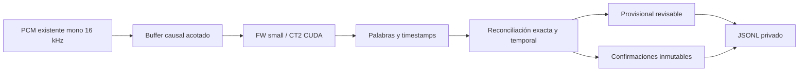

# TRAD — Sprint 2 / M4-C: ASR incremental de alta fidelidad médica

20 de octubre de 2026, America/La_Paz. Primera ronda, dentro del límite de tres
horas. Prioridad: fidelidad del inglés médico. Código experimental en
[trad_lab/m4c](C:/live-captions/trad_lab/m4c/README.md).

**Dictamen: GO CON RESERVAS para ampliar experimentos. Ningún candidato cumple
todavía todos los criterios médicos para una prueba integrada.** Se implementó
un reconocedor causal small/CTranslate2 sin AlignAtt que completó las tres
conferencias. La mejor base técnica para continuar investigando es la variante
adaptativa con dos coincidencias y espera mínima de 1 s; **no es una ganadora
clínica**. Una espera de 4 s redujo el WER global, pero añadió regresiones de
negación y cifras, por lo que no se recomienda seleccionarla por ese promedio.

La variante adaptativa de 1 s obtuvo **4,12 % de WER léxico en texto estable**;
4,04 % al añadir la cola EOF explícitamente no confirmada. El small offline
anterior obtuvo 3,52 %. En el Yeti, la discrepancia respecto al offline fue
3,00 %, frente al 12,02 % de WLK. Estas discrepancias **no son WER clínico**.
LIVE, el colector M4-B y el remuestreador permanecen intactos. No hubo micrófono,
servicios, DeepL, instalación, descarga, cambios Git ni M5.

## 1. Protección y procedencia

Se revisaron los informes M4/M4-B, TRAD-LAB, el README del laboratorio,
BIDIRECTIONAL_MVP_REPORT e INSTALL_WINDOWS. Se verificó el checkpoint aprobado
`codex/s2-m4-checkpoint`, `cd008ad436d8d2c13a739490e899d18e188df9b3`.
HEAD/main permanecen en `64f82214b33fad4ee68295df1367249caeae3187`, rama
`sprint2/m1-rtx4070`; no se cambió de rama ni se preparó staging.

Run privado: `C:/live-captions/logs/trad_lab/m4c_20261020T173100Z`.
[audit.json](C:/live-captions/logs/trad_lab/m4c_20261020T173100Z/audit.json) inventaría
182 fuentes previas y 1818 archivos de evidencia. El respaldo de fuentes previo
`pre_m4c_sources.zip` tiene SHA-256
`8322617d7ce1f76662527b4e7ee21dd671a998a929da723ef24709cac5b471eb`;
excluye `.env`, runtime, perfiles, entornos y pesos. Se contrastaron también los
SHA históricos de los ZIP M3, M4 y M4-B.

[preservation_check.json](C:/live-captions/logs/trad_lab/m4c_20261020T173100Z/preservation_check.json)
confirma fuentes/evidencias previas, `.env`, pesos cacheados y referencias Git
sin cambios. Solo se añaden el paquete M4-C, este informe y evidencia privada
bajo `logs/trad_lab/`, excluida de Git. No se restablecieron claims físicos ni se
consumió el intento 04. El cierre y los hashes de entrega están en
[delivery.json](C:/live-captions/logs/trad_lab/m4c_20261020T173100Z/delivery.json).

## 2. Datos y referencias

**Nivel A — mismo PCM real del Yeti.** Se usó completo
`environment_opener_ready/trad_wire/wire_01/received.s16le`, conservado en M4-B:
4.629.552 bytes, 2.314.776 muestras s16le mono, 144,6735 s nominales a 16 kHz.
SHA-256 `d482dead07ea58555bb5a478fcb95c1ea2eccef346153a636464f1023060809d`.
El tap WLK tiene el mismo SHA y M4-B verificó además orden/límites de mensajes y
EOF. No se confundió con el prefijo incompleto observado por el navegador.

Se reutilizaron WLK RAW realmente registrado y el offline sobre esos mismos
bytes; no se generó un sustituto de WLK. Los pesos CT2 coinciden con el manifiesto
de aquel offline. RAW→READY de esa sesión conservó las palabras normalizadas;
M4-C no ejecuta una nueva segmentación TRAD. La configuración completa del decoder
WLK de ese intento no está atestiguada: el contraste comprende caminos distintos
de decodificación/contexto/confirmación, no demuestra una causa exclusiva AlignAtt.

La captación conservó las limitaciones M4-B: origen acústico externo, intervalo
comunicado 0:10–2:00, ausencia de reloj de reproducción sincronizado y metadata
del navegador parcialmente problemática. No existe un TXT temporal clínicamente
certificado de esa captación. **No se puntuó el Yeti contra el TXT completo.**

**Nivel B — tres conferencias.** Se verificaron MP3/TXT originales de
`C:/TRAD-LAB/corpus`, los WAV mono 16 kHz derivados en M3 y su correspondencia
bit a bit registrada. Total: 2217,82275 s, 36,96 min y 4204 palabras de referencia.
Las comparaciones de archivos completos usan TXT provisionales revisados por el
usuario; permiten puntuación léxica exploratoria, no certificación clínica.

También se evaluaron los tres recortes M4 con hashes y aceptación temporal
conservados: cardio_01 0–87,95 s; cardio_02 418,84–513,54 s; cardio_03
235,56–324,12 s. Total 271,21 s y 482 palabras. La dispersión de sus límites es
0,58/0,70/1,37 s. La aceptación humana previa no equivale a alineación exacta por
palabra ni elimina errores del TXT; por ejemplo, contiene formas dudosas de
`aldosteronism`. No se corrigieron referencias desde el ASR.

## 3. Arquitectura implementada

La confirmación por acuerdo local entre decodificaciones sucesivas tiene un
antecedente en [Whisper-Streaming](https://arxiv.org/abs/2307.14743).
Se emplea la API de [Faster-Whisper/CTranslate2](https://github.com/SYSTRAN/faster-whisper),
contrastada con la firma y el código **instalados**, no sustituida por upstream.

El lector entrega 1–2 s de PCM por paso. El decoder recibe una copia de muestras
ya disponibles, con inicio/fin absolutos y SHA del float32 registrado. Nunca
recibe el archivo completo durante el replay incremental. La evaluación posterior
lee referencias/trazas, sin realimentarlas al modelo.

`fixed` utiliza los últimos 5/10/15/30 s. `adaptive` conserva el comienzo del
buffer entre actualizaciones y recorta en puntuación confirmada al superar el
objetivo de 15 s. El límite duro es 30 s, con recorte en palabra confirmada cuando
es necesario y 0,4 s de contexto izquierdo. En inicio/pausa sin frontera
confirmada puede retirar contexto anterior a la primera palabra provisional o
sin hipótesis. Eso **no acredita silencio acústico**: un falso negativo VAD/ASR
continúa siendo un riesgo. Si el recorte expulsaría el prefijo provisional, falla
con `HorizonError`; no disimula ese fallo como transcripción completa.

Se agrupan continuaciones literales sin espacio, como `norma` + `-tensive`, antes
de votar; no se cambia su texto. El acuerdo exige claves léxicas exactas,
signos/comparadores/porcentajes/unidades preservados y compatibilidad temporal:
tolerancia de fin 0,8 s y solapamiento de intervalos o centros a ≤60 ms.
Repeticiones próximas permanecen distintas. Se confirman únicamente prefijos
coincidentes en dos o tres hipótesis con la antigüedad mínima configurada.
Una coincidencia repetida incorrecta puede seguir confirmándose incorrectamente.

El motor retiene como máximo 30 s de audio, 32 palabras confirmadas recientes,
128 puntos de recorte y hasta dos hipótesis acotadas a 512 registros. Las 32
palabras no se entregan como prompt. La conservación del transcript completo y
las trazas para puntuar pertenece al evaluador offline, no al estado del motor;
no se ha validado un servicio indefinido de memoria constante.

EOF no añade silencio ni fabrica otro voto con la misma entrada. Conserva una
cola **no confirmada**, separada de las confirmaciones. Un fallo de decoder,
integridad o GPU aborta el lote sin fallback/reintento automático.

## 4. Perfil y experimentos

Perfil principal: `small` multilingüe cacheado, idioma `en`, tarea `transcribe`,
CUDA float16 comprobado, beam 5, best_of 5, temperatura 0, word timestamps,
`condition_on_previous_text=True` dentro de cada llamada; `initial_prompt=None`
y `hotwords=None`. CPU threads 4, num_workers 1. No hay contexto entre llamadas
inyectado al modelo, TXT como prompt, glosario ni fuzzy. No se cargó un decoder
PyTorch/AlignAtt ni se evaluaron medium/turbo en esta ronda.

Se contrastó VAD OFF frente a Silero ON usando exclusivamente el ONNX incluido,
en CPU y con defaults instalados: threshold 0,5, neg_threshold automático,
min_silence 2000 ms, speech_pad 400 ms, min_speech 0. No se ajustaron por muestra
ni se modificó el VAD operativo. Los hashes de pesos/API y cada perfil están
en `weights_before.json`, `installed_decoder_api.json` y los `environment.json`.

| Contraste sobre Yeti completo | Resultado frente a offline, mismo PCM |
|---|---|
| Fija 5 s, avance 2 s, LA2, sin VAD | Aborta a 6 s por prefijo no estabilizado; sin puntuación final |
| Fija 10 s, resto igual | Discrepancia 4,72 % |
| Fija 15 s, resto igual | 1,72 %; todavía emite `You` en preroll |
| Avance 1 s, fija 15 s, sin VAD | Exploratorio: aborta a 28 s; no extrapolar a VAD ON |
| LA3, fija 15 s, sin VAD | 3,00 %; mediana serial 5,52 s, sin ventaja terminológica |
| Fija 30 s, LA2, sin VAD | 3,43 %; ampliar contexto no mejoró uniformemente |
| Fija 15 s, VAD ON | 1,29 %; elimina `You`; falla en cardio_03 completo a 320 s |
| Fija 30 s, VAD ON | 2,58 % |
| Fija 15 s, VAD ON, beam 1 | 2,58 %; añade otra sustitución de `hypertension` |
| Adaptativa 15→30 s, VAD, LA2, espera 1 s | 3,00 %; completa las tres conferencias |
| Adaptativa igual, espera 4 s | 2,58 %; completa las tres, con nuevas regresiones médicas |

Las configuraciones se eligieron secuencialmente para aislar tamaño, avance,
acuerdo, VAD, beam y confirmación; no se hizo un barrido combinatorio. Las
correcciones del prototipo y revalidaciones se conservan por separado. El detalle
de 45 replays archivo/perfil, incluidos fallidos, está en
[comparison.json](C:/live-captions/logs/trad_lab/m4c_20261020T173100Z/comparison.json).
Cada ejecución posterior al primer arranque exploratorio congela sus fuentes y
argumentos. No se mezclan versiones exploratorias para declarar una mejora clínica.

Se corrigieron duplicación en la frontera confirmada, fragmentos de palabra,
preservación de signos/unidades y el límite de preroll/pausa adaptativo. El primer
contraste de espera 4 s falló a 32 s antes de esa última corrección; se conserva
en `yeti_adaptive_age4`, y su repetición explícita en
`yeti_adaptive_age4_prerollfix`. No fue un fallo físico nuevo ni reparación CDP.

## 5. Comparación de fidelidad

### Mismo PCM del Yeti

Se fija el offline de 233 palabras normalizadas como denominador común:

| Hipótesis comparada con offline | Ediciones / 233 | Discrepancia |
|---|---:|---:|
| WLK RAW observado | 28 | 12,02 % |
| Fija 15 s + VAD | 3 | 1,29 % |
| Adaptativa, espera 1 s | 7 | 3,00 % |
| Adaptativa, espera 4 s | 6 | 2,58 % |

Son diferencias entre hipótesis. No prueban que toda coincidencia con offline
sea correcta. La fija 15 s no se selecciona por ese único clip: falló en la
tercera conferencia completa, tanto sin VAD como con él.

### Tres conferencias completas

WER léxico exploratorio, **incluida la cola EOF no confirmada** en las dos filas
incrementales; la tabla posterior separa esa cola:

| Perfil | cardio_01 | cardio_02 | cardio_03 | Total micro |
|---|---:|---:|---:|---:|
| Small offline, no causal | 2,38 % | 1,74 % | 5,85 % | 3,52 % |
| Adaptativa, espera 1 s | 2,80 % | 2,70 % | 5,97 % | 4,04 % |
| Adaptativa, espera 4 s | 2,66 % | 2,25 % | 6,03 % | 3,85 % |

| Salida evaluada, 4204 palabras de referencia | Errores | WER | CER |
|---|---:|---:|---:|
| Offline completo | 148 | 3,52 % | 1,43 % |
| Adaptativa 1 s: solo estable | 173 | 4,12 % | 1,84 % |
| Adaptativa 1 s: estable + cola provisional EOF | 170 | 4,04 % | 1,73 % |
| Adaptativa 4 s: solo estable | 172 | 4,09 % | 1,86 % |
| Adaptativa 4 s: estable + cola provisional EOF | 162 | 3,85 % | 1,55 % |

Las sumas usan errores/denominadores totales, no medias de porcentajes. La cola
de espera 4 s incluye siete palabras al final de cardio_02 y cuatro de cardio_03;
el cambio de errores no coincide necesariamente con su número por el alineamiento.
No se publican como texto estable ni se ocultan como una sesión completa perfecta.

### Recortes con aceptación temporal M4

| Perfil, 482 palabras | WER estable | WER con cola provisional EOF | CER con cola |
|---|---:|---:|---:|
| Small offline beam 5, antecedente M4 | — | 3,73 % | Antecedente offline |
| Adaptativa 1 s | 6,43 % | 4,98 % | 1,79 % |
| Adaptativa 4 s | 8,92 % | 4,15 % | 1,41 % |

La espera de 4 s deja más texto sin confirmar al cortar estos recortes. Se
conservan por separado los resultados con cola y los estrictamente estables.
No son WER clínicos; mantienen los límites y dudas de referencia de §2.

## 6. Casos médicos que impiden aprobar integración

La revisión compara texto crudo, contexto y referencia provisional. **No es un
conteo clínico certificado.** Las alertas automáticas no cubren toda la semántica:
la alteración morfológica `untreated`→`I'm treated` no se detectaba mediante la
lista genérica de `no/not/without`. Se identificó revisando las hipótesis.

| Pasaje | Comparación observada | Evaluación delimitada |
|---|---|---|
| Yeti, recomendaciones | WLK `50 seven`; offline y candidatos `57` | Representación numérica ambigua en WLK; no convertir automáticamente formatos en un error clínico |
| Yeti, `patients with hypertension` | WLK/offline correctos en esa hipótesis; adaptativa 1 s `high attention`; espera 4 s conserva `hypertension` | Regresión terminológica nueva de la variante 1 s |
| Yeti, `defining hypertension` | WLK y ambas adaptativas `height attention`; offline `hypertension` | No resuelto |
| Yeti, `non-elevated`, `120 over 70`, rango 120–139 | Negación/cifra conservadas en candidatos; WLK usa `one 20 to one 39` | Separar formato de valor; no certifica indicación clínica |
| Yeti, final truncado | Offline `di-`; espera 4 s `diastolic`; variante 1 s termina en `classical` | No adjudicar una palabra completa desde un final acústico parcial |
| cardio_01, `140 over 90` en TXT | Offline y ambas adaptativas `140 over 19` | Conflicto numérico persistente; requiere escucha |
| cardio_01, `orthostatic hypotension` en TXT | Offline y ambas adaptativas `orthostatic hypertension` | Conflicto de término/polaridad persistente |
| cardio_02, `diastolic` | Offline/espera 1 s `diastolic`; espera 4 s `dystolic` | Regresión terminológica de la espera mayor |
| cardio_03, `untreated stage two` | Offline/espera 1 s `untreated`; espera 4 s `I'm treated` | Alteración de negación/condición; no aceptable como mejora por WER |
| cardio_03, intervalo `four to six years` | Offline/espera 1 s conservan rango; espera 4 s `46 years` | Cambio de rango a valor; **no es equivalencia de formato** |
| cardio_03, unidad `deciliter` | Offline `deciliter`; ambas adaptativas `decilator` | Unidad mal formada; la unidad real del audio también exige adjudicación |
| cardio_03, fármaco | TXT `spironolactone`; offline `spironolactam`; adaptativas `spironolactam and` | Persisten errores del nombre; no se repara con fuzzy |
| cardio_03, aldosteronismo | TXT y ASR contienen variantes distintas/dudosas | No adjudicar desde el TXT automático ni corregirlo para favorecer al modelo |

`100`/`a hundred`, `stage two`/`stage 2`, `1000`/`1,000` y
`millimetres`/`millimeters` se revisan como diferencias de formato/ortografía.
La métrica primaria no las borra. Un canal secundario aplica únicamente las
equivalencias M4 de `%`/`percent` y `stage one/two`; no cambia texto ASR, cifras,
negaciones ni referencias. `medical_review.json` conserva ediciones, firmas de
medición crudas y ejemplos de omisión/inserción.

Se exportaron **11 audios de revisión**, sin ganancia ni remuestreo, verificados
contra los bytes del intervalo original. Sus límites son localizadores aproximados
desde timestamps ASR, no nuevas referencias certificadas:
[manifiesto](C:/live-captions/logs/trad_lab/m4c_20261020T173100Z/review_audio_delivery/manifest.json).
Prioridad de escucha:
[untreated/treated](C:/live-captions/logs/trad_lab/m4c_20261020T173100Z/review_audio_delivery/cardio03_untreated.wav),
[intervalo de años](C:/live-captions/logs/trad_lab/m4c_20261020T173100Z/review_audio_delivery/cardio03_years.wav),
[140](C:/live-captions/logs/trad_lab/m4c_20261020T173100Z/review_audio_delivery/cardio01_140.wav) y
[orthostatic](C:/live-captions/logs/trad_lab/m4c_20261020T173100Z/review_audio_delivery/cardio01_orthostatic.wav).

## 7. Estabilidad, omisiones y causalidad

El texto confirmado es append-only por construcción; no se revisa después.
Eso no significa que sea correcto. En las conferencias completas hubo 319
actualizaciones con cambios del prefijo provisional en la variante de 1 s y
362 en la de 4 s, sobre 1110 actualizaciones por variante.

En el texto completo con cola EOF, los alineamientos provisionales no muestran
grandes fragmentos consecutivos borrados o duplicados: máximo de una palabra
borrada y dos insertadas en la variante de 1 s; dos borradas/dos insertadas en
la de 4 s. Esto no acredita ausencia de pérdidas acústicas ni elimina las
sustituciones médicas de §6. Los fallos de horizonte se conservan como fallos,
sin inventar un transcript completo. El EOF pendiente puede incluir frases y
no debe confundirse con una omisión silenciosa del log.

La auditoría independiente verificó **5425 ventanas de 42 resultados** contra
sus muestras reales, límites causales, hash float32, EOF cuando procede y texto
confirmado. Incluye prefijos de intentos fallidos, sin calificarlos completos.
Las tres ejecuciones iniciales `yeti_initial` precedían el hash por ventana y
se excluyen de ese conteo. Además, **16 replays de reconciliación, 2786 ventanas**,
reutilizaron solamente las palabras del decoder ya registradas para comprobar
equivalencia con el código final; no son nuevas inferencias ni nuevas mediciones
de latencia. Los primeros-avistamientos indexados coinciden con los resultados
anteriores. Evidencia: `report_data.json` y `comparison.json`.

## 8. Latencia y coste de inferencia

Reloj de disponibilidad: muestras recibidas /16000, simulado en replay acelerado.
Reloj de cómputo: `perf_counter`, consumiendo todo el generador del decoder.
La confirmación algorítmica resta el fin de palabra **estimado por el propio ASR**;
la variante serial suma el cómputo medido y modela una sola cola sin descartar audio.
No hay alineación independiente por palabra que convierta esto en latencia física.

| Perfil / conjunto | n registros confirmados | Mediana serial | p95 serial | Máximo serial | RTF inferencia |
|---|---:|---:|---:|---:|---:|
| Adaptativa 1 s, Yeti | 233 | 3,64 s | 5,43 s | 8,40 s | 0,204 |
| Adaptativa 4 s, Yeti | 233 | 5,65 s | 8,36 s | 11,21 s | 0,213 |
| Adaptativa 1 s, tres completas, agrupadas | 4174 | 3,64 s | 6,34 s | 24,07 s | 0,263 |
| Adaptativa 4 s, tres completas, agrupadas | 4162 | 5,63 s | 7,60 s | 14,37 s | 0,259 |

Sin sumar cómputo, las medianas/p95 algorítmicas agrupadas son 3,11/5,69 s y
5,10/7,02 s respectivamente. Las medianas de inferencia por actualización son
0,506/0,503 s; p95 0,740/0,729 s. Los máximos de una actualización fueron
3,420/2,515 s: el RTF medio <1 no elimina picos ni confirma un SLA.

En modo adaptativo el objetivo 15 s **no significa ventanas siempre de 15 s**:
mediana real 21,24/21,10 s y máximos 30,00/29,97 s en los corpus completos.
La espera de confirmación también cambia cuándo se recorta el contexto.

Estas cifras excluyen captura, SO, altavoz, red, SegmentManager, escritura de
logs, DOM, traducción y pantalla. No son latencia EN→ES ni se suman a medianas
históricas de otras etapas. El M4-B conservado no permite una comparación física
audio→RAW válida contra estos valores. Son una pasada por perfil; no intervalos
de confianza ni garantía de rendimiento sostenido LIVE.

## 9. GPU, pruebas y cierre

Un solo modelo ASR small en GPU por proceso, ejecuciones secuenciales, sin
inferencias concurrentes. Silero usa el ONNX local en CPU. Reserva inicial
2200 MiB libres y parada del experimento ante reserva agotada/error GPU; no son
thresholds ASR operativos. Los puertos 8000/8010/18000/18010 deben estar cerrados
antes y durante los replays.

Muestreo del dispositivo cada ~1 s: **máximo 1243 MiB usados**, mínimo 6706 MiB
libres, temperatura máxima 72 °C. Incluye Windows/OBS y no mide el pico exacto del
allocator. El audio retenido del motor ocupa como máximo unos 1,83 MiB float32,
con copias temporales adicionales y memoria del modelo aparte. No hubo OOM ni
descargas. Tras los replays no quedaban procesos ASR M4-C; se observaron 281 MiB
usados/7668 libres y 56 °C. El cierre final está en `final_closure.json`.

**121 pruebas CPU PASS, sin skips: 100 regresiones previas seleccionadas y 21
específicas M4-C.** Incluyen referencia/hash, métricas exactas, SegmentManager,
normalizador, evidencia/taps sintéticos M4-B, CDP con dobles y política nueva.
Las nuevas prueban disponibilidad causal, palabras repetidas, frontera inmutable,
continuaciones, negaciones/signos/unidades, EOF sin voto falso, memoria con pausas
de 1000 s, preroll largo, rechazo de pérdida de texto pendiente y fallo de decoder
sin reintento. Log: `tests_final.log`.

No se ejecutaron pruebas que arrancaran servidores TCP o navegador ni sesiones
físicas. Compilación, revisión de whitespace y preservación completadas; los
contratos operativos no se declaran revalidados mediante una integración nueva.

## 10. Recomendación, integración mínima y rollback

**Conservar como base de investigación la adaptativa de espera 1 s**, VAD local,
avance 2 s y LA2: es causal, acotada, completó los tres archivos y conserva los
casos `untreated`/`four to six` que empeoró la espera mayor. Tiene regresiones
terminológicas propias, por lo que no se presenta como solución clínica aprobada.
La fija 15 s es la mejor en discrepancia Yeti, pero su fallo de generalización la
descarta como ganadora. La espera 4 s demuestra que retrasar la confirmación y
reducir WER puede desplazar el error a negaciones/cifras relevantes.

La siguiente decisión necesita adjudicar los audios prioritarios y sus referencias.
Después procede un experimento offline focalizado de contexto/confirmación,
conservar un conjunto de comprobación fuera del Yeti y exigir ausencia de las
regresiones identificadas. No aumentar el modelo solo por WER offline ni aplicar
reemplazos médicos/números desde glosario para obtener un PASS.

Propuesta mínima **no implementada**: un adaptador de laboratorio que emita
provisional/confirmado en el contrato ASR existente, con estado por sesión,
inglés explícito y rechazo de idiomas no soportados. Primero replay a los
contratos TranscriptState/SegmentManager; definir el tratamiento de cola EOF
antes de declarar READY. Una prueba con servicios requerirá autorización
posterior y conservará propietario, auth, dirección y cierre. No sustituir
CAPTURE, traducción ni overlay para acomodar al candidato.

Rollback actual: no hay cambio operativo que revertir. El backend WLK existente
permanece disponible como implementación original. Una selección experimental
futura debe poder retirarse sin tocar `.env` ni restaurar fuentes por reset.
El respaldo y manifiestos permiten comparar archivos en una carpeta vacía;
no extraer sobre trabajo posterior ni borrar evidencia.

Se cierra M4-C para **revisión del usuario**, sin integración, cambios operativos
ni otro milestone. Revisar especialmente las negaciones, rangos y unidades de §6.
