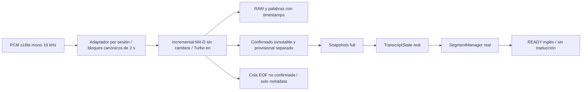

# TRAD — Sprint 2 / M5-A: adaptador experimental Faster-Whisper Turbo

20 de octubre de 2026, America/La_Paz. Integración mínima por archivos; EN→ES
prioritario, traducción deshabilitada.

**GO CON RESERVAS para un futuro ensayo E2E aislado de ingeniería, sujeto a revisión
y autorización posterior. NO-GO para LIVE, uso clínico o aptitud para el congreso.**
El adaptador completó el PCM Yeti preservado y los tres archivos completos sin
introducir pérdidas, duplicaciones ni revisiones confirmadas al pasar por las clases
reales de TRAD. Conservó exactamente el reconocimiento Turbo de M4-D en el corpus,
incluidos sus errores médicos. No se inició ningún servidor ni micrófono.

## 1. Auditoría y alcance

Se leyeron M4-D, M4-C, BIDIRECTIONAL_MVP_REPORT y los contratos de ASR,
TranscriptState, SegmentManager, START/STOP, CLEAR y cierre. Rama
`sprint2/m1-rtx4070`; HEAD/main/RC permanecen en
`64f82214b33fad4ee68295df1367249caeae3187`; checkpoint
`cd008ad436d8d2c13a739490e899d18e188df9b3` verificado.

Run privado: `C:/live-captions/logs/trad_lab/m5a_20261020T201327Z`.
[audit.json](C:/live-captions/logs/trad_lab/m5a_20261020T201327Z/audit.json) preserva 199 fuentes y 2339
archivos privados previos. Incluye los cambios sin versionar y `research/`;
no sobrescribe trabajo anterior. Respaldo previo `pre_m5a_sources.zip`, SHA-256
`103822f23d57d5a72dfe722e693e2ebff0e8fc9c3005b273fc811e822a184d12`. Excluye secretos, entornos, pesos, runtime y perfiles.

[preservation_check.json](C:/live-captions/logs/trad_lab/m5a_20261020T201327Z/preservation_check.json) confirma 198 fuentes intactas de las 199,
todas las evidencias privadas previas, `.env` por hash, los 13 archivos CT2 cacheados,
Silero, el peso PyTorch no utilizado y referencias Git sin cambios. El JSON de
progreso de `research/` cambió concurrentemente fuera del alcance M5-A: esta tarea
no lo escribió ni lo sobrescribió. Sus bytes iniciales están preservados en el ZIP;
el manifiesto registra ambos hashes y deja el archivo actual intacto. Solo se añade
`trad_lab/m5a/`, este informe y evidencia privada por esta tarea.
No se alteró código operativo, glosarios, modelos, paquetes, remuestreador ni claims
físicos. Sin staging, commits, tags, merges, resets, push o despliegues.

## 2. Arquitectura y selección reversible

La selección exige `backend='turbo-experimental'` y el argumento de laboratorio
`--backend turbo-experimental`. No existe registro ni selector nuevo en `app/`
o `.env`. Una instancia contiene exclusivamente su sesión; no admite reutilización
tras EOF ni mensajes de otra sesión. Pesos compartidos solo en replays secuenciales;
no se acredita concurrencia de sesiones ni un servicio de larga duración.

Perfil idéntico a M4-D: `large-v3-turbo` CT2 cacheado, CUDA float16 efectivo,
inglés explícito/transcribe, beam 5, best_of 5, temperatura 0, timestamps por palabra,
condition_on_previous_text=True dentro de cada llamada, sin initial_prompt/hotwords.
Silero instalado ON con sus defaults; LA2, espera mínima 1 s, avance 2 s, objetivo
15 s y límite 30 s, tolerancia temporal 0,8 s y máximo 512 registros por hipótesis.
CPU threads 4, num_workers 1. Motor M4-C/M4-D SHA-256
`0d7c1ba5615c118a6efc414c46130f65d5e2964770c5752c54aed3c8e4c3d004` intacto.
No se usaron referencias como contexto ni se retocaron parámetros.

## 3. Contrato y controles

`TurboAdapter.start()` emite config full/PCM/en y aislamiento de idioma. Cada frame
debe ser bytes s16le pares, secuencia contigua y máximo 64000 bytes; no remuestrea.
La acumulación hasta exactamente 32000 muestras independiza las ventanas del tamaño
de los mensajes. STOP permite recibir el flush pendiente; el único frame vacío es
EOF. Decoder/integridad fallidos producen error/incomplete, sin fallback o retry.

Cada snapshot conserva todos los lotes confirmados anteriores, con texto y registros
de palabra/timestamps exactos. `buffer_transcription` reemplaza solo el provisional.
No se atribuye hablante: speaker es null. Diarización y traducción quedan vacías.
Un lote confirmado no se revisa aunque una hipótesis posterior recupere una palabra
omitida: este riesgo de fidelidad heredado permanece visible en RAW.

Al llegar EOF se procesa únicamente audio nuevo pendiente. No se añade silencio ni
se repite una entrada para obtener otro voto. `ready_to_stop.unconfirmed_eof_tail`
conserva la cola sin introducirla en lines/confirmado/READY. El relay real reenvía
esa metadata, pero su `complete` describe el drenaje, **no confirmación de toda la
voz**. La UI operativa no se modificó para destacar la cola: requiere revisión antes
de un uso que dependa de ella. No se construye texto o traducción para completarla.

CLEAR conserva la semántica existente: generación visual del CaptionHub, sin
reiniciar ASR, TranscriptState o SegmentManager. Las pruebas llaman el método real;
no sustituyen la autorización HTTP, dueño o recuperación de Operator. Los replays
no publican captions ni ejecutan un motor de traducción.

## 4. Compatibilidad e integridad

Tres controles con las palabras ya registradas por M4-D verificaron **1110 ventanas**
con hashes idénticos, mismas confirmaciones/provisionales y cola EOF exacta. No son
nuevas inferencias ni nuevas mediciones ASR. Cuatro replays nuevos sumaron **1183
inferencias causales**. [integration_audit.json](C:/live-captions/logs/trad_lab/m5a_20261020T201327Z/integration_audit.json) audita los siete resultados:
PCM exacto, ventanas causales, orden/identidad de sesión, snapshots completos,
inmutabilidad de palabras/timestamps y conservación en todas las transiciones
confirmado→READY+pendiente. Un terminal EOF por sesión; cero errores de integración.

Se utilizó TranscriptState y SegmentManager reales, SegmentConfig predeterminado
explícito (.8 s estabilización, 1 s silencio, 7/13/21 palabras, 3.3/5.5 s edades,
tick .1 s). No se leyó ni certificó un override histórico de LIVE. El control
normaliza solo espacios al comparar presentación: no elimina cifras, signos,
negaciones, unidades, puntuación o repeticiones. Los registros RAW conservan bytes
de texto y timestamps originales. Solapamientos temporales heredados del ASR
permanecen registrados; no se reinterpretan como nuevas duplicaciones del adaptador.

## 5. Replay del PCM físico preservado

Se leyó el recibido completo M4-B, no el prefijo incompleto del navegador:
4.629.552 bytes, 2.314.776 muestras, 144,6735 s nominales a 16 kHz, SHA-256
`d482dead07ea58555bb5a478fcb95c1ea2eccef346153a636464f1023060809d`.
La fuente TRAD y el tap WLK conservan el mismo hash. Se reprodujeron sus **53832
mensajes de 86 bytes** y un EOF; recepción del adaptador con el mismo SHA completo.

Resultado: 73 inferencias, 231 registros confirmados, **42 READY**, cola EOF vacía;
confirmado→READY conserva todo el texto en orden. Frente al small offline histórico
del mismo PCM: **2/233 palabras, 0,86 % de discrepancia**, frente a 7/233 del small
incremental M4-C y 28/233 del WLK histórico. La diferencia actual consiste en un
artículo añadido y el fragmento final `di` ausente; no adjudica quién es correcto.
Turbo conserva en su hipótesis hypertension, 57, non-elevated y 120 over 70.
M4-D no ejecutó Turbo sobre Yeti: este es un nuevo punto de comparación, no una
mejora atribuible al código del adaptador.

No es nueva captación física, comparación clínica con TXT ni prueba de interfaz.
Persisten las reservas M4-B: altavoz externo sin reloj sincronizado, metadata de
entrada parcial, reloj del remuestreador original y final acústico limitado. No se
reconstruyó audio ausente ni se consumió el intento físico 04.
Resultado privado: [gpu_r1/turbo/yeti_received_full/result.json](C:/live-captions/logs/trad_lab/m5a_20261020T201327Z/gpu_r1/turbo/yeti_received_full/result.json).

## 6. Comparación con Turbo M4-D

Mismos tres WAV verificados, 2217,82275 s y 4204 palabras TXT provisionales.
En los tres archivos coinciden exactamente texto estable, registros completos de
palabras/timestamps y cola EOF con M4-D. La integración no mejora ni degrada el ASR
por sí misma. [baseline_comparison.json](C:/live-captions/logs/trad_lab/m5a_20261020T201327Z/baseline_comparison.json) conserva diferencias y métricas.

| Archivo | WER estable M4-D | WER estable adaptador | Texto/palabras exactos | READY nuevos |
|---|---:|---:|---|---:|
| cardio_01 | 2.66 % | 2.66 % | Sí | 131 |
| cardio_02 | 1.57 % | 1.57 % | Sí | 337 |
| cardio_03 | 3.63 % | 3.63 % | Sí | 326 |

Agregado estable: **109/4204, 2,59 % WER léxico; 1,30 % CER**. Añadiendo la cola
explícitamente no confirmada: 105/4204, 2,50 % WER y 1,17 % CER. Estos son resultados
exploratorios sobre referencias provisionales; no WER clínico. Cardio_02/03 se
agrupan conservadoramente como un mismo webinar y el corpus ya fue explorado;
no son tres discursos independientes ni validación externa.

Colas EOF:

- `cardio_01`: '', 0 palabras por espacios; sin promover a READY.
- `cardio_02`: ' are associated with stepwise.', 4 palabras por espacios; sin promover a READY.
- `cardio_03`: ' is...', 1 palabra por espacios; sin promover a READY.

Que una cola reduzca el WER al puntuarla no autoriza publicarla como confirmada.
READY completos: 794 en el corpus. Su partición es nueva, basada
en lotes confirmados del adaptador; M4-D no ejecutaba SegmentManager y no existe
un baseline M4-D de segmentación con el que equiparar este conteo.

## 7. Trazabilidad médica y errores persistentes

[clinical_review.json](C:/live-captions/logs/trad_lab/m5a_20261020T201327Z/clinical_review.json) y siete archivos `clinical_traces/` registran por caso
ventanas/hashes, RAW, provisionales, confirmaciones y conflictos. Los intervalos
son localizadores desde ASR, no nueva alineación clínica por palabra. La adjudicación
humana provisional de cuatro expresiones proviene de M4-D; no se realizó una nueva
escucha independiente ni se corrigió el TXT desde el ASR.

| Expresión prioritaria | Salida y límite de revisión |
|---|---|
| orthostatic hypotension | Conservada, igual a M4-D |
| untreated stage two hypertension | Conservada; no se elimina untreated |
| four to six years | Conserva el rango, igual a M4-D |
| 140 over 90 | Persiste `140 over 19`, conflicto con adjudicación previa |
| spironolactone | Conservada en el completo; no prueba todos los contextos |
| aldosterone | Persiste `eldest run` en el pasaje focal; requiere revisión |
| 10-year ASCVD risk | Persiste `low tenure ASCVD risk`; no equivale a conservar 10 años |

Coincidir en LA2 no implica certeza clínica. Tampoco se borraron `per per day`,
`Significance, significant…` o revisiones tardías ya presentes en el baseline.
La corrección clínica de cifras, unidades y términos sigue pendiente; no se usa
glosario fuzzy, prompt correcto ni conversión numérica para conseguir un PASS.

## 8. Latencia simulada y recursos

Disponibilidad = muestras/16000; cómputo = perf_counter consumiendo el decoder.
El reloj serial modela un solo decoder y ticks ideales de SegmentManager. El fin
de palabra lo estima el propio ASR, no una referencia acústica independiente.

| Medición | Yeti | Tres corpus agrupados |
|---|---:|---:|
| Confirmación serial, mediana / p95 | 3.602 / 6.598 s | 3.630 / 6.439 s |
| Confirmado visto→READY, mediana / p95 por segmento | 3.336 / 5.550 s | 3.353 / 5.550 s |
| RTF de inferencia | 0.231 | 0.287 |

La primera fila excluye CPU del adaptador/serialización; la segunda mide desde la
primera aparición del lote confirmado, no desde el inicio de voz. No se suman
medianas para estimar una latencia total. Tiempos de callbacks/push no decoder se
registran por separado. No hay medición de red, DOM, pintado, traducción española
o voz real→pantalla. No se inició optimización de latencia.

GPU total muestreada nominalmente cada segundo: pico **2673 MiB**,
libre mínimo 5276 MiB, temperatura máxima 79 °C.
El intervalo observado entre muestras fue mediana
3.547 s / p95
3.593 s: incluye el coste de las comprobaciones
del monitor, por lo que no es una cadencia real de 1 Hz.
No es pico del allocator del modelo ni ensayo térmico prolongado. Pico de working
set del proceso: **1729.2 MiB**, incluye runtime y
trazas del evaluador; no es solo estado del adaptador. Sin OOM ni fallback.
El warmup de 0,5 s de ceros se registró separado y queda excluido de las métricas.
Motor tras recorte: máximo 480000 muestras, con copias/transitorios adicionales.
Snapshots completos acotados a 6000 lotes/300000 caracteres; payload máximo observado
208156 bytes. No se acredita una cola TCP concurrente o memoria
constante de sesión indefinida. [summary.json](C:/live-captions/logs/trad_lab/m5a_20261020T201327Z/summary.json) conserva distribuciones.

## 9. Regresiones y límites de aceptación

**157 pruebas Python PASS, sin skips**: regresiones M3/M4/M4-B,
CDP, normalizador, SegmentManager, release, incremental M4-C, evaluación M4-D,
TranscriptState y 16 nuevas M5-A. Estas últimas incluyen PCM particionado, secuencia,
EOF sin votos ficticios, flush nuevo legítimo, sesiones, errores, signos, repeticiones,
CLEAR real y tres controles del relay real con transporte en memoria/DeepL OFF.
No se ejecutaron tests que levantan servidores TCP.

Seis suites JS operativas PASS; compilación, whitespace e inspección de contratos
PASS. No son nuevas pruebas de navegador/OBS. [checks.json](C:/live-captions/logs/trad_lab/m5a_20261020T201327Z/checks.json) y logs conservan
los comandos/resultados. La primera sonda de telemetría RAM detectó un handle Windows
con tipo ctypes incorrecto; se corrigió antes del replay GPU. No fue un fallo del
adaptador, del ASR ni una captura física. Controles anteriores conservados separados.

## 10. Rollback y plan E2E para revisión

Rollback actual: terminar el replay y dejar de seleccionar `turbo-experimental`.
No hay backend operativo que restaurar. Conservar fuentes/evidencias; no ejecutar
reset/clean ni sobrescribir el trabajo previo. En una futura copia aislada, volver
al selector original solamente después de STOP/EOF y cierre del proceso candidato.

Propuesta concreta, **sin ejecutarla en esta entrega**:

1. Revisar este diff y la semántica de la cola EOF, incluidos el `complete` operativo
   y cómo mostrar explícitamente cualquier texto no confirmado en diagnóstico.
2. Añadir solo en copia experimental el transporte acotado para el adaptador, con
   un decoder serial, backpressure, presupuestos y errores sin fallback. Mantener
   auth/owner/dirección/CLEAR del TRAD actual; no basta el puente en memoria para
   acreditar esos controles por red.
3. Con autorización nueva para servicios, usar exclusivamente 18000/18010 y DeepL
   OFF. Primero reproducir archivos y verificar PCM completo, orden, RAW, READY,
   cola EOF, STOP/terminal y cierre; probar también error/timeout y selección reversible.
4. Solo con permiso físico posterior, seleccionar/verificar Yeti efectivo, registrar
   condiciones y referencia temporal revisada. No consumir un intento como retry
   automático. Conservar las discrepancias médicas; no declarar aptitud clínica.
5. Ante fallo, STOP normal, preservar evidencia y cerrar únicamente procesos propios.
   No abrir 8000/8010 ni modificar LIVE. Cualquier ensayo GPU offline posterior se
   hará con servidores cerrados.

El GO CON RESERVAS se limita a continuar esta comprobación técnica aislada; no
levanta los gates médicos de M4-D ni autoriza promover Turbo. Todos los procesos
M5-A terminaron y los cuatro puertos quedaron libres: [final_closure.json](C:/live-captions/logs/trad_lab/m5a_20261020T201327Z/final_closure.json).
Se entrega y se detiene para revisión del usuario.
