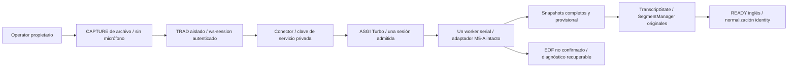

# TRAD — Sprint 2 / M5-B: integración experimental E2E de Turbo

Actualizado el 21 de octubre de 2026, America/La_Paz. MVP previsto para el 22 de octubre, 07:00.

**M5-B2 E2E a tiempo real: GO CON RESERVAS para revisión y eventual autorización
de M5-C; NO-GO para LIVE o aptitud para el congreso.** Los dos ensayos autorizados
terminaron: Yeti y cardio_02 conservaron todo el PCM y los 231/1.750 registros
confirmados exactos a M5-A, sin brecha de entrega. Créditos, EOF y cierre PASS;
las cuatro palabras no confirmadas de cardio_02 permanecen separadas de READY.
Operator recuperó el control y registró CLEAR en ambas sesiones. No hubo timeout,
OOM, reintento ni comparación acelerada. Los servicios experimentales están
cerrados, los cuatro puertos libres y LIVE intacto. La sección 17 documenta
esta ejecución real; las secciones 15/16 conservan el fallo y la corrección previa.
No se inició M5-C y se detiene para revisión.

Run privado: `C:/live-captions/logs/trad_lab/m5b_20261020T222007Z`.

## 1. Auditoría, preservación y alcance

Se revisaron M5-A, M4-D, M4-C, BIDIRECTIONAL_MVP_REPORT, INSTALL_WINDOWS y los
contratos de Operator/CAPTURE, TranscriptState, SegmentManager, CaptionHub y cierre.
Rama `sprint2/m1-rtx4070`; HEAD/main/RC siguen en
`64f82214b33fad4ee68295df1367249caeae3187`. Checkpoint
`codex/s2-m4-checkpoint`, `cd008ad436d8d2c13a739490e899d18e188df9b3`, conservado.

[audit.json](C:/live-captions/logs/trad_lab/m5b_20261020T222007Z/audit.json) inventaría
225 fuentes y 2511 archivos privados previos. El respaldo previo de fuentes tiene
SHA-256 `30784a3da6aed43a2e66861b70b1cb10b276778938b78f4592a09b0b5a7a6787`.
No contiene `.env`, credenciales, runtime, perfiles, entornos o pesos.

[Preservación](C:/live-captions/logs/trad_lab/m5b_20261020T222007Z/preservation_check.json):
224 fuentes originales intactas; cambio concurrente de `research/.../sources.json`,
fuera de M5-B, conservado sin escribirlo ni sobrescribirlo. Sus bytes iniciales
están en el respaldo y se registran ambos hashes. Ninguna operación M5-B escribe
en `research/`. Evidencias previas, `.env` por hash, glosarios, 13 archivos CT2,
Silero, peso PyTorch no utilizado, referencias Git y versión LIVE de `app/` intactos.
Sin staging, commits, tags, merges, resets, push o despliegues.

Solo se añaden `trad_lab/m5b/`, este informe y evidencia privada. La copia nueva
aplica hooks experimentales a cuatro archivos de **su propio** `app/`; no edita
los originales. Diff de fuentes nuevas:
[M5B.diff](C:/live-captions/logs/trad_lab/m5b_20261020T222007Z/M5B.diff).
Diff específico de la copia:
[M5B_COPY.diff](C:/live-captions/logs/trad_lab/m5b_20261020T222007Z/M5B_COPY.diff).

## 2. Arquitectura del transporte



`transport.py` implementa `/asr?mode=full&language=en`, exclusivamente loopback,
con clave privada de servicio en cabecera y session_id ligado al Operator. No
guarda cabeceras, tokens, scope o query en las trazas. La autenticación de
`/ws/session`, propiedad, nonce y recuperación siguen en las rutas originales.
La clave del servicio no se entrega al navegador ni se reutiliza como token del
Operator; se generaría únicamente al arrancar el backend tras autorización.

Una sesión por broker y un `ThreadPoolExecutor(max_workers=1)`. El event loop
permanece disponible durante la inferencia. Cada frame espera su procesamiento;
la cola de salida aplica backpressure, sin tirar audio o snapshots silenciosamente.
Los frames grandes se dividen sin cambiar bytes y M5-A conserva su partición
canónica de 32000 muestras por actualización.

Modelo/perfil sin cambios: large-v3-turbo CT2 cacheado, CUDA float16, inglés
explícito, transcribe, beam 5, best_of 5, temperatura 0, word timestamps,
condition_on_previous_text=True por llamada, initial_prompt/hotwords=None, Silero
instalado/defaults ON, LA2, espera mínima 1 s, avance 2 s, objetivo 15 s/máximo
30 s, tolerancia temporal .8 s, máximo 512 registros por hipótesis; cuatro hilos
CPU y un worker. No se pasan referencias, glosarios o respuestas al decoder.

## 3. Contratos y separación del cierre

- **START/idioma:** config full/en y backend verificado antes de PCM. Selección
  explícita `turbo` o `wlk`, sin default ni fallback. Un handshake incompatible
  con el selector falla. Turbo rechaza ES, query duplicada y cliente no autorizado.
- **Snapshots/RAW:** confirmado inmutable en `lines`; provisional revisable en
  `buffer_transcription`; diarización y traducción vacías. Texto, orden y registros
  de palabra/timestamps se conservan. RAW y hashes de ventanas quedan privados.
- **PENDING/READY:** PENDING contiene texto ya confirmado que espera segmentación.
  La cola EOF provisional nunca entra artificialmente en PENDING o READY. Puede
  seguir visible como último partial, además del panel EOF explícito.
- **STOP/EOF:** STOP del propietario permite el flush. Un EOF terminal, sin
  silencio añadido, nuevo voto ficticio o reconstrucción de palabras faltantes.
- **CLEAR:** generación visual original; no reinicia audio, ASR ni confirmaciones.
  Solicitudes rivales u obsoletas se rechazan; no borra evidencia diagnóstica.
- **Recuperación:** rotación del token con el secret existente y mismo session_id;
  la sesión sigue abierta y el propietario recuperado puede detenerla. La cola
  EOF persiste en el estado autenticado, independiente del journal truncable.

El diagnóstico distingue `transport_completion` de `transcription_completion`.
Un transporte puede cerrar `complete` y conservar `unconfirmed_tail`. El estado
`all_emitted_words_confirmed` solo describe las palabras emitidas, nunca toda la
voz ni certeza médica. Error, desconexión o timeout producen `incomplete`.
El WLK original se marca `not_reported_by_wlk` si no informa cola; no se inventa
una garantía. La UI de la copia muestra backend, ambos estados, cola y riesgos
con `textContent`, sin alterar el texto clínico.

El CAPTURE de archivos mantiene `capture_ready`/`capture_start`, origen y opener
esperados, token del propietario, dirección y STOP. No crea un MediaStream falso:
getUserMedia está bloqueado en la copia. Acepta solo los cuatro SHA M5-A, raw
s16le o WAV PCM mono 16 kHz, sin remuestreo ni reproducción por altavoces.
La ruta original de micrófono no se ha validado ni autorizado en M5-B.

## 4. Comparación con M5-A e integridad

Cuatro controles reutilizaron palabras M5-A registradas y otros cuatro replays
ejecutaron Turbo realmente en GPU. Ambos saltos WebSocket fueron colas ASGI
acotadas: no TCP ni servidor de prueba escuchando. Se usó la aplicación aislada
real, incluyendo OperatorBrowser, autenticación, relay, TranscriptState,
SegmentManager, IdentityNormalizer y CaptionHub. No un relay sustituto.

| Entrada preservada | Bytes PCM íntegros | Inferencias nuevas | READY M5-B | Cola EOF no confirmada |
|---|---:|---:|---:|---|
| Yeti recibido completo | 4.629.552 | 73 | 30 | Vacía |
| cardio_01 completo | 11.031.150 | 173 | 97 | Vacía |
| cardio_02 completo | 30.587.124 | 478 | 241 | ` are associated with stepwise.` |
| cardio_03 completo | 29.352.054 | 459 | 223 | ` is...` |

**Ocho resultados, 2366 ventanas verificadas; 1183 inferencias GPU nuevas.**
En cada archivo coinciden exactamente texto estable, registros de palabras y
timestamps, y cola EOF con M5-A. Cero nuevas omisiones, sustituciones, duplicaciones
o revisiones confirmadas. La auditoría independiente verificó SHA por frame,
offsets, orden, EOF, bytes recibidos, ventana float32 causal y conservación de
texto en cada transición confirmado→READY+pendiente. Normalización inglesa sin
correcciones. Un terminal backend y frontend por sesión.

[integration_audit.json](C:/live-captions/logs/trad_lab/m5b_20261020T222007Z/integration_audit.json)
y los `result.json`, `operator.jsonl`, `frames.jsonl`, `raw.jsonl`, `asr.jsonl`
y `received.s16le` conservan la evidencia. El Yeti usa el recibido completo SHA
`d482dead07ea58555bb5a478fcb95c1ea2eccef346153a636464f1023060809d`, incluidos
53832 mensajes de 86 bytes y EOF; no el prefijo incompleto del navegador M4-B.
Fuente: [PCM Yeti preservado](C:/live-captions/logs/trad_lab/m4b_openerfix_20261020T161600Z/environment_opener_ready/trad_wire/wire_01/received.s16le).
No es nueva captación ni una referencia clínica temporalmente adjudicada.

Hay 591 READY en total, frente a 836 en M5-A. **No son palabras perdidas:** M5-A
simulaba disponibilidad/ticks seriales; aquí SegmentManager usa tiempo real durante
replay acelerado. Cambian las particiones y edades de los segmentos, conservando
todo el texto y el orden. No se cambiaron sus thresholds para igualar el conteo.
Los tiempos acelerados no acreditan latencia de red, navegador o voz→pantalla.

## 5. Regresiones clínicas y trazabilidad

Se preserva la fidelidad al baseline, no se resuelven sus fallos:

| Riesgo conocido | Resultado conservado |
|---|---|
| 140 over 90 | `140 over 19` |
| aldosterone | `eldest run` en el pasaje focal |
| 10-year ASCVD risk | `low tenure ASCVD risk` |
| Medicamento | `spironolactone` conservada en el completo |
| Corrección del conferencista | Se conserva la autocorrección a stage one |
| Revisiones tardías/repeticiones | RAW conserva las hipótesis; no se borran `per per day` o `Significance, significant…` para aparentar mejora |

[clinical_traceability.json](C:/live-captions/logs/trad_lab/m5b_20261020T222007Z/clinical_traceability.json)
enlaza la revisión y trazas M5-A con hashes; la comparación exacta de los nuevos
registros mantiene esa procedencia. Las alertas visibles son riesgos conocidos
del candidato, no un detector clínico completo ni afirmación de que ocurran en
cada sesión. No hay nueva adjudicación por escucha, WER clínico del Yeti o
declaración de precisión médica desde un promedio WER. Dos acuerdos LA2 no
convierten una hipótesis errónea en certeza.

## 6. Pruebas, fallos y revisión final

**179 pruebas Python PASS, sin skips**, incluidas 22 M5-B; **ocho suites JS PASS**
(seis operativas y dos del laboratorio). Se comprobaron autenticación, idioma,
propiedad/rival, dos sesiones, PCM grande/impar, presupuesto, EOF sin voto extra,
backpressure, decoder fuera del event loop, desconexión, idle timeout, OOM
sintético, cuarentena nativa, envío/cierre bloqueados, selector/rollback y copia
alterada. Tests JS: extracción PCM sin resampling, guard de micrófono, cola
recuperada visible/segura y limpieza al cambiar de sesión. No prueban pintado real.

Ocho escenarios sobre las rutas reales de la copia pasaron: estado autenticado,
EN/origin, propietario y START rival, CLEAR/obsolescencia, resume→STOP→EOF con
cola recuperada, separación de sesiones, DeepL OFF y rollback del contrato WLK
después del cierre. Este último usa un wire en memoria, no un WLK GPU nuevo.
[checks_delivery.json](C:/live-captions/logs/trad_lab/m5b_20261020T222007Z/checks_delivery.json)
incluye logs, compilación, whitespace y coincidencia del paquete con la copia.

Se conserva el fallo inicial del harness por httpx ausente; se eliminó esa
dependencia usando ASGI propio, sin instalar nada. También se reprodujo y corrigió
en el wrapper un rechazo de handshake ASR que el clasificador heredado habría
confundido con autenticación DeepL. La regresión pasó tras la corrección.
Un test asyncio se bloqueó por su socketpair interno en el sandbox: se identificó
y detuvo solo su cadena propia de dos PIDs, conservando el log, y se repitió con
permiso de ejecución. No fue un fallo del ASR ni se arrancó un servicio TCP.

El GPU corrió con `environment_r4`; la entrega posterior añadió cierre acotado,
observación de excepciones nativas, verificación de rollback/manifiesto y categoría
de handshake. Los cuatro controles finales y regresiones se ejecutaron con la
copia de entrega; modelo, perfil, adaptador M5-A y muestras no cambiaron.
[runtime_equivalence.json](C:/live-captions/logs/trad_lab/m5b_20261020T222007Z/runtime_equivalence.json)
expone diferencias y límites, sin atribuir un GPU nuevo a la revisión posterior.

## 7. Recursos y manejo explícito de errores

- Un frame en proceso, máximo 1 MiB; cola de salida ocho mensajes/8 MiB más uno
  en envío; mensaje JSON máximo 2.000.000 bytes. Uvicorn preparado con cola de
  cuatro frames. El cliente WebSocket instalado mantiene su cola finita de 16
  frames; no se confunde el límite de la outbox con RAM total del proceso.
- Audio máximo 230.400.000 bytes, trazas JSON 256 MiB por sesión; snapshots M5-A
  hasta 6000 lotes/300000 caracteres y audio incremental de hasta 30 s tras recorte,
  con copias/transitorios adicionales. No se acredita servicio indefinido.
- Deadlines de transporte: decoder 30 s, envío/cierre 5 s, espera de PCM 30 s,
  sesión 7200 s. Al excederlos se falla explícitamente, sin descartar datos ni
  emitir terminal completo. No son cambios de parámetros ASR/médicos.
- Un timeout nativo **no termina CUDA**: pone el broker en cuarentena y rechaza
  nuevas sesiones. El writer solo puede cerrar al retornar la llamada. Un bloqueo
  o abort nativo permanente requiere revisar/cerrar el proceso experimental y
  conservar el ensayo como incompleto; nunca un retry automático sobre ese estado.

Medido en los cuatro replays: outbox máxima **209470 bytes/un mensaje**;
GPU total pico **2614 MiB**, libre mínimo **5335 MiB**, máxima **81 °C**;
working set pico del proceso **1732,5 MiB**. No hubo OOM real. Telemetría: 209
muestras, intervalo observado mediana 3,500 s/p95 3,547 s, incluido coste del
monitor. No son picos exactos del allocator ni un ensayo térmico prolongado.
La RAM incluye modelo, aplicación y trazas; no solo el buffer PCM.
[summary.json](C:/live-captions/logs/trad_lab/m5b_20261020T222007Z/summary.json)
conserva los recursos y su alcance. No se optimizó DeepL, OBS o latencia.

## 8. Copia y procedimiento de arranque, pendiente de autorización

Copia de entrega: **environment_e2e_ready**, 135 archivos verificados:

`C:/live-captions/logs/trad_lab/m5b_20261020T222007Z/environment_e2e_ready/plan.json`

SHA-256 del plan:
`741a407d7fde2e724d9ba3eb183f30c5b3dad17e01748330eb40f9b310d40399`.
No reemplaza las revisiones históricas. No copia ni crea `.env`. Se limpian
overrides heredados y se fija inglés/DeepL OFF; SegmentConfig predeterminado igual
a M5-A. No se certifican overrides históricos de terminales LIVE.

TranscriptState, SegmentManager, CaptionHub, worklet y remuestreador permanecen
byte a byte iguales en la copia. Solo sus hooks de transporte/diagnóstico y el
CAPTURE de archivo son experimentales. Importación desde el Python TRAD existente
PASS, con raíz dentro de la copia, inglés, DeepL disabled/sin clave, sin lifespan
ni servidor: [trad_e2e_import.json](C:/live-captions/logs/trad_lab/m5b_20261020T222007Z/trad_e2e_import.json).
No se cambió ninguna dependencia.

**No ejecutar todavía.** Después de aprobación humana, en terminales dedicadas:

```powershell
# Terminal 1: backend Turbo, únicamente después de autorización M5-B.
$m5bPlan='C:\live-captions\logs\trad_lab\m5b_20261020T222007Z\environment_e2e_ready\plan.json'
Set-Location 'C:\live-captions\logs\trad_lab\m5b_20261020T222007Z\environment_e2e_ready\copy'
& 'C:\live-captions\.venv-wlk\Scripts\python.exe' -m trad_lab.m5b.serve backend --plan $m5bPlan --backend turbo --authorization 'M5-B E2E aislado autorizado'

# Terminal 2: definir su propio $m5bPlan y usar la misma copia.
$m5bPlan='C:\live-captions\logs\trad_lab\m5b_20261020T222007Z\environment_e2e_ready\plan.json'
Set-Location 'C:\live-captions\logs\trad_lab\m5b_20261020T222007Z\environment_e2e_ready\copy'
& 'C:\live-captions\.venv\Scripts\python.exe' -m trad_lab.m5b.serve trad --plan $m5bPlan --backend turbo --authorization 'M5-B E2E aislado autorizado'
```

La interlock CLI no sustituye autorización humana. Launchers rechazan LIVE
ocupado, puerto propio ocupado, copia alterada, archivos extra y ejecución fuera
de la copia. No hay descarga/fallback. La clave local nueva se crea con acceso
restringido y no se imprime. Una copia ya usada no se reinicia sobrescribiendo
clave o evidencia: se prepara otro run tras revisar su cierre.

## 9. Plan de navegador/servidor con DeepL OFF

1. Tras aprobación, verificar puertos/modelo/GPU y abrir únicamente el Operator
   experimental en `http://127.0.0.1:18010/operator`. Confirmar Turbo, inglés y
   translator disabled; ninguna solicitud de micrófono debe aceptarse.
2. START abre CAPTURE de archivo con opener. Seleccionar el s16le Yeti completo
   de la tabla; esperar SHA validado y REPLAY PCM. No hay altavoz, micrófono,
   resampler o dispositivo falso. Comprobar handshake antes del primer byte.
3. Durante el replay, recargar Operator y recuperar propiedad sin abrir otra
   captura; probar CLEAR y verificar session_id, generación y continuidad.
   Conservar CAPTURE hasta EOF/terminal/cierre. Comparar PCM y ASR con M5-A.
4. Solo si el primero conserva integridad, usar cardio_02 completo para observar
   la cola EOF no vacía, ambos estados de cierre y persistencia al recargar.
   Cualquier STOP temprano queda como recorte explícito, sin puntuarlo como el
   archivo completo. Revisar STOP/errores controlados sin reconstruir palabras.
5. Ante error, OOM o pérdida de integridad: STOP normal, preservar el intento,
   no volver automáticamente a START; cerrar exclusivamente procesos propios tras
   verificar cierre. No consumir claims de M4-B ni abrir una sesión física.

Pendientes reales: binding TCP/stack WebSocket, nueva clave/ACL de servicio en
arranque real, navegador/popup/opener y pintado de diagnósticos, backpressure de
red, cierre real y comportamiento prolongado. Los PASS en memoria no acreditan
esos puntos. No se propone inferencia concurrente con otros servidores GPU.

## 10. Rollback y dictamen

Rollback actual: dejar detenidos los launchers; LIVE nunca cambió. Para un futuro
ensayo autorizado: STOP/EOF completo, cerrar únicamente TRAD/Turbo experimentales
y comprobar 18000/18010 libres. Con el mismo selector explícito `--backend wlk`
en **ambos** launchers, se vuelve al entry point WLK original small/en cacheado
sobre los puertos de laboratorio. Se comprueban pesos CT2/PyTorch y handshake;
no se instala, descarga o sustituye el motor LIVE. Si no corresponden selector y
backend, falla antes de PCM. No hay conmutación durante una sesión ni fallback.
El contrato de rollback pasó en memoria; el servicio WLK real no se arrancó.

**GO CON RESERVAS para autorizar el ensayo E2E aislado descrito, exclusivamente
con archivos y DeepL OFF. NO-GO para LIVE o uso clínico/congreso.** Los errores
médicos conocidos y la cola no confirmada permanecen sujetos a revisión.
Se termina M5-B en esta preparación; no se inicia M5-C.

[final_closure.json](C:/live-captions/logs/trad_lab/m5b_20261020T222007Z/final_closure.json)
verifica procesos propios cerrados y los cuatro puertos libres. Se solicita al
usuario autorización explícita posterior antes de arrancar backend/TRAD o navegador.


## 11. Ejecución autorizada TCP/navegador: detenida antes del PCM

El usuario autorizó expresamente el E2E en la Alienware con el plan congelado
`C:/live-captions/logs/trad_lab/m5b_20261020T222007Z/environment_e2e_ready/plan.json`.
Esta autorización sustituye la espera de permiso de las secciones 8–10; esas
secciones describen la entrega anterior. No convierte sus pruebas en memoria
en resultados TCP. El ensayo debía usar primero el PCM Yeti completo y después,
solo tras validar el primero, `cardio_02`. Se respetó esa dependencia: el segundo
no se ejecutó.

Run de ejecución nuevo, separado de la entrega sellada:
`C:/live-captions/logs/trad_lab/m5b_e2e_20261020T230400Z`.
`authorization_preflight.json` registra alcance, hashes y entradas verificadas;
`report_before.md` conserva este informe antes de actualizarlo, SHA-256
`60848aed93bda86e02ab78bcda0f4c5c15f99bbe0a6676da0efa51c0b9d2f465`.
El manifiesto y ZIP de la entrega anterior siguen siendo históricos e intactos.

### Preparación y arranque realmente comprobados

Se verificaron SHA del plan
`741a407d7fde2e724d9ba3eb183f30c5b3dad17e01748330eb40f9b310d40399`,
sus 135 archivos congelados y los cuatro archivos del manifiesto de entradas.
El PCM Yeti completo conserva SHA
`d482dead07ea58555bb5a478fcb95c1ea2eccef346153a636464f1023060809d`;
verificarlo en disco no equivale a haberlo transmitido. Los cuatro puertos
8000/8010/18000/18010 estaban libres; GPU inicial 247 MiB usados y 7702 libres,
55 °C. HEAD, main, RC resuelto y checkpoint siguen en las referencias de §1.
No se modificó ni detuvo LIVE.

Los launchers se ejecutaron desde la copia congelada con el selector explícito
`turbo` y la autorización CLI documentada, sin modificar sus fuentes ni ajustes.

| Servicio propio | Puerto loopback | PID Python servidor | Padre Python |
|---|---:|---:|---:|
| Turbo experimental | 18000 | 25512 | 12552 |
| TRAD experimental | 18010 | 17840 | 9020 |

El backend creó su clave local restringida y verificó los pesos cacheados/Silero;
la clave quedó privada y no se imprimió. El health HTTP autenticado respondió
`ready=true`, `active=false`, `backend=turbo-experimental`, `language=en`.
TRAD respondió health OK/en y `wlk_check=on_session_connect`: ese último campo
no prueba un handshake ASR. No se descargó ni actualizó nada. Se cargó el modelo
y ejecutó el warmup instalado; no se decodificó voz de los archivos autorizados.

Se observó Operator real en el navegador integrado, con panel M5-B, dirección
English → Español, translator `none · Disabled`, estado IDLE y STOP deshabilitado.
No se pulsó «Permitir / actualizar», no se seleccionó un micrófono ni se abrió
getUserMedia. Los nombres genéricos del selector no acreditan acceso al Blue Yeti.
No se aceptaron permisos de micrófono.

### Bloqueo del control del popup, sin reintento de sesión

Se pulsó START una vez. Operator pasó a STARTING e indicó CAPTURE independiente,
con **cero frames PCM recibidos**. Sin embargo, el inventario del navegador de
control solo expuso Operator; buscar la URL exacta del CAPTURE devolvió «Tab not
found». La ausencia del target en la herramienta no demuestra por sí sola que
el popup no existiera o que el código de CAPTURE fallara. No se adjudica una causa
al adaptador, a autenticación ASR, al modelo o a los datos.

Después del cierre de los servidores, el usuario informó que en la ventana de
CAPTURE «le doy a choose file y no hace nada». Esto acredita que veía una ventana
con ese control; matiza la ausencia del target en el inventario de la herramienta.
No se obtuvo selección de archivo ni una explicación técnica del selector.
La ventana no expuesta puede seguir visible: solo se cerró el tab de Operator
accesible al controlador, no toda la aplicación del navegador del usuario.
Se indicó no pulsar REPLAY con los servidores ya cerrados.

Una recarga de Operator devolvió IDLE, «sin sesión» y STOP deshabilitado, sin RAW
ni READY. Esto acredita esa recuperación visual antes del audio, **no recuperación
del propietario durante una sesión activa**. La herramienta no tenía Chrome como
navegador disponible. El intento de abrir el Chrome instalado por Computer Use
terminó con `Computer Use app approval timed out`; posteriormente no se encontraron
procesos Chrome. Fue un vencimiento de aprobación de esa herramienta, no un rechazo
de revisión automática del sandbox ni un error de autenticación de TRAD.

No se creó una segunda sesión ni se repitió START. No se seleccionó el archivo,
no se pulsó REPLAY y no se envió PCM. Antes de cerrar servicios, el health
backend seguía `active=false` y no existía evidencia de sesiones en `turbo_wire`.
No hubo WebSocket ASR/handshake acreditado ni cierre EOF que validar. No se
presenta este bloqueo previo al PCM como una sesión de audio fallida o un fallo
de reconocimiento. Se detuvo el trabajo dependiente y se somete a revisión el
acceso al navegador antes de otra ejecución.

El CAPTURE congelado envía bloques acelerados con backpressure, sin pacing de
tiempo real. Se advirtió expresamente antes del ensayo y se mantuvo esa versión,
como permite la autorización. Al no enviarse audio, **no existe una aceleración
medida ni una latencia observable nueva**. No se llama LIVE a ninguna métrica.

### Matriz de resultados y pendientes

| Comprobación | Resultado real de esta ejecución |
|---|---|
| Copia, entradas y perfil cacheado | Verificados; fuentes sin cambios |
| Binding TCP 18000/18010 y health HTTP | PASS; health de Turbo autenticado |
| Operator/panel/DeepL OFF | Observados en navegador real |
| START/popup | START observado; popup no accesible al controlador |
| CAPTURE, SHA en navegador y PCM transmitido/recibido | No ejecutados; cero bytes de sesión |
| Autenticación WS, dueño y recuperación activa | Pendientes; health autenticado no los sustituye |
| CLEAR, RAW, PENDING, READY y segmentación | Pendientes en E2E real |
| STOP/EOF/cola pendiente y separación de sesiones | Pendientes en E2E real |
| Yeti frente a M5-A y cardio_02 completo | No hay nuevas hipótesis; segundo archivo no ejecutado |
| Omisiones, sustituciones, duplicaciones y confirmación estable | Sin medición nueva |
| Latencia mediana/p95 y precisión clínica | No disponibles; sin WER nuevo |

Los errores conocidos de §6 —incluidos `140 over 19`, `eldest run` y `tenure`—
permanecen sin corrección automática. No se reinterpretan los resultados anteriores
como una validación clínica nueva. Las regresiones previas (179 Python y ocho
suites JS) mantienen su alcance: no se cambió código y no se repitieron para
presentarlas como E2E. No se consumió el intento físico 04 de M4-B.

### Recursos, cierre y preservación

Telemetría acotada: 403 muestras, intervalo mediano 2,042305 s, pico de VRAM
2566 MiB, mínimo libre 5383 MiB, máxima temperatura 56 °C y pico de utilización
39 %. Corresponde al modelo cargado/warmup y espera del navegador; **no al replay
de voz ni a rendimiento E2E**. No se observó OOM ni error del servidor en los logs.
No se midió un pico de RAM de esta ejecución.

Se cerró el tab propio de Operator. Tras comprobar backend inactivo y ausencia
de PCM se envió Ctrl+C solo a las dos sesiones de terminal experimentales,
identificando antes sus PIDs y padres. `final_closure.json`, 23:17:54 UTC,
verifica cero procesos propios, cero Chrome y cero listeners en los cuatro
puertos; GPU 292 MiB usados, 7657 libres, 56 °C. El Ctrl+C terminó los launchers
con exit code 1; no se presenta ese código de interrupción como un cierre EOF
normal de audio. No había una sesión ASR que drenar.

La verificación final conserva 135 fuentes congeladas y 62 archivos del alcance
protegido (app, glosarios, paquete M5-B y hash de `.env`) sin cambios. No se
sobrescribieron evidencias anteriores ni se tocaron referencias Git. Las únicas
adiciones dentro del entorno autorizado son runtime privado, perfil de carga y
logs nuevos de esta ejecución. La clave queda preservada: el launcher congelado
rechaza reutilizarla; no se borró ni eludió ese control. Para otro arranque será
necesaria una copia nueva documentada tras revisión, conservando el plan histórico.

Evidencia: `startup_health.json`, `owned_processes.json`, `gpu.jsonl`,
`preclosure_and_browser_block.json`, logs de ambos servicios, `execution_result.json`,
`final_closure.json` y manifiesto de esta ejecución. Las observaciones del navegador
están transcritas de las respuestas de la herramienta; no son una traza de eventos
DOM/WS ni una medición de pintado. No se registraron tokens o claves.

**Dictamen: NO-GO para pasar a M5-C; E2E aislado pendiente por bloqueo del acceso
a CAPTURE.** El arranque TCP queda demostrado; los criterios de audio/texto/cierre
siguen pendientes. Se solicita revisión del acceso al popup/navegador antes de
repetir, conforme a la política de detención del usuario. No se propone modificar
ASR, SegmentManager o parámetros clínicos para resolver este bloqueo de control.
Servicios cerrados, LIVE intacto; sin commits/tags/merge/push/deploy ni M5-C.


## 12. Revisión del selector: copia HTTP sin ASR preparada

Estado histórico de preparación; ejecución posterior y dictamen actual en §13.

El usuario autorizó revisar el acceso al navegador antes de repetir el E2E.
Run separado: `C:/live-captions/logs/trad_lab/m5b_browser_review_20261020T232816Z`.
No se reanudó el ensayo, abrió micrófono, transmitió PCM ni cargó Turbo.

El inventario del controlador solo expone el navegador integrado, sin pestañas
abiertas ni aplicaciones nativas disponibles en esa superficie. La revisión de
las fuentes confirma que `input#pcm` es un input file habilitado al abrir CAPTURE;
la validación SHA ocurre después de seleccionar. No se encontró en esa lectura
una causa del selector que no se abre: esto no prueba su funcionamiento real.

Se preparó una página mínima local con el mismo tipo de input y un marcador de
dos bytes, sin red ni APIs de audio. **No llegó a cargarse**: la política Browser
Use rechazó `file://` y declaró que solo admite HTTP/HTTPS. El rechazo impide esa
prueba; no demuestra que la política fuera también la causa del problema original
en el CAPTURE HTTP. No se intentó eludirlo mediante data URLs, CDP u otra superficie.
Las páginas/marcador quedan como artefactos no ejecutados, no como pruebas PASS.

Como preparación de una revisión por la ruta HTTP normal de la aplicación se
creó una **copia nueva de los 135 archivos del manifiesto**, byte a byte, sin
copiar runtime ni credenciales y sin modificar el plan histórico. Plan de revisión:
`http_review_environment/plan.json`; envoltura `http_review.py`, ambos dentro del
run nuevo. No sustituye el launcher E2E y no es un backend alternativo.

La envoltura permite GET/HEAD de las rutas normales y rechaza toda conexión
WebSocket antes de recibir datos; también bloquea HTTP mutante y el conector al
backend. Conserva la guarda de micrófono de M5-B. No inicia Turbo, VAD, decoder,
traducción ni reproducción. La futura comprobación se limita a Operator, apertura
del popup y selección/validación local del archivo, sin pulsar REPLAY. La selección
no transmite el PCM a un servidor.

**Comprobaciones en memoria PASS**, usando la aplicación copiada y sin bind/listen:
Operator, CAPTURE, JS de archivo y manifiesto devolvieron 200 con su contenido
esperado; WebSocket rechazado con 4403 sin llamar a receive; HTTP mutante rechazado
con 403. Evidencia: `http_review_memory_checks.json`. No es una prueba del selector
nativo ni del popup en navegador, y no valida autenticación o EOF de una sesión ASR.

La opción `--serve` requiere una autorización literal específica y comprueba que
8000/8010/18000/18010 estén libres; solo escucharía en 127.0.0.1:18010. Se pidió
aprobación de esta revisión HTTP nueva, porque la autorización E2E anterior nombró
un plan distinto. **No se arrancó el servicio en esta preparación.**

`audit.json`, `report_before.md` y `result_before_http_approval.json` conservan
alcance, hashes, preservación y rechazo de la herramienta. Fuentes originales,
`.env`, copia congelada y evidencia anterior intactos. No hay nuevas hipótesis,
latencias ni consumo del intento físico 04. Se mantiene NO-GO para M5-C mientras
el E2E siga pendiente; el bloqueo de control no se atribuye al motor ASR.


## 13. Revisión HTTP autorizada: selector y PCM verificados, sin ASR

Estado histórico de la revisión; E2E posterior autorizado en §14.

El usuario autorizó expresamente «Sí, revisión HTTP sin ASR» sobre la copia
preparada en §12. `http_authorization.json` registra el alcance. Se revalidaron
sus 135 archivos, la envoltura y el plan; los cuatro puertos estaban libres.
Solo se abrió 127.0.0.1:18010, servidor Python PID 31240, padre 30496. No hubo
listener 18000 ni carga de modelo; DeepL permaneció OFF. No se utilizó el plan
E2E para eludir su control de clave usada.

### Resultado de navegador y selector

| Superficie o comprobación | Evidencia y alcance |
|---|---|
| Operator HTTP | Panel M5-B, IDLE, inglés y translator Disabled observados por el controlador |
| Popup del navegador integrado | START abre la ruta, pero el target sigue sin exponerse en su inventario |
| CAPTURE en pestaña directa administrada | Se recibió el evento filechooser; selector de un solo archivo |
| Selección y SHA en esa pestaña | `PCM verificado yeti_received_full, 4629552 bytes. Sin micrófono.` |
| REPLAY en esa pestaña | Deshabilitado: la pestaña directa carece del opener/propietario |
| Popup de Chrome normal, prueba manual | Usuario confirmó «Sí, abre el selector y muestra propietario» |
| Selección en el popup de Chrome, prueba manual | Usuario confirmó «Sí, PCM verificado» tras indicar el archivo y el mensaje exacto esperado |

Se utilizó el `received.s16le` completo preservado de M4-B, SHA
`d482dead07ea58555bb5a478fcb95c1ea2eccef346153a636464f1023060809d`.
El archivo fue seleccionado/leído localmente por el navegador para verificar su
SHA; **no se transmitió PCM por WebSocket ni se ejecutó ASR**. No se accedió al
micrófono físico. En Chrome la selección la realizó el usuario: no se presenta
su confirmación como una observación DOM automática ni una comparación de tokens.

El resultado permite usar Chrome normal con intervención del usuario para el
siguiente E2E. También demuestra que el selector y la validación de archivo
funcionan en una pestaña administrada. No prueba una causa exacta del botón que
antes parecía no responder en el navegador integrado; allí persiste la limitación
del controlador para acceder al popup. No se modificó `file_capture.js`, la
aplicación, los parámetros ASR ni la semántica del propietario para superar eso.
Abrir CAPTURE directamente **no sustituye** la prueba del popup con propietario.

Captura verificable de la pestaña directa, con REPLAY deshabilitado:
[capture_sha_verified.jpg](C:/live-captions/logs/trad_lab/m5b_browser_review_20261020T232816Z/capture_sha_verified.jpg).
Evidencia adicional: `http_browser_observations_partial.json` y
`http_browser_review_result.json`. Se conserva también la observación del usuario
sobre el selector original de §11, sin borrar ni reinterpretar ese fallo.

### Barreras, estado y cierre

El control negativo TCP hacia `/ws/session` recibió el **403 esperado** de la
envoltura, antes de llegar al handler original o enviar PCM. Es una prueba de la
barrera de revisión, no un fallo de autenticación de una sesión E2E ni una prueba
de autenticación ASR. Evidencia: `http_websocket_block_tcp.json`. Las barreras en
memoria de §12 permanecen PASS. No se pulsó REPLAY ni se intentó una sesión Turbo.

La consulta autenticada final de Operator indicó `waiting`, `session_open=false`
y diagnósticos ASR vacíos. Se cerraron las dos pestañas propias del controlador y,
tras verificar PIDs/estado, se envió Ctrl+C solo al proceso HTTP propio. El Chrome
abierto por el usuario quedó bajo su control; se le indicó cancelar el selector
y cerrar las ventanas de prueba sin REPLAY.

`http_final_closure.json`, 23:39:51 UTC, verifica procesos propios terminados y
8000/8010/18000/18010 libres. GPU inicial 381 MiB usados/7568 libres, 55 °C;
final 210 MiB usados/7739 libres, 55 °C. Son lecturas del equipo sin carga Turbo,
no un benchmark de inferencia ni una atribución de la diferencia al diagnóstico.
No se midió un pico de RAM o VRAM en esta revisión. El Ctrl+C termina el launcher
con código 1; no se presenta como un cierre EOF de audio.

Fuentes originales (61 del alcance de app/glosarios/M5-B), hash de `.env`, copia
histórica y evidencias anteriores intactos. No se repitieron regresiones ASR porque
no cambió el motor. No hay nuevas hipótesis, cifras médicas adjudicadas, medianas
ni p95, ni se consumió el intento físico 04. No hubo commits/tags/merge/push/deploy.

### Plan E2E nuevo, preparado sin arrancar

La revisión deja una copia E2E nueva, **distinta de la envoltura que bloquea WS**:
`C:/live-captions/logs/trad_lab/m5b_browser_review_20261020T232816Z/environment_e2e_after_browser_review/plan.json`,
SHA-256 `5592ae4972a66629273d4004ddf07aae4ab7c0bbefa0b92c6c429dded2dd1ff1`.
Sus 135 hashes fuente son idénticos a los del plan E2E original. No hay runtime,
clave de servicio, perfiles ni credenciales copiados. Perfil Turbo, contratos,
PCM, parámetros y archivo CAPTURE siguen intactos. `fresh_e2e_plan_proposal.json`
registra equivalencia y límites. No se arrancó esta copia.

Propuesta concreta de ejecución tras aprobación del nuevo plan:

1. Verificar LIVE/puertos/GPU y arrancar sus launchers originales, Turbo 18000 y
   TRAD 18010, con DeepL OFF. Cerrar antes las ventanas de revisión y abrir una
   pestaña nueva de Chrome normal para evitar estado de control obsoleto.
2. El usuario abre el popup desde Operator, selecciona el mismo PCM verificado y
   pulsa REPLAY solo tras confirmar preparación. El controlador no dependerá del
   popup no expuesto del navegador integrado. No se abre micrófono.
3. Mantener envío acelerado con backpressure tal como está congelado, documentar
   disponibilidad real de los bloques y no llamarlo latencia LIVE. Registrar
   GPU/trazas, recuperación, CLEAR y cierre; STOP temprano invalidaría el objetivo
   de archivo completo. Contrastar íntegramente PCM, texto estable y cola con M5-A.
4. Solo tras PASS del Yeti completo, ejecutar cardio_02 completo para la cola EOF.
   Ante fallo real de sesión, detener y conservar evidencia sin reintento automático.
5. Cerrar únicamente servicios propios y verificar puertos/GPU antes del dictamen.

**GO CON RESERVAS para autorizar este E2E aislado por Chrome normal**, por las
comprobaciones de interfaz y selección anteriores. **NO-GO para M5-C y LIVE**
mientras no se complete el ensayo de audio/texto/cierre. La revisión HTTP no
acredita handshake ASR, integridad de transporte PCM, confirmaciones, READY,
latencia, propiedad durante streaming o cola EOF. Se detiene para revisión del
plan nuevo; no se inicia Turbo, E2E ni M5-C automáticamente.


## 14. E2E autorizado por Chrome: Yeti PASS; segunda entrada pendiente

**Fase histórica; el estado final y cierre están en §15.**

**Registro de fase, no entrega final.** El usuario respondió «Sí» al plan nuevo
`C:/live-captions/logs/trad_lab/m5b_browser_review_20261020T232816Z/environment_e2e_after_browser_review/plan.json`,
SHA-256 `5592ae4972a66629273d4004ddf07aae4ab7c0bbefa0b92c6c429dded2dd1ff1`.
Run separado: `C:/live-captions/logs/trad_lab/m5b_e2e_chrome_20261020T234240Z`.
`authorization_preflight.json` conserva permiso, referencias Git, 135 fuentes
verificadas, entradas y hashes de preservación. `report_before.md` preserva este
informe antes de la ejecución. Puertos inicialmente libres; GPU 212 MiB usados,
7737 libres, 56 °C. Se verificaron los mismos HEAD/main/RC y checkpoint de §1.

Se arrancaron los launchers originales desde la copia nueva, sin la envoltura de
revisión que bloqueaba WebSocket. Turbo servidor PID 13548 en 18000; TRAD PID 4712
en 18010. Health Turbo ready/en autenticado con clave privada nueva; TRAD health
OK y translator disabled. Se verificó reserva de GPU y pesos cacheados sin descarga.
No se abrió micrófono, cambió ASR/SegmentManager ni consumió el intento físico 04.

### Primer archivo: sesión real 4426f99c42e2

El usuario confirmó el PCM Yeti verificado y REPLAY habilitado en su Chrome.
El servidor abrió una sesión autenticada y recibió el archivo completo. El config
conservado en el historial de Operator confirma protocolo 1, dirección en-es,
16000 Hz, backend Turbo, full/en, aislamiento inglés y traducción disabled.
La auditoría CPU independiente se ejecutó tras cerrar los writers de esa sesión;
no hubo nueva inferencia offline ni reintento del audio.

| Control real | Resultado |
|---|---:|
| PCM exacto de fuente → backend recibido | 4.629.552 bytes idénticos |
| SHA-256 | d482dead07ea58555bb5a478fcb95c1ea2eccef346153a636464f1023060809d |
| Bloques de audio / EOF terminal | 73 / 1 |
| Ventanas, hashes f32 y salidas RAW idénticas a M5-A | 73 |
| Registros confirmados, timestamps y probabilidades exactos M5-A | 231 |
| READY finales, IDs únicos | 31 |
| Cola EOF no confirmada | Vacía |
| Cierre backend y TRAD | Complete; sesión cerrada; sin EOF forzado |

`yeti_received_full_audit.json` verifica offsets, secuencias y hashes de todos los
bloques, ventanas causales hasta la última muestra, config, snapshots inmutables,
provisional, EOF único y cola separada. Cada salida RAW —decoder_words, hypothesis,
confirmed, provisional y conflictos de frontera— coincide exactamente con M5-A.
No hay nuevas omisiones, sustituciones ni duplicaciones respecto a esa hipótesis.
Esto conserva sus aciertos y errores; no certifica precisión clínica o que todas
las palabras habladas hayan sido reconocidas.

El journal HTTP no tiene gaps/truncación, conserva entradas inmutables y READY
sin IDs repetidos entre eventos reales. Las muestras observadas conservan
READY + PENDING = confirmado, y al final READY = confirmado y PENDING vacío.
Normalización identity, sin correcciones o sugerencias. La partición de 31 READY
no tiene por qué coincidir con el reloj simulado de M5-A ni con las 30 unidades
del replay M5-B previo: se comprobó conservación del texto y orden, no identidad
de cortes basada en otro reloj.

La pestaña observadora, autenticada con su propio token y sin propiedad, mostró
RAW/normalizado inglés y el diagnóstico `complete / all_emitted_words_confirmed`.
Sus controles de propietario permanecieron deshabilitados. Se guardaron
`yeti_operator_complete.jpg` y `yeti_operator_dom.txt`, con READY/PENDING expandidos.
El usuario aún debe confirmar los flags finales del CAPTURE y qué pasos de
recarga/CLEAR realizó. La generación visual observada hasta esta fase fue 0:
**no se declara todavía probado CLEAR ni recuperación activa de Chrome**.

### Tiempos observables y recursos de esta fase

El envío quedó acelerado con backpressure, tal como se había advertido. Duración
nominal del PCM: 144,6735 s; sesión frontend: 32,515 s (4,449×); primer bloque
admitido por el worker backend → EOF: 32,0462 s. Inferencia acumulada: 32,1911 s.
No son latencias LIVE, de micrófono, altavoz, DOM, OBS o español.

| Métrica acotada | n | Mediana | p95 |
|---|---:|---:|---:|
| Fin de palabra ASR: admisión de su bloque al decoder → primera observación HTTP de confirmado, cota superior | 231 | 1074,93 ms | 2718,79 ms |
| Primera aparición confirmada en SegmentManager → READY, reloj interno | 31 | 1313 ms | 2578,5 ms |

La primera métrica usa timestamps fuente ASR, no una referencia clínica alineada;
los registros de palabras comparten lotes y no son muestras independientes. El
instante de bloque es `Trace.pcm`, después de buffering de red/cola, antes de la
llamada serial: no mide recepción socket inmediata ni envío del navegador. El
observador HTTP conserva brackets perf_counter_ns antes/después y cotas por
polling; `yeti_received_full_metrics.json` registra intervalos e incertidumbre.
EOF backend → primera observación HTTP stopped fue como máximo 563,54 ms. No hay
mediana/p95 de un único drenaje ni medición de pintado de pantalla.

`resources_interim_yeti.json` registra 242 muestras hasta la espera posterior:
pico GPU 2600 MiB, mínimo libre 5349 MiB, máxima temperatura 71 °C; intervalo
mediano 2,164 s. Backend: pico working set muestreado 738,07 MiB y pico de vida
1715,18 MiB, que incluye carga/warmup previos al muestreo. No hubo OOM o cuarentena.
La telemetría sigue activa; estos no son los valores finales de la entrega.

El helper privado de auditoría se amplió para distinguir un ID READY repetido en
un nuevo evento de la repetición normal de entradas entre polls. Una lectura
inicial de transcript=None produjo AttributeError antes del primer snapshot; se
corrigió solo ese helper para tratar el estado inicial vacío y se repitió el
análisis CPU, PASS. La evidencia inicial y `audit_helper_initial_state_fix.json`
conservan el incidente. No se modificó servidor/adaptador, relajó integridad ni
repitió una sesión ASR.

### Estado pendiente

Se solicitó confirmar el cierre mostrado por CAPTURE y preparar el WAV completo
`C:/live-captions/logs/trad_lab/20261020T074247Z/evaluation/inputs/cardio_02.16k.wav`
(SHA `1df4e05baf5d76d91572d76296e3132460a808c0c99975bc24ff0c7a78726c22`),
sin pulsar REPLAY aún. El primer ensayo ha pasado la integridad del servidor; el
segundo no se ha iniciado. Se conserva la política de detener ante fallo real
sin reintento automático. Todavía faltan cardio_02, su cola EOF, los controles
manuales pendientes y el cierre final de ambos servicios para emitir dictamen
M5-C. Los procesos experimentales permanecen disponibles, sin sesión abierta;
no se presenta esta fase como entrega final ni como servicios ya cerrados.

## 15. Resultado E2E real: Yeti completo; cardio_02 incompleto antes de EOF

Esta sección cierra la ejecución autorizada de §14. El usuario confirmó el cierre
Yeti y después el inicio de `cardio_02`; durante este último confirmó recuperación
de Operator, CLEAR y avance posterior del texto. Al aparecer el error confirmó
expresamente: **«Apareció sin pulsar STOP»**. Se aplicó la política de parada ante
fallo real: no hubo reintento, cambio de timeout, corrección del adaptador ni otra
sesión. Todos los análisis posteriores al cierre son CPU sobre archivos guardados.

### Sesiones observadas y controles reales

| Sesión backend / identidad | Entrada | Resultado real |
|---|---|---|
| 0001 / `4426f99c42e2` | Yeti completo | 4.629.552 bytes; 73 ventanas; 231 palabras confirmadas exactas M5-A; 31 READY; EOF y cierre completos |
| 0002 / `5b979609ac5c` | Repetición Yeti completo | Mismos bytes/SHA, 73 ventanas y 231 palabras exactas M5-A; 31 READY; EOF y cierre completos |
| 0003 / `5107e5949c8f` | `cardio_02` | Corte antes de EOF; transporte y transcripción incompletos; decoder en cuarentena |

La segunda sesión Yeti apareció durante la interacción manual en Chrome; no fue
un reintento automático lanzado por herramientas del agente. El JSON pegado por
el usuario (`whole_file=true`, `terminal=true`, `transport=complete`) identifica
esa segunda sesión, no `cardio_02`. `session_identity_check.json` conserva la
distinción. Se auditó cada sesión por separado; no se suman ni mezclan sus textos.
Ambas colas EOF Yeti están vacías, sin confirmaciones añadidas al cerrar. Los dos
replays usan el PCM recibido completo de M4-B, no una nueva grabación física:
siguen vigentes las limitaciones acústicas y de metadata del diagnóstico M4-B.

Chrome normal abrió el selector de archivos y verificó los SHA; el usuario operó
el popup con propietario. Backend y TRAD verificaron autenticación, idioma inglés,
handshake, aislamiento y secuencias. La observadora HTTP tenía autorización propia
sin propiedad y no inició sesiones. Durante `cardio_02`, el log registra cuatro
eventos `authorization_resumed` y cuatro CLEAR, con generaciones 1–4, manteniendo
la misma sesión. El número de eventos de autorización no prueba cuatro recargas
distintas. El usuario confirmó que el texto siguió avanzando tras recuperar y
limpiar. CLEAR no borró el historial confirmado ni alteró la salida del decoder.
Esto prueba recuperación durante flujo hasta el fallo; no acredita cierre normal
por STOP manual. La prueba adicional preparada para ese control no se ejecutó.

### Integridad y comparación parcial de cardio_02

Fuente WAV verificada, mono s16le 16000 Hz, SHA de contenedor
`1df4e05baf5d76d91572d76296e3132460a808c0c99975bc24ff0c7a78726c22`.
PCM completo esperado: 30.587.124 bytes, SHA
`693bd889839cf9472c7cf692dcae8aa4280857f2e207ce442d9120e341c898f5`.

| Medición | Resultado |
|---|---:|
| PCM esperado / duración nominal | 30.587.124 bytes / 955,847625 s |
| PCM contado por TRAD | 26.688.000 bytes / 417 bloques |
| PCM admitido y conservado por Turbo | 26.432.000 bytes / 413 bloques / 826 s nominales |
| Diferencia TRAD → Turbo al corte | 256.000 bytes / 4 bloques / 8 s nominales |
| Fuente aún no recibida por Turbo | 4.155.124 bytes / 129,847625 s nominales |
| Ventanas RAW exactas a las primeras de M5-A | 413 de 478 del baseline completo |
| Palabras confirmadas en Turbo | 1.489; prefijo exacto de las 1.750 de M5-A |
| Palabras confirmadas conservadas en TRAD | 1.480; coincide con Turbo tras la llamada 409 |
| READY / PENDING al fallo | 208 / 21 caracteres |
| EOF / ready_to_stop | 0 / 0 |
| Duración de sesión TRAD hasta fallo | 229,922 s |

El PCM guardado es un prefijo byte a byte de la fuente, con offsets, orden y SHA
de sus 413 bloques válidos. Su SHA es
`79f77ba1418c93501227c0b45a20514c51ef94205c801c452a897042259eb5e8`.
Las ventanas f32 reconstruidas son causales, acotadas y tienen el mismo hash que
M5-A; coinciden `decoder_words`, hipótesis, confirmados, provisionales y conflictos
de frontera. No se detectaron nuevas sustituciones, duplicaciones o revisiones
del confirmado **en ese prefijo del decoder**.

Hay, sin embargo, **nueve registros de palabras ya confirmadas en Turbo ausentes
del estado final de TRAD**. La salida ASR conservada tiene 413 snapshots, mientras
TRAD contabilizó 410 mensajes ASR, incluido config. La diferencia no se oculta
con una comparación limitada a las hipótesis recibidas. Los bytes pendientes
entre componentes tampoco prueban por sí solos pérdida de paquetes de red: hubo
buffering y cierre antes de completar la entrega. El E2E no cumple conservación
completa de contenido ni de transporte.

En las 597 observaciones HTTP conservadas, READY + PENDING reconstruye exactamente
el confirmado que TRAD había recibido; los 208 IDs READY son únicos y las 202
entradas de journal inmutables, sin gaps ni truncación. Normalización identity,
sin correcciones clínicas. No se adjudica esa entrega ausente a SegmentManager.
El último RAW contiene 27 palabras provisionales: no son los 21 caracteres de
PENDING de SegmentManager ni una cola EOF evaluada. Al no llegar EOF, el campo
diagnóstico de cola vacío **no demuestra ausencia de palabras sin confirmar**.
El final esperado de M5-A, «are associated with stepwise.», no se alcanzó como
prueba EOF; su conservación sigue pendiente.

Evidencia: `cardio02_partial_cpu_audit.json` y
`cardio02_undelivered_confirmation_diagnostic.json`. No se fabricaron EOF,
terminales, confirmaciones o archivos de finalización para obtener un PASS.

### Fallo y límite del diagnóstico causal

TRAD clasificó un `TimeoutError` como `stop_timeout`, mostró finalización incompleta
y cerró la sesión. El backend registró `ClientDisconnected`, transporte incompleto
y cuarentena del decoder; health pasó a `ready=false`, `active=false`. No hubo
fallback ni reinicio automático. La etiqueta de interfaz «STOP agotó su plazo»
no identifica el punto que venció: el manejador genérico asigna esa razón a todo
`TimeoutError`. El usuario no pulsó STOP, `stop_reason` es null y no hay evento
`stop_requested` ni el log de fin de audio para esta sesión.

El fallo ocurrió durante streaming, no después de un EOF observado. Los plazos
existentes incluyen envío upstream de 3 s, escritura al navegador de 2 s y espera
final de 120 s. La diferencia aproximada de 4 s entre último audio y ERROR es
compatible con timeout de envío más cierre upstream de 1 s, pero los logs no
identifican el `await` concreto que venció. **Backpressure/plazo de transporte es
una hipótesis pendiente, no una causa raíz demostrada.** No se atribuye al usuario,
al Blue Yeti, a un error médico ni a CUDA OOM. No se aumentó ningún timeout.

El replay está acelerado y sometido a backpressure. Se conservan las métricas
válidas del primer Yeti de §14: mediana/p95 de cota HTTP de confirmación
1074,93/2718,79 ms y de confirmado → READY interno 1313/2578,5 ms. No se obtienen
latencias LIVE de esas cifras. No hay métricas de cierre o cola EOF válidas para
`cardio_02` incompleto ni métricas contemporáneas HTTP para el segundo Yeti.

### Recursos, cobertura y cierre exclusivo del laboratorio

`resources_final_observed.json`: 1.734 muestras GPU conservadas; pico total
2675 MiB usados, mínimo libre 5274 MiB, temperatura máxima 78 °C, utilización
máxima 100 %. No se observó CUDA OOM. Working set máximo muestreado Turbo
738,07 MiB y TRAD 53,56 MiB; picos de vida 1715,18 y 54,34 MiB, respectivamente.
Outbox máxima de la sesión fallida: 179.864 bytes/un elemento. Estos datos no
demuestran ausencia universal de presión en colas/socket ni memoria prolongada.

El observador original terminó normalmente por su límite, tras 3265,922 s; hubo
un hueco antes de reanudar únicamente la observación, sin reiniciar ASR. La segunda
sesión Yeti dispone de trazas backend completas y lectura posterior, pero no de
telemetría contemporánea. La GPU es compartida: sus totales incluyen otros procesos.
Después de apagar servidores, el observador reanudado registró conexión HTTP
rechazada y terminó; es un efecto del cierre, distinto del fallo E2E anterior.

Tras conservar el estado de error y comprobar que no quedaba trabajo nativo activo,
se envió Ctrl+C solo a los procesos propios Turbo 13548 y TRAD 4712, verificando
sus padres 11404/40424. `final_closure.json`, 20 de octubre 23:39:47 America/La_Paz:
cero procesos propios y listeners en 8000/8010/18000/18010; GPU 304 MiB usados,
7645 libres, 54 °C. No se cerraron procesos Chrome/OBS ajenos. El corte de servicios
no se presenta como un cierre EOF completo de la sesión fallida.

### Regresiones, clínica, rollback y dictamen para revisión

No se cambió código de aplicación, adaptador o perfil ASR durante estos replays.
Las 179 pruebas Python y ocho suites JS previas conservan su alcance; no se
repitieron sin cambios. Dos auditorías CPU completas Yeti PASS y una auditoría
parcial de `cardio_02` verifican las propiedades descritas, sin inferencia nueva.
La validación en memoria no cubrió el fallo real de flujo/cierre aquí demostrado.

Se conservan las alertas M5-A: `140 over 90 → 140 over 19`,
`aldosterone → eldest run`, `10-year ASCVD risk → tenure`, revisiones tardías,
medicamentos y correcciones del conferencista. Son riesgos conocidos, no detección
de ocurrencia en cada replay. Los pasajes prioritarios de cardio_01/cardio_03 no
se volvieron a ensayar en esta ejecución de Yeti/cardio_02. La coincidencia exacta
de prefijos no acredita certeza médica. No se calculó nuevo WER clínico ni se
usaron referencias correctas como prompts o correcciones.

Rollback de esta ejecución completado: apagar exclusivamente el laboratorio y
conservar las trazas; LIVE no requiere restauración. El selector de backend de la
copia sigue siendo reversible, pero no se arrancó WLK como sustituto. Permanecen
intactos `.env`, glosarios, modelos, thresholds, SegmentManager, remuestreador,
fuentes operativas, plan congelado, main/RC/checkpoint e intento físico 04.
`final_preservation.json` y `execution_final_manifest.json` registran comprobación
final y hashes de evidencia privada sin copiar runtime, claves o perfiles.

**NO-GO para pasar a M5-C o promover a LIVE.** Hay evidencia útil y dos cierres
Yeti válidos, pero falta el contrato E2E de entrega completa y cola EOF de un
archivo largo. Se solicita revisión del fallo antes de otra ejecución. Propuesta
acotada para esa revisión: localizar el deadline exacto, medir backlog de envío y
entrega de snapshots y revisar backpressure del replay acelerado conservando el
perfil ASR; validar primero fallos controlados en memoria. No se implementa esa
propuesta ni se repite audio automáticamente. No hubo commits, tags, merges,
resets, push, despliegues, acceso al micrófono, consumo DeepL ni inicio de M5-C.

## 16. M5-B2: diagnóstico y corrección del flujo, sin TCP ni inferencia nueva

El usuario autorizó diagnóstico causal, correcciones del laboratorio, inyección
de fallos y controles en memoria; excluyó nuevos servicios o sesiones TCP hasta
otra autorización. Run separado:
`C:/live-captions/logs/trad_lab/m5b2_20261021T035811Z`.
`audit.json` inventaría 140 fuentes y conserva referencias Git, hash de `.env`,
respaldo previo y verificación de 71 artefactos de la entrega E2E anterior.
`pre_m5b2_sources.zip` excluye credenciales, runtime, perfiles, modelos y audio.
El informe histórico también está respaldado; no se reescribieron sus trazas.

### 16.1 Cronología demostrada e incertidumbre restante

`historical_causal_analysis.json` reconstruye el corte de `5107e5949c8f`, dejando
vigentes los dos Yeti completos de §15 y distinguiendo QPC/perf_counter del
backend y monotonic de TRAD. La resolución de salud TRAD era 15,625 ms; no se
atribuye precisión nanosegundo a sus valores redondeados. Extracto del corte:

| Reloj Windows, segundos | Hecho registrado |
|---:|---|
| 98401,343 | TRAD contabilizó el bloque 417 antes del await de envío upstream |
| 98401,809112 | Turbo admitió el bloque 409; su inferencia duró 2,487072 s |
| 98404,296 | Último ASR recibido por TRAD: snapshot 409, 1.480 palabras confirmadas |
| 98404,323824 | Turbo admitió el bloque 410 |
| 98404,793974 | Turbo admitió el bloque 411 |
| 98405,343 | TRAD entró en ERROR: TimeoutError, razón genérica stop_timeout |
| 98405,446785 | Turbo admitió el bloque 412 durante el desmontaje |
| 98406,098234 | Turbo admitió el bloque 413; aún produjo resultado durante el cierre |

Las snapshots 410/411/412/413 añadieron respectivamente **5/3/1/0** registros
confirmados. Así se localizan las nueve palabras: están en RAW y ASR del backend,
después de la última snapshot incorporada a TranscriptState. No estaban en READY
ni eran la cola EOF. La cancelación del receptor de TRAD al fallar el flujo impidió
incorporar esos resultados; parte del trabajo backend continuó con audio ya
almacenado mientras se cerraba la conexión. No se recuperan ni confirman a mano.

Los cuatro bloques no admitidos son 414–417. Por el orden serial del upload, los
envíos 414–416 habían retornado antes de que TRAD recibiera y contabilizara 417;
el retorno del envío 417 no está registrado. Un retorno de `send()` acredita
aceptación por la biblioteca de transporte, no admisión al decoder. Las trazas
no distinguen si esos bytes estaban en el búfer de escritura, TCP/Windows o
prefetch WebSocket del servidor. **No se afirma que los cuatro ocuparan una cola
concreta ni que el bloque 417 se hubiera enviado completamente.**

El inventario incluye 13 etapas de espera. Las principales son:

| Etapa histórica | Plazo / backpressure existente |
|---|---|
| CAPTURE de archivo | Solo bufferedAmount local >1 MiB y polling de 20 ms; sin crédito del consumidor |
| TRAD recibe audio | Receive y watchdog de control; flush de 5 s solo tras petición STOP |
| TRAD → Turbo | wait_for(upstream.send(audio), 3 s), después de contabilizar el bloque |
| Turbo recibe PCM | Idle 30 s / sesión 7200 s; prefetch WebSocket configurado a cuatro frames |
| Decoder serial | 30 s; timeout/cancelación no mata la llamada nativa y exige cuarentena |
| Cola y salida de snapshots | Ocho mensajes/8 MiB más uno en envío; enqueue y send 5 s |
| TRAD descarga ASR | Receive más ticks; no deadline independiente por cada recv |
| Entrega al navegador | Locks de envío; escritura limitada a 2 s |
| EOF y cierre | Drenaje TRAD 120 s tras fin de upload; close upstream 1 s; backend send/close 5 s |

No hubo STOP ni EOF. El genérico `main.py` histórico clasificaba **cualquier**
TimeoutError como `stop_timeout`. Los cuatro segundos entre último audio y ERROR
son compatibles con envío de 3 s y cierre de 1 s, pero no registran el inicio ni
el vencimiento de ese await. **No se puede identificar unívocamente el await
TCP original.** No se declara raíz demostrada una hipótesis sobre presión de
socket, escritura al navegador o rendimiento GPU.

Sí se demostraron dos defectos del camino experimental: diagnóstico incorrecto
por fase y acumulación de entrada sin crédito que vinculara admisión/resultado
al productor de audio. El replay original era acelerado; la diferencia 417/413
no certificaba ese progreso. Su contribución al fallo TCP particular aún requiere
comparar reproducción real y acelerada con la instrumentación nueva.

### 16.2 Reproducción controlada y corrección acotada

Se aplicó el mismo estímulo a las rutas reales de TRAD en la copia histórica y
la corregida: doce bloques de 64000 bytes, decoder sintético de 40 ms y plazo
de envío **de prueba** de 10 ms. No hubo modelo ni sockets TCP. Con la revisión
antigua, TRAD contó seis bloques, el backend admitió cinco y el resultado fue
incomplete/stop_timeout, sin STOP ni terminal. Con la nueva, los doce bloques
obtuvieron crédito, hubo un EOF terminal y cierre complete, sin aumentar ese
plazo. Evidencia: `legacy_reproduction_r3/result.json` y
`credit_reproduction_r2/result.json`. Esto demuestra el mecanismo de congestión
en memoria; no recrea buffers, tiempos o causa exclusiva de la conexión histórica.

La corrección negocia **pcm_credit_v1**. Turbo devuelve una recepción de progreso
por bloque con sesión, secuencia, bytes acumulados y SHA. Se encola después del
procesamiento y de las snapshots correspondientes. El consumidor serial de TRAD
lee el crédito después de procesar y entregar esas snapshots; entonces admite
otro bloque y notifica crédito a CAPTURE. Hay como máximo un bloque de 64000
bytes pendiente en cada enlace de la ruta de archivo que respeta el protocolo.
Un cliente autenticado que no respete el crédito puede llenar el prefetch finito
de entrada; TRAD no elimina por ello sus límites ni admite frames mayores de lo
negociado hacia Turbo. ACK inválido, duplicado, ajeno o fuera de orden invalida
el flujo, sin fallback silencioso.

**El crédito es control de transporte, no un voto LA2, palabra confirmada o certeza
clínica.** No se modifica el motor M5-A ni se colapsan/descartan snapshots. Mientras
falta crédito no se ejecuta otro envío de audio. La espera queda separada del plazo
de escritura de socket; una falla continúa siendo incomplete. Una desconexión
puede impedir entregar el resultado del bloque en curso: RAW/ASR lo preservan y
los contadores distinguen producido, envío ASGI retornado, recibido y entregado.
No se promete entrega a través de una conexión rota ni se simula un cierre válido.

Los plazos de producción anteriores **no aumentan**: envío TRAD 3 s, entrega al
navegador 2 s, decoder 30 s, backend send 5 s y EOF 120 s. El crédito introduce
una espera compuesta de 37 s (30+5+2); la notificación al cliente añade los 2 s de
escritura, por lo que su límite compuesto es 39 s. Son límites de la transacción
de progreso, no sustituciones del timeout de escritura. Cola, PCM, JSON, sesión,
trace y cuarentena permanecen acotados. El log adicional TRAD admite 8 MiB por
sesión; agotarlo también impide un PASS.

Los errores llevan fase: upstream_send, browser_delivery, backend decoder/salida,
pcm_credit_wait, eof_drain o cierre. Un error previo a config conserva su fase
backend; no se presenta como simple mismatch de motor. Los mensajes de streaming
no dicen que el usuario pidió STOP. El panel diagnóstico muestra bytes enviados/
ACK y confirmados recibidos/entregados; antes de terminal dice **cola EOF no
evaluada**, en lugar de interpretar una lista vacía como ausencia de pendientes.
Los logs nuevos usan perf_counter_ns, identificadores, offsets, hashes y tipos
controlados; no guardan headers, tokens ni query de autenticación.

El cliente de archivo predetermina **Tiempo real**: el bloque no está disponible
antes de su instante según 32000 bytes/s. Esperar crédito puede hacerlo más lento;
no genera muestras para ponerse al día. La opción acelerada es explícita y sigue
limitada por crédito. Ninguno de estos modos se ejecutó aún en navegador/TCP.

### 16.3 Archivos y alcance del cambio

Solo se modificaron o añadieron fuentes dentro de `trad_lab/m5b/`, este informe
y evidencia privada. `M5B2_SOURCE.diff` y `M5B2_COPY.diff` permiten revisar ambas
capas; `final_validation.json` enumera hashes y comprobaciones.

| Archivos del laboratorio | Justificación |
|---|---|
| `flow.py` nuevo, `runtime.py` | Crédito serial, integridad, diagnóstico por await, contadores de entrega y EOF observado |
| `transport.py` | ACK de progreso, trazas de admisión/decoder/salida, diagnóstico de confirmados pendientes y resumen posterior al retorno nativo |
| `prepare.py` | Hooks/clasificación solo en copia nueva, configuración de crédito congelada y rechazo de cambios concurrentes |
| `file_capture.js`, `file_capture.html` | Un bloque por crédito, SHA/secuencia y elección explícita real/acelerada |
| `diagnostics.js` | Fallo por fase y contenido recibido/entregado visible, sin promoción del provisional |
| `replay.py` | Frames de archivo de hasta 2 s; mantiene el PCM y partición canónica del adapter |
| `test_flow.py`, `test_flow.cjs`, `check_failures.py` nuevos; tests prepare/diagnostics | Fallos, límites, negociación, confirmados pendientes, STOP/EOF y clasificación |
| `README.md` | Protocolo, límites, controles offline y rollback |

La copia aplica cambios adicionales a `app/main.py`, `app/operator_control.py`,
`app/asr/whisperlivekit_client.py` y `app/static/operator_console.js` **dentro del
directorio nuevo**; conserva los hooks previos de Operator y CAPTURE de archivo.
La versión LIVE de esos archivos permanece intacta. TranscriptState, SegmentManager,
CaptionHub, remuestreador y glosarios no se editan, tampoco en la copia. Modelo,
beam, VAD, LA2, thresholds y decodificación M5-A siguen iguales.

### 16.4 Pruebas y comparación final sin servicios

**195 pruebas Python PASS, sin skips; nueve suites JS PASS.** Incluyen las 179
anteriores, catorce regresiones de flujo, una de configuración congelada y una
que impide reintentar un fallo de fase diagnosticado durante startup. La
copia final pasa también ocho escenarios de rutas autenticadas y tres inyecciones
de fallos de sesión ASGI, contados por separado de unittest. Compilación,
whitespace y preservación PASS. No se cargaron pesos ni se ejecutó otra inferencia.

Cobertura significativa:

- Consumidor/decoder temporalmente lentos: termina con todos los créditos y
  confirmados entregados, sin ampliar el plazo de envío de la prueba.
- Congestión de salida y timeout de envío: incompletos por fase; RAW preservado
  y contador de confirmados no enviados distinto de cero.
- Fallo de entrega al navegador: fase browser_delivery; contenido recibido pero
  no entregado permanece visible, sin reclamar cierre completo.
- Desconexión durante inferencia y timeout nativo: cuarentena, sin segundo trabajo
  sobre el mismo estado; resumen y archivos cierran al retornar la llamada.
- Negociación, secuencia, SHA, duplicados, sesión ajena y presupuesto de trazas:
  rechazo explícito antes de más PCM; sin ACK o EOF artificial.
- STOP auténtico y EOF: propiedad, recuperación y CLEAR preservados; un cierre
  normal distingue transcripción con cola de transporte completo. Un drenaje
  que vence se clasifica eof_drain_timeout, separado de envío durante streaming.

El control final recorre las rutas y el servicio ASGI con **palabras del decoder
previamente registradas**, verificando los PCM y hashes de cada ventana antes de
inyectarlas. No utiliza la referencia correcta ni presenta este control como una
nueva evaluación del modelo. `control_delivery_exact_comparison.json` compara todos los
campos RAW relevantes y registros completos de palabras con M5-A:

| PCM completo | Ventanas exactas | Confirmados exactos | Cola EOF no confirmada | Bytes |
|---|---:|---:|---|---:|
| Yeti recibido M4-B | 73 | 231 | Vacía | 4.629.552 |
| cardio_01 | 173 | 716 | Vacía | 11.031.150 |
| cardio_02 | 478 | 1.750 | are associated with stepwise. | 30.587.124 |
| cardio_03 | 459 | 1.696 | is... | 29.352.054 |

Son idénticos decoder_words, hipótesis, confirmados, provisionales, timestamps,
probabilidades, conflictos de frontera y ventanas f32. Al final, diferencia de
confirmados producidos/enviados y recibidos/entregados: **cero en los cuatro**.
READY + PENDING conserva orden y texto confirmado; los conteos READY de cada
control están en ese JSON y dependen del reloj de ejecución.
Los cortes varían con el reloj de pruebas, no con una reescritura ASR. Las colas
EOF no se añaden a confirmado ni READY. Los errores médicos heredados siguen
presentes donde aparecían en M5-A, sin correcciones automáticas ni nuevo WER clínico.

Se conservaron las iteraciones fallidas del harness. Una excepción inmediata de
escritura se traducía en desconexión por Starlette: se probó después la espera
real de 2 s. El productor del comparador debía cancelarse al cerrar la sesión;
el decoder sintético necesitó timestamps relativos a su ventana al avanzar esta.
Una prueba con 20 ms de inicialización agotó su plazo antes de config; se corrigió
además la clasificación de ese error y se dio margen al fixture, sin cambiar el
default de 30 s. `regressions_delivery.log` conserva el PASS final. El primer
unittest quedó bloqueado por socketpair de asyncio en sandbox; se identificaron
y cerraron solo sus PIDs 43344/37388 y se repitió con permiso de ejecución, sin
servicios de laboratorio. No se confundieron esas pruebas con sesiones E2E reales.

### 16.5 Revisión congelada, rollback y plan E2E posterior

Plan nuevo, sin sobrescribir los históricos:
`C:/live-captions/logs/trad_lab/m5b2_20261021T035811Z/environment_e2e_delivery/plan.json`.
Contiene **139 fuentes verificadas**, protocolo de crédito y pacing real por
defecto. `final_validation.json` registra su SHA y equivalencia de fuentes con
las pruebas finales. No se generó una clave de servicio real ni arrancó Turbo/TRAD.
Las claves sintéticas y códigos administrativos de los tests no se publican.

Propuesta para autorización posterior, exclusivamente 18000/18010 y DeepL OFF:

1. Verificar plan/hashes, LIVE detenido, puertos libres y recursos GPU; crear un
   runtime y clave nuevos. Registrar perfil y estado inicial, sin micrófono.
2. Yeti completo a velocidad real; exigir SHA, secuencia de todos los créditos,
   ventanas/confirmados M5-A, RAW/PENDING/READY, terminal y whole_file. Recargar
   Operator y probar CLEAR durante flujo. Detener ante cualquier fallo real.
3. Solo si pasa, cardio_02 completo a velocidad real: mismos parámetros y PCM;
   comprobar 1.750 confirmados y cola EOF separada, además de todos los bytes.
   Medir por fase envío, crédito, decoder y entrega, sin llamar latencia clínica
   a timestamps de ASR o retornos de socket.
4. Únicamente con autorización que incluya la comparación y tras esos PASS,
   repetir en directorio/sesión nuevos con aceleración explícita y el mismo
   crédito. Comparar backlog y plazos; no confundir aceleración con latencia LIVE.
5. Cerrar procesos experimentales y verificar puertos/GPU. Ningún fallo real
   admite retry automático. El intento físico 04 de M4-B no se usa en estos archivos.

Rollback: detener y cerrar solo esta revisión, conservar evidencias y seleccionar
una revisión histórica íntegra en otro directorio/runtime limpio. El contrato WLK
original con selección explícita fue probado en memoria; el nuevo cliente de
archivo requiere crédito Turbo y no se presenta como navegador WLK validado.
Para una reversión de navegador se debe usar también el cliente histórico
compatible, sujeto a autorización de arranque. No hay fallback ni restauración
de LIVE, main, RC o checkpoint: no cambiaron.

`final_closure.json` confirma cuatro puertos sin listeners y ningún proceso propio
de prueba/servidor; GPU observada 265 MiB usados, 7684 libres, 54 °C. El consumo
nativo de Turbo y los plazos de red de esta revisión no se midieron: solo hubo CPU
y colas en memoria. Los históricos 01/02/03 y el intento físico 04 se preservan.

**GO CON RESERVAS para solicitar autorización del E2E aislado descrito.** La
corrección y clasificación están verificadas en memoria; faltan TCP/WebSocket real,
navegador, GPU y adjudicar con nuevas trazas qué plazo vence si se repite el fallo.
El E2E histórico de §15 sigue siendo incompleto y no se convierte en PASS.
**NO-GO M5-C, LIVE o congreso.** Se detiene aquí para revisión; no se arrancaron
servicios, repitieron replays TCP, modificaron dependencias/pesos ni realizaron
commits, tags, merges, resets, push o despliegues.


## 17. M5-B2 autorizado: dos E2E reales completos con pcm_credit_v1

### 17.1 Autorización, preservación y ejecución

El usuario autorizó expresamente iniciar Turbo 18000 y TRAD 18010 exclusivamente
con `logs/trad_lab/m5b2_20261021T035811Z/environment_e2e_delivery/plan.json`.
SHA-256 del plan:
`577cf8e171e822b23cd7ab3b08c999bd374e0f04ecddc02aa5e021d3a8b48cd5`.
Se verificaron sus **139 fuentes**, 136 archivos protegidos del workspace,
cuatro entradas y las referencias Git. No se reconstruyó ni parcheó la copia.
El informe anterior queda preservado como `report_before.md`.

Run nuevo, sin sobrescribir evidencia histórica:
`C:/live-captions/logs/trad_lab/m5b2_realtime_20261021T044322Z`.
`authorization_preflight.json` conserva autorización, hashes, inventario Git y
estado inicial: cuatro puertos libres, sin servicios Python LIVE observados,
GPU 306 MiB usados/7643 libres, 57 °C. Los otros consumidores GPU se conservaron;
no se presenta esa observación como una GPU exclusivamente dedicada a Turbo.

| Proceso experimental | Puerto | PID servidor | PID padre |
|---|---:|---:|---:|
| Turbo | 18000 | 36152 | 32852 |
| TRAD | 18010 | 7476 | 42104 |

Se generó la clave local normal del servicio en el runtime privado, excluida de
la entrega. Health ready, inglés explícito, DeepL disabled y sesiones inicialmente
cerradas. El usuario utilizó **Chrome normal**, Operator propietario y CAPTURE de
archivo. No se abrió micrófono ni se usó el intento físico 04. El observador HTTP
de solo lectura utilizó una autorización sin propiedad, sin enviar START/STOP/CLEAR.

Se ejecutaron exactamente dos sesiones, primero Yeti; cardio_02 se habilitó solo
tras el PASS de integridad del primero. No hubo reintentos ni reproducción
acelerada. La preparación manual no se contabiliza como duración de audio.

### 17.2 PCM, texto, crédito y cierre

| Control real | Yeti M4-B recibido completo | cardio_02 completo |
|---|---:|---:|
| Sesión | `1aa506e32830` | `99f6b072dea3` |
| PCM s16le mono 16 kHz, bytes | 4.629.552 | 30.587.124 |
| Bloques de audio / créditos completos | 73 / 73 | 478 / 478 |
| Ventanas y RAW exactos a M5-A | 73 | 478 |
| Confirmados producidos/enviados/recibidos/entregados | 231/231/231/231 | 1750/1750/1750/1750 |
| Brecha de entrega final | 0 | 0 |
| READY con IDs únicos | 42 | 337 |
| PENDING confirmado final | Vacío | Vacío |
| EOF terminal | Uno | Uno |
| Transporte y cierre | complete | complete |
| Cola EOF no confirmada | Vacía | 4 registros separados |
| Error / cuarentena | Ninguno | Ninguno |

SHA PCM Yeti:
`d482dead07ea58555bb5a478fcb95c1ea2eccef346153a636464f1023060809d`.
SHA PCM cardio_02:
`693bd889839cf9472c7cf692dcae8aa4280857f2e207ce442d9120e341c898f5`.
Su WAV original conserva SHA
`1df4e05baf5d76d91572d76296e3132460a808c0c99975bc24ff0c7a78726c22`;
se compara el payload PCM, excluyendo la cabecera WAV.

Los auditores CPU comprobaron bytes, offsets, secuencias y SHA por bloque/total,
sesión de cada crédito y ACK acumulado. Cada envío siguiente se produjo después
del crédito anterior: **máximo un bloque de audio pendiente**, sin brecha final.
Se conservaron orden y contenido de RAW, hipótesis, provisional, registros
confirmados, timestamps, probabilidades y conflictos de frontera respecto a M5-A.
No se revisaron líneas ya confirmadas ni se añadieron confirmaciones artificiales.
La suma ordenada READY+PENDING conserva los confirmados en todas las observaciones
archivadas; al final READY conserva todos los confirmados. Se verificaron todos
los IDs del journal archivado, sin huecos; no hubo evicciones del historial API.
Los cortes READY dependen del reloj de SegmentManager y no se exigen idénticos
a los replays acelerados o en memoria; su texto agregado sí se exige íntegro.

El crédito acredita progreso de la transacción del adaptador y entrega de las
snapshots disponibles; no implica que cada bloque produzca una nueva inferencia
o confirmación. El último bloque parcial puede quedar en el buffer canónico
de M5-A hasta EOF. Se comprobó también ese flush final, sin alterar su política.

En cardio_02 quedaron **«are associated with stepwise.»**, con timestamps
953,32–955,72 s, como cuatro registros no confirmados. El diagnóstico terminal
indica `transcription_completion=unconfirmed_tail`, mientras transporte es
`complete`. No se añadieron a confirmado ni READY. No se confundió esta cola con
los nueve confirmados perdidos del ensayo histórico: en esta ejecución no falta
ninguno de los 1.750 confirmados.

La fuente Yeti es el PCM recibido íntegro conservado de M4-B; este PASS de replay
no restaura la metadata acústica ni el registro de navegador ausentes de M4-B.

### 17.3 Navegador, recuperación, CLEAR y observaciones

El usuario confirmó selección de archivo y Tiempo real en ambos ensayos, e inicio
de ambos replays. Para Yeti confirmó además `transport=complete`, `whole_file=true`,
`terminal=true`, `pacing=realtime` y `sent_bytes=acked_bytes=4629552`, antes de
cerrar CAPTURE y seleccionar cardio_02. La comprobación visual final de cardio_02
se solicitó; el estado servidor y los créditos ya acreditan su cierre completo.
Su respuesta se registra por separado si llega, sin convertirla en evidencia DOM
automatizada ni mantener los servidores abiertos para esperarla.

Los logs reales registran `authorization_resumed` con éxito a 04:47:48,263 UTC
y 04:51:54,964 UTC. CLEAR quedó registrado en cada sesión, generación 0→1,
a 04:47:49,986 y 04:51:56,494 UTC. RAW y el journal siguieron avanzando después;
la auditoría conservó texto confirmado antes y después de la recuperación.
Los CLEAR muestran `through=0` en captions traducidos, coherente con DeepL OFF;
no prueban limpieza de subtítulos españoles ni presentación OBS.

Ambas sesiones registraron health `DEGRADED` por `overlay_no_subscribers`.
No hubo suscriptor del overlay operativo; es una limitación de cobertura de
presentación de este ensayo, no un fallo de crédito o reconocimiento. Al cerrar
pasaron a READY/stop_complete. Autenticación, configuración en-es, aislamiento,
snapshots, RAW/PENDING/READY y cierre cruzaron TCP/WebSocket reales.
El archivo envió EOF automáticamente: **no se probó STOP manual nuevo en estas
dos sesiones**. STOP auténtico y errores inducidos mantienen las regresiones
ASGI de §16; no se presentan como una nueva inyección TCP.

### 17.4 Ritmo, tiempos observables y backpressure

La duración nominal del Yeti es 144,6735 s y la de cardio_02 955,847625 s.
Config recibida→último bloque admitido: **144,785848 s / 955,984212 s**;
duración de sesión frontend: **145,703 s / 956,546 s**. La comprobación de
disponibilidad temporal de cada bloque y créditos pasó. Esto fue reproducción
a tiempo real con procesamiento final, no un replay acelerado llamado LIVE.

| Etapa, ms mediana / p95 | Yeti | cardio_02 |
|---|---:|---:|
| Envío TRAD→Turbo (74/479 operaciones, incluye EOF) | 3,140 / 3,597 | 3,072 / 3,534 |
| Espera de crédito (74/479) | 444,221 / 1149,402 | 500,780 / 741,292 |
| Transacción serial de decoder (74/479, incluye push/EOF) | 441,478 / 1141,321 | 477,719 / 724,626 |
| Entrega de mensaje al navegador (181/1198) | 0,579 / 1,883 | 0,856 / 10,638 |
| Bloque del final ASR admitido→confirmado observado HTTP (231/1750 registros) | 2636,585 / 5678,073 | 2679,557 / 4748,705 |
| Primera observación interna de confirmado→READY (42/337 segmentos) | 3390 / 5561,4 | 3360 / 5516 |

Máximo de espera de crédito: 1569,347 / 2389,046 ms. Las llamadas nativas de
decode medidas por separado tienen máximo 1,556 / 2,313 s, sin OOM ni cuarentena.
La suma de esas llamadas fue 32,845 / 247,656 s; no es duración wall del replay.
La espera de recepción desde CAPTURE incluye deliberadamente el pacing real;
no se interpreta su mediana cercana a 1,5 s como bloqueo.

EOF admitido→flow_finished: **488,225 / 553,209 ms**, un intervalo por sesión.
EOF→stopped observado por HTTP: cotas superiores **702,057 / 685,283 ms**.
No se asigna una distribución mediana/p95 a un único cierre por audio.

Los tiempos de servidor y observador usan perf_counter_ns de Windows. Las cotas
HTTP incluyen polling/red: RTT mediano 14,948 / 20,905 ms; ancho mediano del
intervalo de observación de confirmación 521,036 / 559,066 ms. Los registros
de palabras están correlacionados por lotes, no son muestras independientes.
El máximo bloque→confirmado observado de cardio_02 fue **16,602 s**: no se oculta
la espera larga de algunas confirmaciones tras la mediana. La primera hipótesis
global Yeti apareció a una cota de 26,695 s desde el primer bloque, incluyendo
silencio de la grabación, sin equivaler a latencia desde inicio de voz.

El timestamp fuente se toma del ASR y del bloque que contiene ese límite; no es
una referencia clínica alineada. Estas cifras excluyen captura ADC, buffering del
altavoz, envío medido dentro de Chrome, DOM/render, proyector y traducción EN→ES.
No se modificaron ni optimizaron thresholds de latencia o SegmentManager.

La cola de salida backend alcanzó 25.826 / 209.470 bytes y un elemento; todos los
límites y plazos de §16 permanecieron iguales. No hubo timeout de streaming,
envío, recepción, crédito, decoder, entrega o EOF. El pico de JSON acumulado de
cardio_02 fue 55.950.883 bytes, conservado sin colapsar snapshots.

### 17.5 Regresiones, recursos y límites clínicos

No cambió código de ejecución: siguen aplicando las **195 pruebas Python y nueve
suites JS PASS** de §16, sin repetición innecesaria. Se añaden los dos auditores
reales de sesión y dos de crédito PASS. Los scripts de análisis privados se
adaptaron para etiquetar correctamente este ritmo real; se conservaron sus
primeras etiquetas heredadas de un analizador acelerado y el cambio de alcance
en `analysis_scope_label_fix.json`. Solo se repitió análisis CPU, sin nueva sesión
o inferencia. Los resultados M5-A se usaron para comparar después de decodificar,
nunca como prompts ni sustitutos de la inferencia real.

La salida exacta conserva también los errores médicos de M5-A. Siguen las alertas
conocidas `140 over 90 → 140 over 19`, `aldosterone → eldest run`,
`10-year ASCVD risk → tenure`, revisiones tardías, fármacos y correcciones del
conferencista. La lista de riesgos no es detección automática de ocurrencia en
cada audio. No se aplicó corrección clínica ni nuevo WER clínico; la igualdad
repetida de hipótesis no demuestra certeza médica o aptitud para el congreso.

678 muestras de recursos: GPU compartida pico **2813 MiB usados**, mínimo
**5136 MiB libres**, máximo **70 °C** y utilización muestreada 100 %. El working
set muestreado alcanzó 751,84 MiB Turbo y 65,30 MiB TRAD; sus picos de vida de
proceso fueron 1714,45 / 65,69 MiB, incluyendo carga/warmup. No se confunde el
total compartido de GPU con VRAM exclusiva del modelo. El observador cerró
normalmente tras 1505,75 s, 285.165.254 bytes, dentro de su presupuesto privado
de 512 MiB; no cambió deadlines de las sesiones.

### 17.6 Cierre, rollback y dictamen

Después de completar ambos EOF y estados stopped/session_closed, se detuvo el
observador por su bandera normal y se envió Ctrl+C únicamente a las dos PTY
propias. La comprobación explícita de listeners y Win32_Process terminó sin
errores suprimidos: **8000/8010/18000/18010 libres**, sin los cuatro PIDs propios.
GPU final **442 MiB usados/7507 libres, 54 °C**. Chrome del usuario, OBS y otros
procesos quedaron bajo su control. No se abrió ni cerró un servicio LIVE.

`final_validation.json` revalida plan, fuentes protegidas, entradas, inventario y
referencias Git; `execution_final_manifest.json` identifica la evidencia privada
por SHA. No contiene claves runtime ni publica audio/transcripciones. Los datos
históricos y sus manifiestos permanecen intactos. Solo cambian este informe y
los nuevos registros privados; sin commits/tags/merge/reset/push/deploy.

Rollback: la revisión experimental queda cerrada y preservada. LIVE y WLK original
no requieren restauración. Un arranque futuro debe seleccionar explícitamente
la revisión/backend y cliente compatibles en su runtime aislado autorizado;
no hay fallback automático ni cambios de configuración operativa implícitos.

**GO CON RESERVAS para revisión y eventual autorización de M5-C.** Los dos PCM
demuestran ahora integridad y entrega completas a tiempo real con crédito, incluida
la cola EOF separada de cardio_02. El fallo histórico de §15 sigue siendo real:
este PASS no adjudica retrospectivamente su await exacto. Como cambiaron control
de flujo y ritmo respecto a aquel ensayo, no se aísla la contribución de cada uno;
la comparación acelerada no se ejecutó y exige autorización posterior.

Persisten cobertura limitada a dos archivos, ausencia de overlay/latencia física
o española, confirmaciones ocasionalmente tardías y errores médicos conocidos.
**NO-GO para promover LIVE o declarar aptitud para el congreso.** M5-C no se
inició; el intento físico 04 permanece sin usar. Se detiene para revisión.
