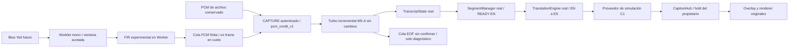

# TRAD — Sprint 2 / M5-C: preparación y ensayo integral EN → ES

21 de octubre de 2026, America/La_Paz. MVP previsto para el 22 de octubre, 07:00.

**Estado actual: GO CON RESERVAS para continuar la integración supervisada con
Operator; OBS pendiente por decisión del usuario. Sin promoción a LIVE ni inicio
automático de M6.** La copia corregida completó dos cierres físicos: el primero
superó el antiguo límite de registro; el segundo conservó 189,12 s de PCM,
140/140 confirmados y 29/29 traducciones DeepL EN→ES, con créditos y EOF íntegros.
Recuperación de Operator, CLEAR y STOP corroborados. El tramo previsto se
interrumpió por nuestra indicación; no se certifican sus dos minutos completos.
La confusión conocida 90/19 queda registrada y, por instrucción del usuario, no
bloquea este avance técnico. No se añadió una corrección automática de cifras.
La sección 16 conserva resultados, límites y cierre de todos los servicios.

El ensayo B anterior (§14) demostró 262/262 confirmados entregados y 51 traducciones
reales hacia OBS, pero terminó incompleto por el registrador. Se conserva su fallo,
las tres palabras no mostradas y los errores de ASR/traducción en el registro de
incidencias; no se borran ni se declaran corregidos clínicamente. LIVE y todos los
resultados previos siguen intactos. A conserva su PASS técnico en §12. No se
consumió el intento físico histórico M4-B 04.

**Resultado histórico C1: GO CON RESERVAS de preparación, NO-GO para LIVE o
aptitud médica/congreso.** Existe una copia reproducible; los dos
PCM completos pasaron la cadena real en memoria con Turbo GPU y traducción
simulada, conservando exactamente 231/716 confirmados de M5-A. El overlay original
recibió el destino ES y pasó render/DOM en Chrome headless, sin OBS ni TCP.
La ruta física quedó preparada y bloqueada en C1. El FIR tiene duración/fase y
espectro comprobados, pero cambia hipótesis del prefijo físico: sus discrepancias
deben revisarse antes del ensayo, sin asumir mejora clínica. No hubo micrófono,
DeepL real, servicio TCP ni consumo del intento físico 04 durante C1.

## 1. Protección, copia y alcance

Se revisaron M5-B §17, M5-A, M4-D, BIDIRECTIONAL_MVP_REPORT, INSTALL_WINDOWS y los
contratos de sesión, captura, TranscriptState, SegmentManager, traducción y overlay.
Rama `sprint2/m1-rtx4070`; HEAD/main/RC permanecen en
`64f82214b33fad4ee68295df1367249caeae3187`; checkpoint `codex/s2-m4-checkpoint`
`cd008ad436d8d2c13a739490e899d18e188df9b3`, intacto.

Run privado: `C:/live-captions/logs/trad_lab/m5c1_20261021T113447Z`. `audit.json` y `pre_m5c1_sources.zip` preservan
**307 fuentes** existentes y los hashes de **5158 archivos privados previos**
inventariados, excluyendo perfiles Chrome/runtime/bytecode. ZIP previo SHA-256:
`8d3ee5e4136dd29ce955b8715e1efafb8efb781bc8bf4aba842ff2c4d79bf454`.
`preservation_check.json` confirma todos esos archivos intactos y `.env` idéntico
por hash. No se imprimió su contenido ni se copiaron credenciales a la copia;
la configuración C1 ignora `.env`. Se conservaron
los 18 cambios versionados previos, resultados M1–M5-B2 y trabajo de `research/`.

La preparación clona el plan M5-B2 de SHA
`577cf8e171e822b23cd7ab3b08c999bd374e0f04ecddc02aa5e021d3a8b48cd5`, sin runtime.
Revisión final de **167 fuentes verificadas**:
`C:/live-captions/logs/trad_lab/m5c1_20261021T113447Z/environment_c1_final/plan.json`.
SHA-256: `0aa1745e70949fc0facd04ba551c3dcdd955bc07675916a38bfca9badf521425`.
De las 139 fuentes base, 133 son idénticas; seis reciben cambios exclusivamente
en la copia. No se modificó `app/` LIVE. La dirección ES→EN y el backend histórico
del workspace quedan intactos; el candidato Turbo de esta copia solo admite EN→ES.

## 2. Arquitectura candidata y archivos



Faster-Whisper/CTranslate2 large-v3-turbo cacheado, CUDA float16, inglés explícito,
LA2, espera mínima 1 s, avance 2 s, ventana adaptativa objetivo 15/máximo 30 s,
Silero y demás opciones M5-A/M5-B2 intactas. No se cambiaron beam, VAD, thresholds,
glosarios, normalizador inglés identidad ni el remuestreador histórico.

| Archivos nuevos en `trad_lab/m5c/` | Finalidad |
|---|---|
| `prepare.py`, `runtime.py`, `README.md` | Clonado verificado, proveedor simulado, capacidades bloqueadas, autoridad de presentación y operación |
| `physical_capture.html/js`, `physical_core.cjs` | Fuente física futura, verificación de Yeti, cola finita, crédito, STOP/EOF y diagnóstico |
| `worklet.js`, `resample_worker.js`, `resampler.cjs` | Captura mono acotada, continuidad por contador propio, FIR con fase entre bloques |
| `controls.js` | Dirección fija y botones separados OCULTAR / REANUDAR, estado recuperable |
| `integration.py`, `prefix_asr.py`, `dsp_check.cjs` | Replays en memoria, inferencia offline y evaluación DSP |
| `test_contract.py`, tres suites JS, `check_presentation.py`, `check_provider_failure.py`, `render_offline.py` | Contratos, fallos, cierre, captura sintética y render local |

En **la copia** cambian `app/main.py` (hooks), `app/static/operator.js` (ruta del
popup), plantillas Operator/overlay (marca permanente de simulación),
`app/overlay/hub.py` (hold de publicación) y `trad_lab/m5b/serve.py` (rechazo TCP C1).
`M5C1_COPY.diff` contiene esas diferencias. Overlay JS/CSS, geometría y
`caption_renderer.js` permanecen byte a byte idénticos al plan aprobado.
No se sustituyó su renderer ni se alteraron TranscriptState o SegmentManager.

## 3. Integración de PCM, ASR, READY y captions

Primero se ejecutó control con las palabras ya registradas, comprobando SHA de
cada ventana antes de devolverlas: no se presenta como una inferencia nueva.
Después se hicieron **dos inferencias/replays GPU reales** de los PCM completos
por las rutas autenticadas ASGI de TRAD y Turbo, TranslationEngine, CaptionHub y
`/ws/overlay`, mediante colas en memoria. No hubo TCP. Las referencias solo se
conservaron para comparación; no entraron al decoder como prompts/hotwords.

| PCM completo, inferencia real | Bytes PCM | Ventanas exactas | Confirmados exactos M5-A | READY / simulaciones / captions recibidos |
|---|---:|---:|---:|---:|
| yeti_received_full | 4.629.552 | 73 | 231 | 31 / 31 / 31 |
| cardio_01 | 11.031.150 | 173 | 716 | 100 / 100 / 100 |

Yeti SHA PCM:
`d482dead07ea58555bb5a478fcb95c1ea2eccef346153a636464f1023060809d`.
cardio_01 SHA PCM:
`919775e455f4dd1c7201ab100b11dabc5bf0cb0752b4802bdaa0743eaf3bf437`.
WAV cardio_01 SHA de contenedor:
`5906e72a0581187087f1c5f2616ac760aea61b4271f8d11d741cc94dc389cada`.
Se conservaron los TXT/referencias provisionales y sus evidencias previas; Yeti
sigue sin referencia clínica temporal certificada. No se calculó nuevo WER clínico.

Cada crédito conserva sesión/secuencia/bytes/SHA/acumulado. PCM idéntico,
ventanas causales f32 y todos los campos RAW relevantes idénticos a M5-A:
decoder_words, hipótesis, confirmados, provisionales, timestamps, probabilidades
y conflictos. La identidad M5-B2↔M5-A de Yeti procede además del E2E real anterior.
Sin nuevas pérdidas, duplicaciones ni revisión de líneas confirmadas.

Cada READY tiene exactamente un resultado simulado con mismo session_id,
segment_id, secuencia, raw_text y normalized_text, par EN→ES y caption de destino
ES asociado. Se conservaron orden, IDs únicos y texto agregado READY+PENDING en
todas las transiciones observadas. Las distintas particiones READY entre control,
inferencia y M5-B2 responden a sus relojes; no cambian el texto confirmado.

Los replays en memoria enviaron PCM tan pronto como hubo crédito; **no son
reproducción a tiempo real ni nuevas latencias LIVE**. El motor ejecutó llamadas
seriales y los buffers conservaron sus límites. Los dos EOF y cierres completos
terminaron sin cuarentena/OOM/error de integración. El estado y la cola ASR
terminal siguen separados de las traducciones pendientes o fallidas.

## 4. Traducción simulada, fallo del proveedor y presentación

Se usa el proveedor propio `m5c-simulation`, cuyo texto es
`[SIMULACIÓN ES — NO CLÍNICA] ` seguido del inglés original. No pretende traducir.
Tiene un presupuesto explícito de 4096 solicitudes por instancia. El proveedor
ordinario `mock` continúa filtrado por Hub/renderer; no se eliminaron esos filtros.
Esta identidad de simulación y la marca fija en ambas páginas permiten probar
presentación sin etiquetar un resultado falso como DeepL.

El adaptador DeepL original se probó con opener local simulado: payload con
`source_lang=EN`, `target_lang=ES`, texto íntegro y respuesta validada, sin HTTP
real ni clave real. La fábrica C1 rechaza otro proveedor o credenciales; no activa
DeepL heredado del entorno. Esto valida contrato/direccionamiento, **no traducción
médica, red, cuota o disponibilidad de DeepL real**.

Demora, timeout y error del proveedor: orden preservado, error visible, plazo
finito y cancelación explícita de pendientes. En una sesión de fallo ASGI real,
Turbo completó PCM/EOF y produjo confirmados; la traducción falló, no se publicó
caption y el outcome global quedó **incomplete**. No se ocultó el fallo porque
el transporte del backend hubiera terminado. Otra sesión con un solo voto LA2
terminó con cola EOF no confirmada, **sin READY, traducción ni caption**.
Los fallos fueron inyectados en memoria; no se presentan como fallos E2E físicos.

Recuperación de Operator: rotación de token, rechazo del anterior, dueño vigente,
historial y CLEAR durante ambos replays. CLEAR aumenta generación visual sin
borrar ASR. Se preservan origen, dirección, autenticación y rechazo de dueño ajeno.
OCULTAR y REANUDAR son acciones separadas, nunca un toggle ambiguo: ocultar limpia
el caption actual y suprime publicaciones futuras conservando traducciones y
journal; reanudar muestra solo resultados nuevos, sin repetir los ocultos.
La lectura autenticada del estado permite recuperarlo al recargar Operator.
Las operaciones ajenas/obsoletas se rechazan. Para transiciones o pérdida de red,
el operador conserva además la opción de ocultar la fuente OBS manualmente.

El overlay original recibió todos los captions simulados por su ruta ASGI.
Chrome headless real cargó HTML/CSS/JS originales por `file://`, con una conexión
local simulada: DOM visible, idioma `es`, CLEAR vacío y caption posterior, sin
excepciones JS. Captura de 1920×1080 inspeccionada: dos líneas efectivas sin
recorte y marca de simulación. `render_native_final/result.json`, `dom.html` y
`overlay.png` conservan la prueba. No se abrió OBS ni Browser Source, no se midió
un proyector ni fotones. El estado DOM y las oportunidades rAF no son latencia
física; la etiqueta ES no acredita que el inglés simulado sea traducción española.

## 5. Captura física preparada y backpressure

CAPTURE histórico no es compatible directamente con el crédito: envía cada
resultado del worker inmediatamente. La ruta nueva es independiente y no reutiliza
ese envío sin control. El popup mantiene el intercambio auténtico del propietario
y exige EN→ES, deviceId explícito, pista efectiva Yeti y tasa de contexto soportada.
No abre audio hasta un click local autorizado y las capacidades futuras aprobadas.
En C1 `physical_enabled=false`; la prueba de la página real con APIs sintéticas
confirma cero llamadas nativas y cero sockets al intentar iniciarla.

El Worklet copia mono en lotes de 2048 muestras y no espera red, disco o worker.
Admite como máximo ocho lotes pendientes de ACK; un bloqueo de main/worker o canal
inesperado detiene forwarding y marca incomplete. El Worker verifica secuencia,
primer sample, longitud, tasa y canal, usando contadores propios; no confía en
la metadata currentFrame problemática de M4-B. No se afirma que esto repare la
evidencia histórica. La implementación se probó con señal sintética, no un ADC.

La cola PCM admite **512 KiB incluyendo el frame en vuelo**: 16,384 s nominales
a 16 kHz. Solo un bloque de hasta 64000 bytes puede esperar crédito; ni hashing
ni esa espera ocurren en el callback de audio. El socket tiene además control
de bufferedAmount. El plazo de crédito sigue siendo 39 s, sin aumentar los plazos
del servidor. Un backlog físico puede agotar antes su presupuesto: invalida el
ensayo, no elimina muestras para continuar con apariencia de éxito.

STOP impide más forwarding, drena el último lote, el FIR y todos los créditos,
envía un único EOF y mantiene el socket hasta terminal. Se corrigió dentro del
código propio la carrera STOP durante preparación: no abre un grafo después de
haber recibido STOP; tras handshake puede finalizar vacío de forma válida.
La prueba ejecuta página+worker reales con WebAudio/socket sintéticos y compara
todo el PCM con el oracle DSP: dos créditos, un EOF, contadores y terminal exactos.
Se prueban también crédito inválido, congestión y fallo explícito, sin descarte
silencioso. Quedan pendientes permisos/temporización y señal Blue Yeti reales.

## 6. Remuestreo: señal y efecto ASR antes de promoverlo

El worker histórico conserva su defecto temporal y permanece intacto. El nuevo
candidato es un **FIR sinc Hann de 127 taps**, cutoff 7200 Hz, fase racional
persistente, 63 muestras de soporte futuro y salida s16 con la misma cuantización.
No es el promedio rectangular M4-B. A 16 kHz hay identidad; a 44,1/48 kHz el
lookahead es 1,429/1,313 ms, además del batching de audio. No se optimizó latencia.
EOF documenta extensión cero solo en el soporte finito del filtro y produce
ceil(N×16000/rate) muestras; no añade voz, votos ASR ni un segundo EOF.

| Señal | Resultado |
|---|---|
| 60 s a 16/44,1/48 kHz | 960000 muestras de salida en cada tasa |
| Particiones 1/127/128/2048/4093 y bloque grande | Salida f32 idéntica entre particiones |
| Impulso en 0,5 s | Pico en muestra 8000, error de fase ≤1 muestra |
| Tono 1 kHz | Ganancia aprox. −0,001 dB |
| Tono 6 kHz | −0,006 dB a 44,1 kHz; −0,015 dB a 48 kHz |
| Tono 9 kHz, alias observado a 7 kHz | −70,10 / −74,14 dB en las dos tasas |
| Tono 12 kHz | Por debajo de resolución útil del probe cuantizado; no se declara rango dinámico de 232 dB |

Son probes reproducibles, no certificación de toda la banda o calidad clínica.
El prefijo f32 conservado contiene 6.481.920 muestras/135,04 s a 48 kHz. Replay
original: 4.355.040 bytes/136,095 s y SHA exacto histórico
`ec89c0da00aef65b452e3d65a0c12569fb64106d7c3ba2945140e55e2db30308`.
FIR: **4.321.280 bytes/135,04 s**. La corrección de conteo no certifica continuidad
acústica: el prefijo sigue incompleto y conserva las reservas currentFrame M4-B.

Con el mismo Turbo y perfil se hicieron inferencias offline de ambos derivados:
original **231 confirmados**, cola `definition.`; FIR **230**, cola `classical.`.
Las discrepancias incluyen `world, the prevalence`→`world. Prevalence`,
`healthcare`→`health care`, formato/puntuación y desplazamiento de `classical`
de confirmado al final no confirmado. No se promueve esa palabra para igualar
el conteo. Sin referencia temporal clínica válida, **no se adjudica mejora ni
se selecciona el FIR por WER o duración**. `prefix_asr_r3/comparison.json` conserva
los cambios; los audios derivados permanecen privados en `signal_r1`.

El FIR queda como candidato técnicamente verificable para revisión de M5-C2,
sin activación física ni fallback automático al resampler defectuoso. Si la
revisión no acepta estas reservas, el ensayo físico queda bloqueado; no se
improvisa un workaround en LIVE. La selección para C2 debe quedar explícita
en su nueva política/plan y en la autorización supervisada.

## 7. Regresiones, iteraciones y recursos

**253 pruebas Python PASS, sin skips**: selección previa M5-B2 más contratos
de traducción, overlay, Operator, dirección, latencia y seis propios C1; estos
se repitieron tras el ajuste del presupuesto del mock. Nueve suites JS previas
PASS, más tres C1: **43 comprobaciones DSP/worklet/cola**, **12 de página/worker
sintéticos** y **6 de controles explícitos**. Se añaden ocho controles de hold,
cinco de fallo y cuatro de cola en rutas ASGI; no se suman como unittest.
Compilación, whitespace, manifest y preservación PASS.

Iteraciones de harness conservadas: expectativas de cooldown dependientes del
jitter se hicieron deterministas solo en el fixture; el test de nueva sesión
olvidaba cerrar la anterior; el test de cola utilizaba una clave de historial
incorrecta; el render inicial tenía un error de sintaxis en su fetch simulado;
el test de crypto necesitaba esperar su finalización real. Dos arranques offline
del A/B detectaron argumentos incorrectos del constructor del evaluador antes
de decodificar y se corrigieron. No fueron sesiones TCP fallidas ni cambios del
modelo. También se corrigió la carrera STOP propia descrita arriba y se añadieron
botones separados para evitar que OCULTAR pudiera revelar una salida ya oculta.
Se conservaron las copias intermedias; no se sobrescribieron para fingir PASS.

Recursos GPU compartidos muestreados durante la integración nativa:
**2814.0 MiB usados**, mínimo **5135.0 MiB libres**,
máximo **73.0 °C**, 162 muestras.
No es VRAM exclusiva del modelo ni pico exacto del allocator. No hubo OOM,
descargas, instalaciones o fallback. El A/B incluye comprobaciones conservadoras
de puertos alrededor de llamadas: su wall no se usa como benchmark de inferencia.
Las colas de transporte, traducción, trace y capturas mantienen presupuestos;
las listas del harness corresponden a archivos finitos, no a una sesión infinita.

## 8. Riesgos médicos y conducta del operador

Persisten `140 over 90 → 140 over 19`, `aldosterone → eldest run`,
`10-year ASCVD risk → tenure`, revisiones tardías y posibles omisiones. El corpus
reutilizado no generaliza a toda conferencia. Aldosterone/riesgo a diez años
proceden del histórico; no se afirma ocurrencia en estos dos replays.
El mock no valida cifras, negaciones, medicamentos, dosis o traducción médica.
LA2 y coincidencia repetida no son certeza clínica.

No hay fuzzy ni corrección automática inglesa. Ante una discrepancia grave:
**OCULTAR**, pedir **STOP**, mantener CAPTURE hasta EOF/cierre y conservar RAW,
READY, traducción/errores y watermark. Si no responde el control, ocultar la fuente
en OBS manualmente. CLEAR no suspende captions futuros y no sustituye OCULTAR.
REANUDAR requiere decisión explícita y no repite ni corrige los resultados ocultos.

## 9. Procedimiento M5-C2 preparado, NO ejecutado

1. Revisar esta entrega y las discrepancias FIR. Obtener autorización **nueva**
   para TCP, Blue Yeti, DeepL real y OBS, con presupuesto de sesiones y parada ante
   primer fallo. No usar el claim físico 04 M4-B como reintento implícito.
2. Preparar una **copia C2 nueva** de esta revisión, con política explícita de
   fuente física y proveedor DeepL original. C1 rechaza el launcher TCP y tiene
   micrófono/DeepL bloqueados; no se habilita reutilizando el permiso M5-B.
   Solo cambiar esos gates/configuración autorizados, retirar marca de simulación
   de esa nueva revisión y verificar su diff/hashes. Inyectar la clave local
   protegida fuera de manifiestos/logs; no modificar `.env` ni imprimirla.
3. Con LIVE detenido por su operador, verificar 8000/8010/18000/18010 libres,
   sesiones cerradas, modelos cacheados y ≥3500 MiB GPU libres. Registrar otros
   consumidores sin cerrarlos automáticamente. Arrancar Turbo 18000 y TRAD 18010,
   un proceso cada uno, loopback, mismo perfil/crédito. Comprobar health y config.
4. Abrir Chrome normal en `http://127.0.0.1:18010/operator`, dirección EN→ES fija.
   START abre CAPTURE independiente. Seleccionar deviceId explícito Blue Yeti;
   el click local verifica etiqueta y track efectivos, tasa, señal y handshake.
   Confirmar nivel sin clipping, entorno, ganancia/patrón, AGC/AEC/denoise efectivos
   y contador de muestras antes de reproducir voz; detener si no corresponde.
5. Mantener en OBS una fuente experimental separada y inicialmente oculta:
   `http://127.0.0.1:18010/overlay`, 1920×1080, crop 0, sin apagar al ocultar o
   refrescar al activar. Conservar la fuente/escena operativa; no sustituirla.
   Verificar destino ES real, sin marca mock, sin publicar RAW o cola EOF.
6. Reproducir un pasaje médico claro y documentado, primero corto. Guardar muestras
   y contadores de entrada/DSP/sent/ACK/backend, SHA y tiempos por etapa. Verificar
   RAW EN, confirmados/READY, solicitudes/respuestas DeepL EN→ES y asociación de
   cada caption/sequence. No usar referencia correcta como prompt.
7. Comprobar en pantalla/OBS negaciones, rangos, cifras/unidades, medicamentos y
   correcciones del conferencista. Comparar con escucha/referencia alineada;
   no inferir exactitud por un WER agregado o por acuerdo ASR.
8. Registrar MutationObserver de Operator y overlay y oportunidades rAF con
   timeOrigin/performance y calibración a perf_counter; correlacionar IDs READY,
   traducción y caption. Reportar mediana/p95 solo con muestras válidas y origen
   bien definido. DOM/rAF no miden fotones ni latencia física completa voz→OBS.
9. Probar OCULTAR/REANUDAR, CLEAR y recuperación de **solo Operator** mientras
   CAPTURE sigue abierta. No repetir subtítulos ocultos ni mezclar sesiones.
10. STOP normal: parar forwarding, flush FIR/worker, último crédito, un EOF,
    ready_to_stop, traducciones drenadas y estado stopped. Revisar la cola no
    confirmada aparte; complete de transporte no la vuelve texto confirmado.
11. Ante timeout, límite, pérdida, error de proveedor, dispositivo incorrecto o
    OOM: ocultar salida, detener, preservar fase/evidencia; no aumentar timeouts
    ni reintentar automáticamente. No reconocer incomplete como recuperación
    de palabras o traducciones que no se entregaron.
12. Tras cierre verificado, cerrar únicamente Turbo/TRAD/Chrome experimentales,
    verificar puertos y liberar GPU. Registrar evidencia/recursos/errores y pedir
    revisión antes de promover o prolongar. No activar LIVE automáticamente.

## 10. Rollback y dictamen

Rollback actual: dejar la copia detenida y conservar el run. El workspace LIVE,
ES→EN, main, RC, checkpoint y `.env` no requieren restauración: no se tocaron.
Para rollback técnico futuro, usar explícitamente la revisión histórica íntegra
con su CAPTURE compatible después de STOP/EOF y cierre; no usar el cliente de
crédito Turbo contra un backend incompatible. WLK histórico está disponible,
**no es respaldo clínicamente validado**. No hay fallback automático.

`final_closure.json` registra puertos libres y ausencia de procesos experimentales
propios, GPU final `458, 7491, 54, 18` (usados MiB, libres MiB, °C, utilización).
No se arrancaron servicios para obtener ese resultado. `final_validation.json`,
los diffs y el manifiesto de entrega identifican evidencias y hashes; ZIP de
revisión solo contiene fuentes/plan/informe, sin audio, credenciales o runtime.

**GO CON RESERVAS de preparación para un ensayo M5-C2 supervisado, condicionado
a revisión y autorización expresa.** Compatibilidad, PCM, texto, proveedor simulado,
overlay y mecanismos de control están verificados; los permisos, dispositivo,
calidad acústica/FIR sobre voz real, DeepL médico real, OBS y latencia física
siguen pendientes. Si no se aceptan las discrepancias FIR o falta cualquiera de
esos gates, NO-GO para abrir el micrófono. No se declara el MVP apto para uso
médico/congreso. Se detiene en M5-C1; no hay LIVE, M5-C2, commits, tags, merges,
push, releases o despliegues.

## 11. M5-C2 A autorizado: preparación y fallo anterior al primer PCM

Resultado histórico anterior a la repetición autorizada; estado vigente en §12.

21 de octubre de 2026. Run privado nuevo:
`C:/live-captions/logs/trad_lab/m5c2a_20261021T121411Z`.
Esta sección es el resultado vigente; las secciones 1–10 conservan C1.

### Aislamiento, selección y comprobaciones previas

La auditoría preservó **437 fuentes** y hashes de **6806 archivos privados
anteriores**, además de `.env` y referencias Git. ZIP previo sin credenciales:
`pre_c2a_sources.zip`, SHA-256
`3dbf7a515df7839ec0b19865dc8d6da167afe2124d69dcfeba5dfe41b5bb4cbc`.
No se modificó `app/` del workspace, modelos, perfil ASR, SegmentManager,
glosarios, dependencias, corpus ni el remuestreador histórico.
`final_validation.json` verifica los 6806 archivos históricos intactos, `.env`
idéntico y referencias HEAD/main/RC/checkpoint conservadas. Entre las 437 fuentes
previas, únicamente cambia este informe, de forma intencional; el paquete C2 es
nuevo. La copia ejecutada mantiene sus 177 hashes después del cierre.

La nueva copia habilita únicamente fuente física A, EN→ES y `pcm_credit_v1`;
DeepL, traducción simulada y captions traducidos están deshabilitados. El FIR127
de C1 queda seleccionado explícitamente, con idénticos bytes y con las reservas
ASR de la sección 6. No se declara que corrija precisión médica. La fuente OBS
está descrita en `obs_source_spec.json`, separada e inicialmente oculta: **no se
abrió OBS ni se creó/modificó una fuente real**, pues corresponde a B.

Código nuevo: `trad_lab/m5c2/{prepare.py,runtime.py,serve.py,evidence.js,dom.js,
check_evidence.py,test_evidence.cjs,__init__.py}`. `prepare.py` modifica únicamente
la copia: capacidades A, proveedor OFF, etiquetas, enumeración sin abrir audio,
medidor RMS/pico y registro privado. El worker/FIR, motor Turbo, políticas LA2,
backpressure y renderer permanecen idénticos a C1. Las muestras pre-FIR y PCM
sent se conservan en una cola de evidencia finita de 64 MiB JSON, separada de la
cola de audio; la subida autenticada ocurre después del terminal, con ACK de
escritura y límites del writer. No cerrar CAPTURE antes de terminar esa subida.
DOM tiene presupuesto propio; no equivale a observación física de OBS.

Antes de abrir el micrófono pasaron **253 pruebas Python**, sin fallos, errores
o skips; siete controles de evidencia autenticada, ocho de sesión/presentación/
rollback en memoria y doce de página/worker sintéticos. Los controles DSP y de
evidencia Node pasaron durante la preparación. Los replays de control con decoder
**registrado**, sin nueva inferencia ni TCP, conservaron todos los registros y
colas M5-A: Yeti 231, cardio_01 716, cardio_02 1750, cardio_03 1696. Estos PASS
usaron `.venv-wlk`; no probaron el import diferido bajo `.venv`. Esa diferencia
de intérprete fue una omisión de preparación, no una regresión clínica demostrada.

El usuario confirmó presencia y montaje: cardio_01 externo **1:00–2:00 (60 s)**,
cinco segundos antes/después, Bose SoundLink Mini V1 a unos 30 cm, perpendicular,
volumen Bose máximo y fuente medio. Yeti sin cambios; ganancia/patrón numéricos
siguen desconocidos. `physical_authorization_and_prestart.json` conserva el
registro. El permiso Chrome inicialmente ocultaba los dispositivos: Windows
enumeraba el Yeti en estado OK. Tras permitir micrófono para el sitio y recargar
Operator, el usuario confirmó selección explícita Blue Yeti. No se eligió Intel
como sustituto. No se consumió el intento físico histórico 04 de M4-B.

### Arranque, secuencia del error y detención

El primer launcher backend cargó el modelo dentro del sandbox, pero no llegó a
abrir un listener. Se cerró por su PTY y se comprobó liberación de GPU. Una prueba
de asyncio fuera del sandbox pasó; la causa interna exacta del bloqueo inicial
no se adjudica. No hubo sesión ni apertura de micrófono en ese arranque. Se
conservó esa copia y se preparó otra con **los mismos 177 archivos de ejecución**
para arrancar con permiso local; no se alteraron código ni timeouts en marcha.

Copia efectivamente ejecutada:
`C:/live-captions/logs/trad_lab/m5c2a_20261021T121411Z/environment_a_execution/plan.json`,
SHA-256 `31a0be7b376ef8c94d272c8dc267f4149e315cd58a9a1106d1e1cc40f4e5f956`.
Las revisiones intermedias se conservan; no se reutilizó su runtime.

| Servicio propio | Puerto loopback | PID servidor | Intérprete |
|---|---:|---:|---|
| Turbo experimental | 18000 | 31672 | `.venv-wlk` |
| TRAD experimental | 18010 | 14268 | `.venv` |

Health confirmó Turbo ready/inactivo, inglés, TRAD waiting y capacidades A con
DeepL OFF. El usuario abrió CAPTURE desde Operator y pulsó el inicio físico;
el servidor aceptó `/ws/session` con sesión `0d5255f936ba`. **No se dio el aviso
de reproducir el fragmento**. No hubo otro START tras el fallo.

- **12:33:53.280 UTC:** conexión del navegador y estado `RECOVERING`, razón
  `connecting_wlk`.
- **12:33:53.298 UTC:** `ERROR`, `session_transport_error`, excepción
  `ModuleNotFoundError`; outcome global `incomplete`, sesión cerrada.
- CAPTURE mostró: «INCOMPLETE: La sesión no pudo continuar. Revisa los logs
  locales y vuelve a iniciar cuando se resuelva el error».
- Se indicó no reproducir ni reiniciar. Después de comprobar sesión cerrada se
  detuvo primero TRAD y después Turbo, exclusivamente mediante sus PTY propios.
  **El apagado de los servicios fue posterior al error de CAPTURE.**

El log real conserva el tipo de excepción, no el nombre del módulo. La prueba
posterior **solo de imports**, sin red, audio o inferencia, reproduce exactamente
la cadena `m5b.flow → m5b.transport → m5a.adapter → numpy`: bajo `.venv` falla
con `No module named 'numpy'`; bajo `.venv-wlk` pasa. `experimental_relay` importa
FlowTrace antes de abrir la conexión Turbo; esto explica que no hubiera sesión
backend ni frames. Evidencias: `import_diagnostic_trad.json`,
`import_diagnostic_wlk.json`, `trad_execution_console.log` y
`operator_status.jsonl`. La elección incorrecta del intérprete corresponde a la
ejecución del agente; no se atribuye al usuario, Yeti, FIR o modelo.

### Datos disponibles y límites

**Cero bloques / cero bytes PCM recibidos por TRAD, cero confirmados, READY,
traducciones o captions; sin EOF.** El estado global quedó incomplete, con sesión
cerrada. El diagnóstico ASR auxiliar aún mostraba `in_progress`: es un estado no
actualizado por el fallo anterior a inicializar FlowTrace, no un transporte
completo ni una transcripción en curso que pueda recuperarse.

La ruta cliente solicita y verifica la pista antes de abrir el socket, pero el
fallo ocurrió antes del config/handshake y de iniciar Worklet/FIR. No se escribió
`browser_evidence`, pues su sesión se establece después de ese config. Por ello
**no hay metadata archivada que permita certificar aquí pista efectiva, tasa,
procesamiento acústico, continuidad, duración o calidad física del FIR**. Tampoco
hay nueva referencia alineada, WER clínico, comparación de precisión, cifras o
negaciones adjudicadas, ni mediana/p95 de latencia audio→RAW→READY→DOM.

Los aproximadamente 18 ms entre las líneas de log describen detección del fallo
de inicialización; no son latencia ASR. El observador HTTP registró brackets QPC
y recursos, sin audio/control POSTs. No hubo DeepL real, traducción médica ni
validación OBS. Los riesgos médicos previos permanecen sin modificación.

Recursos compartidos durante el observador: **89 muestras**, máximo **2758 MiB
usados**, mínimo **5191 MiB libres**, máximo **57 °C**. No son VRAM exclusiva ni
pico exacto del allocator; no hubo OOM. `final_closure.json` confirma ausencia
de procesos propios y listeners en 8000/8010/18000/18010; GPU final **483 MiB
usados, 7466 libres, 54 °C**. El navegador normal pertenece al usuario; no se
cerraron indiscriminadamente sus ventanas ni otros procesos.

### Corrección preparada, rollback y dictamen

Tras detener los servicios se añadió **solo a las fuentes nuevas** de
`trad_lab/m5c2/serve.py` un preflight del import diferido, anterior a cargar modelo
o escuchar TCP. `README.md` exige el entorno existente `.venv-wlk` para **ambos**
servicios y una copia nueva antes de cualquier repetición. La comprobación sin
servicios rechaza `.venv` y pasa con `.venv-wlk`. No se instaló NumPy, no se cambió
ninguna dependencia y **no se aplicó el cambio a la copia histórica ejecutada ni
se reinició una sesión**. La corrección del preflight no demuestra que el ensayo
físico vaya a pasar; su ejecución queda pendiente de revisión.

Rollback actual: conservar el run y mantener detenida la copia. LIVE, ES→EN,
main/RC/checkpoint y `.env` permanecen intactos; no requieren restauración.
El backend histórico y su CAPTURE compatible siguen disponibles como rollback
técnico, no clínicamente validado. No usar el cliente de crédito con un backend
incompatible ni activar fallback automático.

Para una futura repetición revisada: crear una copia nueva con preflight, verificar
hashes e intérpretes, repetir controles de import/session en ese mismo entorno,
comprobar health y solicitar presencia/montaje antes de abrir audio. Mantener FIR
y perfil ASR; repetir únicamente A con el mismo fragmento y detener ante fallo.
Solo tras integridad y revisión médica preliminar solicitar permiso separado para
B, DeepL real y OBS. No convertir esta propuesta en autorización de ejecución.

**NO-GO para continuar M5-C2 o preparar M6 con este resultado.** La fase A no
llegó a producir audio analizable; B sigue sin autorizar. Se detiene para revisión,
con evidencias preservadas y servicios cerrados. No hubo LIVE, commits, tags,
merges, push, releases, despliegue ni declaración de aptitud para el congreso.

## 12. Repetición autorizada de A con `.venv-wlk`: integridad física PASS

El usuario autorizó expresamente repetir A usando `.venv-wlk` para ambos
servidores, con DeepL apagado. Run nuevo, sin sobrescribir el fallo anterior:
`C:/live-captions/logs/trad_lab/m5c2a_retry_20261021T124048Z`.
`audit.json` y `pre_retry_sources.zip` preservan 446 fuentes y hashes de 7834
archivos históricos inventariados, incluido el run anterior. La copia nueva
incluye el preflight de imports y mantiene el mismo Turbo, perfil LA2/VAD,
FIR127, crédito, límites y contratos C1/C2; no cambian dependencias ni LIVE.

Plan ejecutado, **178 archivos congelados**:
`C:/live-captions/logs/trad_lab/m5c2a_retry_20261021T124048Z/environment_a_ready/plan.json`,
SHA-256 `b4f0409ec892ee8ce6028a59686b8276b0edf6a81a9472849010177f97bcc914`.
Antes del arranque pasaron de nuevo los imports diferidos, ocho comprobaciones
ASGI de sesión/aislamiento/cierre/rollback, siete de evidencia autenticada y la
suite Node de evidencia. **Estas comprobaciones se ejecutaron con `.venv-wlk`
desde la copia nueva**, igual que los dos launchers. Las 253 regresiones Python
previas conservan su alcance; no se repitió toda la selección sin cambios del
motor o los contratos. No se presenta un import PASS como garantía E2E.

### Supervisión, dispositivo y tramo realmente reproducido

Puertos 8000/8010/18000/18010 libres y GPU 483 MiB usados/7466 libres antes de
arrancar. Consumidores observados: DWM, Explorer, Killer y Notepad; no se cerraron.
`owned_processes.json` conserva los PIDs y sus padres:

| Servicio experimental | Puerto loopback | PID servidor | Launcher |
|---|---:|---:|---|
| Turbo incremental large-v3-turbo | 18000 | 44384 | `.venv-wlk` |
| TRAD con traducción deshabilitada | 18010 | 35316 | `.venv-wlk` |

Chrome normal, pestañas nuevas, selección explícita Yeti y propietario recibido.
El usuario reconfirmó presencia/montaje antes del click local de micrófono.
La pista archivada fue **Microphone (Yeti Stereo Microphone) (046d:0ab7)**,
deviceId efectivo exacto comprobado en cliente, sin guardar ese identificador.
Track y contexto: **48000 Hz**, pista mono y lotes Worklet de un canal.
AEC, denoise y AGC reportados activos; latencia configurada de pista 0,01 s,
**no una medición de latencia acústica**. Ganancia/patrón Yeti sin cambios,
valores desconocidos; Bose y montaje declarados conservados.

Sesión `2d416fcc87c0`. Antes de autorizar voz se comprobaron cinco bloques PCM
y sus cinco créditos, sin errores. La instrucción fue cardio_01 1:00–2:00;
después de STOP el usuario aclaró que reprodujo **1:00–3:00 (120 s)**. Se conserva
esa diferencia en `actual_playback_conditions.json`; no se etiqueta como ensayo
de 60 s ni se exige repetir solo por duración. El usuario informó ejecución del
postroll/STOP y resultado satisfactorio. No hubo reproducción local duplicada,
referencias como prompts ni otro START. `playback_cue.json` describe el aviso,
no un evento `playing` sincronizado del dispositivo externo.

### Integridad, FIR, texto y cierre reales

La evidencia se subió y selló antes de cerrar servicios: **317 paquetes ACK**,
writer sin error, 50.379.667 bytes JSON, dentro del presupuesto de 64 MiB JSON.
Los contadores verifican continuidad de los vectores entregados al software;
no acreditan ausencia universal de pérdidas en ADC/Windows anteriores al Worklet.

| Medición verificada | Resultado |
|---|---:|
| Lotes pre-FIR, orden y offsets íntegros | 3818 |
| Entrada mono f32 a 48 kHz | 7.819.136 muestras; 31.276.544 bytes |
| Duración de entrada, incluidos preparación/silencios | 162,8986667 s |
| PCM FIR mono s16le a 16 kHz | 2.606.379 muestras; 5.212.758 bytes |
| Duración del contenedor de salida | 162,8986875 s |
| Bloques de audio / créditos exactos | 82 / 82 |
| EOF | Uno, terminal, cero bytes |
| Confirmados producidos / enviados / recibidos / entregados | 266 / 266 / 266 / 266 |
| READY únicos / PENDING final | 49 / vacío |
| Cola EOF no confirmada | Vacía |
| Estados observados con conservación READY+PENDING | 278 |

SHA pre-f32: `c914bca4a68fbb39d09beb63c1c1df6bcb1718166cbc0ead2511a7a148d87659`.
SHA PCM sent/recibido idéntico:
`cb3714cbfe5f15af796281fc31aa0476ebf63699c7a1506cfa0f7bce7ea6432b`.
Se verificaron SHA por bloque/total, secuencia, offsets, límites y orden, ACK de
sesión/secuencia/bytes/acumulado/SHA, fin de writer y terminal. El replay DSP
determinista con **las particiones reales y el FIR congelado** produjo exactamente
los bytes enviados. La duración difiere de la entrada en 20,83 µs por el ceil
documentado, menos de una muestra de salida. No hubo reinicio de fase, EOF doble
ni descarte detectado en la ruta instrumentada. El replay no es nueva inferencia.

Los 266 registros confirmados del decoder coinciden exactamente con snapshots
inmutables y entrega TRAD. READY conserva orden y texto confirmado; no hay IDs
duplicados, revisión de confirmado, cambios del normalizador ni cola publicada.
Los 278 snapshots HTTP conservan READY+PENDING frente al texto confirmado; el
historial no está truncado. `physical_integrity.json`, `fir_replay.json`, RAW,
traces de transporte y `browser_evidence/2d416fcc87c0/` contienen la comprobación.
El primer análisis offline debía contemplar transcript `null` durante conexión;
se ajustó solo ese lector, sin cambiar evidencia ni implementación ejecutada.

STOP normal produjo flush Worklet/FIR, crédito final, un EOF, ready_to_stop y
estado `stopped`, sesión cerrada, outcome global **complete**, decoder sin
cuarentena. Aquí `all_emitted_words_confirmed` describe los registros emitidos;
no asegura que todo lo pronunciado fuera reconocido correctamente. No se añadió
silencio sintético, votos de confirmación ni palabras para completar la cola.
Se conservaron 37 muestras pre-FIR con amplitud absoluta ≥0,999, aproximadamente
0,00047 %: señal cercana a plena escala, no certificación de clipping del ADC.
El máximo de cola PCM fue 97.410 bytes frente al límite de 524.288.

### Fidelidad y correspondencia con la fuente

Nueve anclajes independientes de dos segundos del PCM original se buscaron en
el PCM capturado. Correlaciones entre 0,314 y 0,798; los seis anclajes entre 105 y
176 s de la fuente dan un desplazamiento coherente alrededor de 29,077 s desde
el inicio de captura para el segundo 60 original. Son compatibles con el tramo
externo 1:00–3:00 y con silencios de preparación/postroll mayores que los cinco
segundos mínimos. Los anclajes iniciales tienen correlación menor: **no se
certifica cada frase ni el primer fonema solo por esta correlación**.

Comparación focalizada con hipótesis M5-A del mismo tramo y TXT provisional:

- `non-elevated blood pressure`, `120 over 70`, `120 to 139` y `70 to 89`
  permanecen en el confirmado físico y en el baseline; el TXT disponible coincide
  en esas expresiones. Esto no valida médicamente los umbrales del discurso.
- **`140 over 90` del TXT → `140 over 19`**, igual que Turbo M5-A. Error clínico
  heredado todavía presente; no se corrige ni se considera aceptable por repetirse.
- Se conserva la autocorrección del conferencista `non, excuse me ... elevated`,
  también presente en el baseline. No se elimina para mejorar una puntuación.
- Hay diferencias de formato/puntuación y `a hundred`/`100`, además de bordes
  cortados por el seek externo; no se adjudican esos bordes como omisiones nuevas
  del transporte. No se ha identificado un fallo clínico grave **adicional** en
  las expresiones revisadas; eso no descarta errores fuera de esa revisión.

No se ejecutó un nuevo A/B de modelos/resamplers ni WER clínico. El audio físico
es distinto del PCM original de M5-A y no se exige identidad de sus hipótesis.
El TXT completo sigue siendo provisional, sin adjudicación temporal clínica del
recorte. Se preserva la hipótesis íntegra privada en `clinical_review_private.json`;
referencias nunca entraron al decoder. Aldosterone, ASCVD, fármacos y otras
negaciones fuera del tramo siguen sin validar en esta sesión. Tampoco se afirma
que el FIR mejore precisión frente al worker anterior.

### Latencia observable, límites y recursos

Mediciones QPC en el mismo Windows (`timing.json`), sin mezclar el reloj externo:

| Etapa | n | Mediana | p95 |
|---|---:|---:|---:|
| Frame recibido por Turbo → snapshot producido | 82 | 410,56 ms | 724,83 ms |
| Espera de crédito observada en TRAD | 83 | 418,42 ms | 733,90 ms |
| Envío backend desde TRAD | 83 | 3,23 ms | 3,81 ms |

El conteo de esperas incluye el gate inicial; no se llama a esto latencia desde
voz ni desde final de frase. Drenaje EOF de TRAD: un intervalo de **320,75 ms**.
EOF recibido por Turbo → primera observación HTTP stopped: **454,04 ms**, cota
superior observada con polling objetivo 250 ms y RTT de esa lectura 4,33 ms;
no es tiempo exacto de emisión del frame stopped.

Estimación exploratoria para 266 palabras: disponibilidad en main thread del lote
de entrada correspondiente al final temporal ASR → primera mutación DOM confirmado
que contiene esa palabra, mediana **3,72 s**, p95 **5,23 s**, máximo **6,95 s**.
Usa `timeOrigin+performance.now` entre las dos páginas Chrome del mismo origen y
supone que el timestamp de palabra ASR corresponde al reloj de muestras. **No
hay calibración independiente entre páginas ni cota instrumentada de incertidumbre**;
por tanto no es una latencia física certificada. Todos esos DOM estaban visibles.
No se midieron ADC/altavoz, fotones, rAF, DeepL, OBS ni proyector.

Recursos compartidos: **142 muestras GPU**, máximo 2854 MiB usados, mínimo
5095 libres, máximo 67 °C; no son VRAM exclusiva del modelo ni pico exacto del
allocator. No hubo timeout, OOM, cuarentena o error de crédito. Tras STOP y sellado
de evidencia se cerraron únicamente TRAD/Turbo propios y el observador. Puertos
8000/8010/18000/18010 libres, ningún proceso propio restante; GPU final 484 MiB
usados/7465 libres, 55 °C. Chrome normal queda bajo control del usuario.

### Rollback y puerta de B

Rollback: mantener detenida esta copia y conservarla junto con el intento fallido.
LIVE, ES→EN, main/RC/checkpoint, `.env`, corpus y resultados previos siguen intactos.
No se modificaron paquetes, glosarios, SegmentManager o modelos. El backend
histórico conserva su CAPTURE compatible como rollback técnico; no se lo presenta
como respaldo clínico validado. No hay cambio automático de backend.

**GO CON RESERVAS técnico de A y para solicitar autorización de B**, con el error
numérico heredado explícitamente visible. **NO-GO para M6, LIVE o aptitud médica
con esta entrega parcial.** DeepL real y OBS no se iniciaron, no hubo captions
traducidos; CLEAR, recuperación y OCULTAR/REANUDAR físicos quedan pendientes de
B, aunque sus contratos pasaron en memoria. No se consumió el intento M4-B 04.
La etapa B exige confirmación nueva después de revisar estos resultados; no se
activa por el éxito de A. Se detiene aquí, sin commits, tags, merges, push,
releases ni despliegues.

## 13. B autorizado: copia preparada, pendiente de inicio supervisado

Estado histórico de preparación, anterior a la ejecución documentada en §14.

El usuario autorizó explícitamente DeepL real EN→ES y OBS en la copia experimental,
manteniendo LIVE intacto. Run separado:
`C:/live-captions/logs/trad_lab/m5c2b_20261021T130251Z`.
`audit.json` preserva 446 fuentes y 8085 archivos históricos inventariados.
Plan preparado de 183 archivos:
`environment_b_ready/plan.json`, SHA-256
`26e105465c74de6719bbfaf63b6b2172267f05ccc06564648d543e37f60fd330`.
Se clona la copia A validada, conservando Turbo, FIR127, pcm_credit_v1 y límites.
Solo se añaden `trad_lab/m5c2b/` y hooks/etiquetas/observación de ES en la copia.

Se utiliza el adaptador DeepL original con source EN / target ES, sin glosario
ni correcciones. La clave se lee del `.env` original solo en memoria; no se
copia ni serializa en evidencias. Únicamente se permite el endpoint HTTPS oficial
de traducción. Un wrapper registra texto, IDs, tiempos, respuesta/error sin
cabeceras ni credenciales y limita la instancia a 128 llamadas y 20.000 caracteres
de texto. No se modifica la política de reintentos/plazos del TranslationEngine.

Pasaron seis comprobaciones de la app B en memoria con el adaptador HTTP original
y respuestas interceptadas: EN/ES, crédito, controles de ocultación autenticados,
caption destino ES por CaptionHub original, cierre y ausencia de clave en trace.
No fueron llamadas DeepL reales. Se conservaron los dos fallos previos del fixture
(clave ficticia corta y falta de Host), corregidos solo en la prueba. Pasaron
28 regresiones de traducción/Hub/contratos. El runtime de la copia final coincide
con la revisión en memoria que pasó. No se instaló `python-dotenv`: se usa un
lector local restringido a las claves DeepL necesarias.

OBS 32.2.2 se abrió mediante la habilidad de control de Windows. Se creó la
colección **TRAD-M5C2-EXPERIMENTAL**, conservando la colección **Untitled**;
fuente **TRAD-M5C2 Spanish experimental**, URL loopback `/overlay`, 1920×1080,
inicialmente oculta, sin apagar al ocultar ni recargar al activarse. No hay
streaming, grabación, cámara virtual o proyector iniciado por el agente.
No se sustituyó una fuente de la colección anterior ni el renderer de captions.

Ambos launchers usan `.venv-wlk`: Turbo PID 25864 en 18000, TRAD PID 40604 en
18010. Health ready, idioma EN, proveedor DeepL configurado EN→ES, primer request
pendiente de verificar el acceso API. OBS PID 17128, iniciado para este ensayo.
Hay dos conexiones overlay: OBS y observador de wire independiente; este último
no se presenta como renderer OBS. Recursos y estado se registran con límites.

Se avisó al usuario que B está listo y se solicitó confirmación de presencia,
CAPTURE con propietario y tramo cardio_01 1:00–3:00 preparado, antes del click
físico. **En este estado no hay sesión física B ni petición DeepL real.** Después
se verificará Yeti/PCM, se hará visible la fuente experimental en la vista privada
y se autorizará reproducción. OCULTAR/REANUDAR, CLEAR y recuperación se probarán
durante el flujo; STOP/EOF y guardado antes de cerrar servicios. Detener ante
fallo, sin reintentos automáticos. No se consume M4-B 04 ni se habilita LIVE.

Esta es preparación autorizada, **no un PASS de B ni autorización de M6/congreso**.
Faltan API, traducción médica real, presentación OBS y cierre de la nueva sesión.
Tras el ensayo se completará esta sección con resultados y rollback; la colección
operativa anterior permanece disponible y los procesos propios están identificados.

## 14. Ensayo físico B: traducción real y OBS observados; cierre incompleto

### Ejecución autorizada y alcance de la evidencia

El usuario confirmó presencia, CAPTURE con propietario y montaje sin cambios;
después confirmó **CAPTURING con Yeti, 48000 y señal visible**. Se verificó crédito
antes de indicar reproducción externa de cardio_01 **1:00–3:00**, cinco segundos
de postroll y STOP normal. Se solicitaron recuperación de solo Operator,
OCULTAR/REANUDAR y CLEAR. El usuario comunicó tramo y controles terminados y STOP,
manteniendo CAPTURE abierta. Se conserva esa declaración; no sustituye los
registros de ejecución que se detallan abajo.

Run: `C:/live-captions/logs/trad_lab/m5c2b_20261021T130251Z`, sesión
`b36d3b663776`, copia/plan de §13, sin cambios durante el ensayo ni después del
fallo. Ambos servidores utilizaron `.venv-wlk`. Turbo, beam, LA2, Silero, ventanas,
FIR127, crédito, TranscriptState, SegmentManager y renderer siguieron con los
hashes congelados. No se instaló software ni se usaron referencias como prompts.

La pista efectiva fue **Microphone (Yeti Stereo Microphone) (046d:0ab7)**, selección
exacta, mono, track y AudioContext de **48000 Hz**; AGC, AEC y supresión de ruido
activados, latencia de pista declarada 0,01 s. Eso describe el procesamiento
navegador/Windows, no el ADC crudo. El Worklet escribió vectores mono de 2048
muestras con secuencia y contador propio continuos en la evidencia conservada.
Ganancia y patrón Yeti siguen sin valor declarado. `playback_cue.json` registra
el aviso posteriormente; no certifica el instante acústico ni el reloj del
reproductor externo. No hubo reproducción duplicada desde el navegador.

### Fallo demostrado del registro, anterior a EOF

La consola de CAPTURE conserva ocho excepciones **`Evidence memory budget
exhausted`**, procedentes de `record → binary → node.port.onmessage`. El código
congelado `m5c2_evidence.js` tiene un máximo de **64 MiB de JSON compacto** en
memoria. En `m5c_capture.js` la llamada `trace.binary('pre', ...)` precede a
`worker.postMessage` y esa ruta del callback carece de captura de excepciones.
Al agotarse el registro, el lote no llega al worker; falta su ACK y finalmente
se agota la ventana finita de ocho lotes del Worklet. CAPTURE muestra
**`INCOMPLETE: worklet_backlog_exhausted`** y su manejador de error libera el
micrófono/grafo y cierra el socket **sin EOF**.

Esto localiza un defecto de la instrumentación experimental: su límite pudo
interrumpir el forwarding de audio. No fue un timeout de Turbo ni de DeepL, un
OOM, ni un cambio del modelo. La duración total capturada, con esperas y silencios,
superó los dos minutos de discurso; la ejecución no dejó margen suficiente para
cerrar antes de ese presupuesto. No se atribuye el fallo al usuario o al Yeti.
No se aumentó el límite ni se corrigió/reintentó la sesión para obtener un PASS.

Secuencia verificable:

| Hito | Evidencia / tiempo |
|---|---|
| Primer bloque enviado | Reloj CAPTURE, 13:25:01,670 UTC; fecha/performance del navegador, sin calibración física |
| Primer READY y petición real | Log servidor 13:25:54,930 / 13:25:54,933 UTC; proveedor completó esa llamada en unos 858 ms QPC |
| Último bloque admitido | Secuencia 107, 108 bloques totales, con crédito completo |
| Fallo visible de CAPTURE | Reloj CAPTURE 13:28:37,947 UTC, `worklet_backlog_exhausted` |
| Desconexión y cierre backend | Log 13:28:37,964 UTC, `capture_disconnected`, outcome `incomplete`, `asr_final=false` |
| Sellado de evidencia | 425 paquetes escritos, `evidence_complete=true`, **`capture_failed=true`** |

Los relojes de navegador y log/QPC no se presentan como una calibración acústica
independiente. El timestamp que devolvió la herramienta al recuperar la consola
corresponde a la consulta posterior, no se usa como instante original del error.
`browser_console_error.json` conserva stack, límite y alcance de esa lectura.
Los 67.300.691 bytes contabilizados por el writer Python incluyen su propia
serialización: no son el mismo contador que los 64 MiB de JSON compacto cliente.
La causa se apoya en las excepciones reales y el orden del código, no en igualar
esos dos contadores distintos.

El usuario confirmó STOP y controles. No hay STOP/EOF exitoso en la traza anterior
al fallo; las únicas filas de control guardadas contienen START. La generación
visual permanece en cero y los logs no acreditan recuperación del propietario,
CLEAR ni hold/resume satisfactorios durante B. **Esos controles físicos quedan
sin validar**, aunque sus pruebas en memoria pasaron. No se adjudica qué ventana
recibió los clicks o cuándo. Un intento del agente de pulsar STOP por la interfaz
falló por geometría de automatización no disponible; no se presenta como STOP
real ni se suplió mediante un token o POST ajeno. El cierre ocurrió por error de
captura, no por STOP normal. `evidence_complete` solo confirma la escritura de lo
que pudo guardarse; no acredita integridad de toda la sesión.

### Integridad válida del prefijo y entrega de confirmados

La auditoría posterior se hizo **sin servicios, micrófono ni llamadas DeepL**.
Se verificaron hashes por bloque/total, offsets, secuencias, créditos y todos los
snapshots conservados, manteniendo el rechazo del cierre incompleto.

| Medición parcial B | Resultado |
|---|---:|
| Pre-f32 mono guardado | 41.836.544 bytes; 10.459.136 muestras; 217,898667 s a 48 kHz |
| Lotes pre / ACK de worker | 5107 / 5107, contadores propios continuos |
| PCM enviado = recibido por Turbo | **6.912.000 bytes**, 3.456.000 muestras, 216 s nominales |
| Bloques / créditos exactos | **108 / 108**, 64000 bytes por bloque |
| Snapshots producidos / recibidos / entregados | **108 / 108 / 108** |
| Registros confirmados producidos / recibidos / entregados | **262 / 262 / 262**, pendientes de entrega 0 |
| READY / solicitudes / respuestas DeepL / captions en wire | **51 / 51 / 51 / 51** |
| EOF / terminal de sesión normal | **0 / 0** |

SHA PCM idéntico sent/received:
`66759eaef0f159aaaa70cf2e238b31ec28bc955abed09afe9bb288b9f9295f16`.
SHA pre-f32:
`7f2747dca2c4c5a8308a966705d5ffeff13279e611ff02c0211e14bb2d5504c8`.
No hubo revisiones de los registros confirmados ya emitidos en los 108 snapshots.
El texto agregado de los 51 READY coincide con el confirmado; no hay pérdidas,
duplicados o sustituciones introducidas **entre esos puntos del prefijo**.
Esto no demuestra conservación de toda la entrada física ni exactitud clínica.

Replay DSP determinista con el FIR congelado, mismas particiones y **sin llamar
`finish()`**: produce 3.486.358 muestras disponibles. Las primeras 3.456.000
son exactamente el sent real. Quedan **60.716 bytes reproducibles del pre
guardado sin observación de envío**; no se presentan como PCM entregado ni se
rellena un EOF ficticio. No puede certificarse el total físico ni el flush final
del FIR en B. A conserva su validación de duración/flush completos (§12).
`partial_dsp_replay.json` y `partial_integrity.json` delimitan estos resultados.

Turbo no quedó en cuarentena. Su causa terminal fue
`client_disconnected_before_eof`, sin backlog de confirmados. El campo de cola
EOF vacío de ese resumen incompleto **no acredita una cola EOF evaluada**: faltó
EOF. No se tradujeron provisionales para completar frases ni se inventaron votos.
No hubo nueva inferencia offline ni comparación clínica por WER después del fallo.

### DeepL real, errores de significado y fidelidad médica

Se realizaron **51 llamadas reales**, todas EN→ES y exitosas al primer intento:
sin error, timeout, retry, cancelación o descarte del proveedor. El presupuesto
del wrapper consumió 1553 caracteres de texto normalizado; los contextos suman
3007 caracteres adicionales, no son una lectura de facturación/cuota de DeepL.
Cada request conserva READY original, sesión, segment_id, secuencia y texto;
cada respuesta coincide exactamente con el caption correspondiente. La cola
máxima fue de dos solicitudes. Clave y cabeceras no se serializaron.

El contrato íntegro no valida el significado. Revisión de pares privados:

- Error **ASR heredado** de A/M5-A: `140 over 19` se tradujo como **«140 sobre 19»**.
  DeepL no lo introdujo ni lo corrigió. El conocido objetivo de referencia era
  `140 over 90`; no se sustituyó automáticamente esa cifra.
- `non-elevated blood pressure` → «presión arterial no elevada»; `120 over 70`
  se conservó entre dos READY como «120» / «por 70 milímetros de mercurio».
  También se conservaron los rangos 120–139 y 70–89 en fragmentos separados.
  Son observaciones de esos pares, no aprobación general de negaciones/cifras.
- **Discrepancia adicional respecto a A**: en el pasaje de autocorrección del
  conferencista, A conservó `non, excuse me, is on the elevated blood pressure
  category`; B confirmó `non,` seguido de `blood pressure category`. Las palabras
  de la corrección aparecen en hipótesis decoder posteriores, pero no en los
  confirmados entregados. La diferencia ya existe antes de TRAD/DeepL; no es una
  pérdida de transporte de palabras confirmadas. Requiere escucha alineada y
  revisión por su posible efecto clínico. Son capturas físicas distintas y no
  permiten atribuirla causalmente al FIR o demostrar una regresión del perfil.
- **Discrepancia propia de traducción**: READY 6 `new recommendations` → **«es que»**,
  con pérdida de contenido. READY 37 `is on the non,` → «está en el tratamiento
  no,»: añade «tratamiento» a un fragmento inglés incompleto. El contexto y los
  cortes de frase exigen revisión; no se equipara éxito HTTP con fidelidad médica.
- El último READY `which we consider 120 to...` llegó como «que consideramos que
  está entre 120 y...». Queda un rango incompleto visible; no se completó con la
  referencia ni se declaró que el cierre lo hubiera resuelto.

`clinical_review_private.json` conserva los pares íntegros; no se publica toda
la transcripción incidental. Persisten como riesgos generales aldosterone,
ASCVD, revisiones tardías y medicamentos, sin afirmar ocurrencia en este tramo.
No se usó fuzzy, glosario corrector o una referencia como prompt. No hay WER
clínico temporal certificado ni dictamen de aptitud médica.

### OBS real, presentación y controles pendientes

OBS 32.2.2 cargó el overlay original en la colección y fuente experimentales de
§13. Se hizo visible únicamente en vista local; no se inició transmisión,
grabación, cámara virtual o proyector. Se observaron subtítulos españoles reales
en dos líneas, sin recorte en los cuadros inspeccionados. El observador CEF
**1** reportó DOM/render de las 51 secuencias; la conexión Python **2** solo
registró wire y no se considera una validación de pintado.

Hub entregó los 51 captions, pero el renderer original notificó **tres tokens
nuevos `rolling_overflow`**, en las secuencias **43 y 49**: al encajar en dos líneas,
retiró palabras del caption recién llegado antes de que quedaran visibles.
No se confunden con las 28 líneas antiguas retiradas por el scroll normal.
Por ello **no se acredita presentación íntegra de todas las palabras traducidas**,
aunque IDs, orden y entrega hasta Hub sean correctos. No se cambió el renderer
durante el ensayo ni se eliminaron sus contadores para obtener un PASS.

La fuente experimental se ocultó después del fallo y antes de cerrar OBS.
Su estado oculto quedó persistido. La colección **Untitled** original permanece
disponible; no se cambió su fuente operativa. OBS quedó cerrado con la colección
experimental seleccionada, evitando reabrir URLs operativas como parte del cierre.
OCULTAR/REANUDAR, CLEAR y recuperación comunicados por el usuario continúan sin
verificación física de éxito; no se certifica el mecanismo remoto de ocultación
con esos clicks. La ocultación manual de la fuente OBS sí se comprobó.

### Latencia observable y recursos

Muestras válidas anteriores al fallo; p95 por rango más próximo, unidades ms:

| Intervalo y alcance | n | Mediana | p95 |
|---|---:|---:|---:|
| Sent → ACK, reloj CAPTURE | 108 | 442,0 | 783,4 |
| Petición → respuesta del wrapper DeepL, QPC | 51 | 637,9 | 811,7 |
| READY → publicación Hub, reloj operativo | 51 | 641,0 | 921,0 |
| READY → oportunidad render CEF estimada | 51 | 659,2 | 928,9 |
| Primera observación ASR del segmento → oportunidad render CEF estimada | 51 | 4005,3 | 4769,8 |

Las dos últimas mediciones usan la calibración original de overlay y doble
requestAnimationFrame, con incertidumbre de entrega reportada de unos **16,0–16,2
ms**; resolución del reloj operativo 15,625 ms. No prueban permanencia legible de
cada token (hubo overflow), fotones, proyector ni latencia física voz→OBS.
«Primera observación ASR» no es inicio de voz ni disponibilidad del último sample.
El proveedor incluye su llamada de red completa; la espera de ACK incluye trabajo
serial del backend. No hay una medición válida de STOP→EOF/drenaje final porque
faltaron esos eventos. `timing_partial.json` conserva métricas y alcance.

408 muestras GPU compartidas: máximo **2923 MiB usados**, mínimo **5026 MiB
libres**, máximo **70 °C**. Working set máximo muestreado: Turbo 662,1 MiB,
TRAD 68,0 MiB, OBS principal 146,5 MiB; no incluyen todo el árbol de Chrome/CEF
ni son pico exacto del allocator. No hubo CUDA OOM ni cuarentena. La salida Turbo
alcanzó un elemento/29.784 bytes pendientes como máximo. El fallo fue el límite
del registro cliente, no una memoria ilimitada del transporte o de traducción.

### Cierre, preservación, rollback y dictamen

Se confirmó sesión cerrada con outcome **incomplete**, escritura sellada de la
evidencia y cero traducciones pendientes. Después se enviaron Ctrl+C solo a los
dos servidores identificados y se cerró el OBS propio, con fuente oculta. No se
reinició ninguna sesión. `final_closure.json`, 13:33:38 UTC: sin procesos propios
restantes ni listeners en 8000/8010/18000/18010; GPU 461 MiB usados, 7488 libres,
56 °C. Chrome del usuario conserva CAPTURE para consulta; no se recargó para
ocultar el error. LIVE, main/RC/checkpoint, `.env`, corpus y evidencias históricas
se verifican en `final_validation.json`.

Las seis comprobaciones B en memoria y 28 regresiones de preparación siguen
pasando; después del fallo no se alteró el runtime ni se repitieron sesiones.
La auditoría offline añadió comprobaciones exactas de bloques, créditos,
inmutabilidad de confirmados y asociación READY→DeepL→Hub, y replay DSP sin EOF.
Este fallo real muestra un camino de excepción/budget no cubierto por aquellos
tests; sus PASS no se extienden al cierre físico B.

Rollback: mantener esta copia detenida y la fuente experimental oculta. No hace
falta restaurar LIVE. Conservar el run, perfiles/credenciales locales privados y
todos los resultados. Para volver al backend histórico se requieren STOP/cierre
y su CAPTURE compatible; no existe fallback automático ni se lo presenta como
respaldo clínicamente validado. No se arrancó una revisión anterior en este cierre.

**NO-GO para preparar M6, promover a LIVE o declarar aptitud para el congreso.**
La cadena física con DeepL y OBS funcionó parcialmente y aporta evidencia útil;
B no pasó EOF/cierre completo, presentación íntegra ni controles supervisados
verificables. La revisión siguiente propuesta es mínima: aislar/manejar el fallo
del registrador sin bloquear el callback ni perder datos silenciosamente,
dimensionar un ensayo con cierre verificable, revisar el overflow y validar los
controles en la ventana propietaria. También deben revisarse la autocorrección
omitida y los pares DeepL señalados, sin cambiar automáticamente cifras, modelo,
LA2, glosario o SegmentManager. **No se implementan esas correcciones ni se
reanuda otro ensayo en esta entrega.** Se detiene para revisión del usuario,
sin M6, intento M4-B 04, commits, tags, merges, push, releases o despliegues.

## 15. Corrección autorizada del registrador y presentación; repetición B preparada

21 de octubre de 2026, America/La_Paz. El identificador UTC del run cruza al día
22: `C:/live-captions/logs/trad_lab/m5c2repair_20261022T020037Z`.
El usuario autorizó corregir ambos defectos exclusivamente en una copia
experimental, sin tocar LIVE ni los parámetros ASR, registrar las incidencias y
avisar cuando fuera posible repetir B. Esta entrega prepara esa repetición; no
ejecuta otra sesión física ni vuelve a consumir DeepL.

### Copia reproducible y cambios limitados

`audit.json` y `pre_repair_sources.zip` preservan **451 fuentes previas** y hashes
de **805 artefactos del run B anterior**, incluidos sus planes, resultados,
auditoría y entrega. Se mantienen sus verificaciones históricas anteriores.
Se conserva el intento fallido completo, sin cambiar sus estados a PASS.

Plan nuevo de **195 fuentes**:
`C:/live-captions/logs/trad_lab/m5c2repair_20261022T020037Z/environment_repaired_ready/plan.json`.
SHA-256: `21e9f77888844103adb7f9ecfbc962db4cd9ee173e488ee9140da4df770dc03c`.
Parte del B congelado de §13; 175 de sus 183 fuentes permanecen idénticas y se
añaden 12 archivos de `trad_lab/m5c2r/`, incluidos preparación, runtime, launcher,
registrador y pruebas. **Solo en la copia** cambian ocho archivos existentes:

| Archivo en la copia | Cambio |
|---|---|
| `app/main.py` | Hooks de preparación/presentación de la revisión; proveedor B original conservado |
| `app/static/m5c2_evidence.js` | Cola y escritura incremental autenticada con ACK |
| `trad_lab/m5c2/runtime.py` | ACK añade contador real de bytes aceptados por el writer |
| `app/static/m5c_capture.js` | Excepción protegida, cierre de audio ante fallo del registro, resultado experimental explícito |
| `app/static/caption_renderer.js` | Saturación/caducidad suspende y avisa en lugar de truncar silenciosamente la cola |
| `app/static/overlay.js` | Aviso visible de presentación incompleta y manejo explícito de resize con contenido pendiente |
| `app/static/m5c_controls.js`, `m5c2_dom.js` | Identificadores y evidencia de botones/respuesta de ocultación; documento nuevo identificable |

Los hashes del backend, adaptador, perfil, crédito, FIR, Worklet, worker,
TranscriptState y SegmentManager se verifican contra B. No cambia el modelo,
beam, LA2, VAD, ventanas, thresholds, glosarios o remuestreo. No hay cambio de
proveedor ni de política de reintentos DeepL. No se modificó `app/` del workspace.
`REPAIR_COPY.diff` y `final_validation.json` conservan alcance y preservación.

### Registrador: memoria liberada, ACK y fallo controlado

El error anterior confundía el tamaño acumulado de una sesión con memoria
pendiente: retenía todos los datos hasta STOP. El nuevo registrador envía durante
la captura, cada 50 ms cuando hay datos, a la misma ruta privada autenticada.
Solo libera registros después del ACK de escritura. Conserva orden, sesión,
secuencia, hashes/offsets del writer y un único sellado final.

- **8 MiB de cola**, incluido el paquete en vuelo, más una serialización de paquete
  acotada; paquetes de hasta 180 kB/64 filas y un solo POST en vuelo.
- **Cinco segundos de ACK**, sin aumentar ese plazo ni el de crédito PCM. No hay
  retry automático de HTTP rechazado, ACK inválido o escritura fallida.
- Usa el token vigente del propietario. Si Operator está recargando y todavía
  no lo expone, espera hasta cinco segundos antes de fallar explícitamente;
  no usa el token revocado como fallback ni elude una respuesta 403.
- El writer conserva su máximo previo de **160 MiB**. El cliente observa su
  contador real y solicita cierre a **128 MiB escritos**, dejando margen para
  drenaje y sellado. No se aumentó el límite para hacer pasar el ensayo anterior.
- La API de registro no lanza excepciones al callback del Worklet/main. Si falla
  cola, escritura, autenticación o límite, marca evidencia incompleta y solicita
  flush, créditos y EOF. El lote actual puede llegar al worker y recibir ACK;
  no se reproduce la cadena excepción → falta de ACK → backlog del Worklet.
- `experiment_complete` requiere transporte/terminal y evidencia completa sin
  `capture_failed`. Un transporte que drena después de fallar el registro no se
  convierte en un ensayo válido. Si la red de evidencias falla, los registros sin
  ACK se retienen acotados y no se finge su escritura ni se reintentan.

Estas reglas no esperan red/disco dentro del callback de audio. Se conservan los
512 KiB PCM, los créditos y el procesamiento FIR anteriores. La comprobación con
la página y worker reales, bajo APIs sintéticas, demuestra tanto STOP normal como
fallo del registrador: **mismos bytes PCM, un EOF, terminal y liberación de pista**;
el segundo caso termina con `experiment_complete=false`.

### Presentación: paginación existente, sin retirar palabras nuevas

La copia selecciona **`timed_queue`**, modo de paginación ya existente en el mismo
renderer. Conserva CSS, fuente de 48 px, geometría 1920×1080, capacidad efectiva
de dos líneas y reglas de partición por palabras. No cambia READY ni el texto
traducido. Cada caption ocupa las páginas necesarias en orden; no se corta su
principio al combinarlo con líneas antiguas del scroll.

Se mantienen los límites existentes de cola/backlog y los tiempos de lectura.
Si se exceden, caduca una página o un token resulta ilegible, se suspende la
publicación, se informa a Hub y aparece **«SUBTÍTULOS SUSPENDIDOS · presentación
incompleta · avisar al operador»**. El journal conserva los textos; la suspensión
no equivale a haberlos mostrado. CLEAR/OCULTAR continúan siendo descartes visuales
intencionales, no una promesa de repetir lo ocultado. Una saturación real invalida
el ensayo y exige STOP/revisión, aunque los confirmados hayan llegado completos.

Replay de los **51 captions españoles ya conservados**, sin nueva llamada DeepL:
orden y palabras exactos, **cero pérdidas**, máximo dos páginas pendientes. En
una simulación con sus tiempos reales de llegada y medida de ancho conservadora,
la espera máxima llegada→página fue **4090,3 ms**. Es coste de lectura simulado,
no una nueva latencia física ni una optimización. Un caption sintético de 40
palabras se dividió en cuatro páginas conservando todas sus palabras.

Chrome headless real pasó los 51 textos con medición de canvas/DOM y drenaje
secuencial por `file://`. Se inspeccionó `render_r4/overlay.png`: el caption 49,
antes afectado, aparece completo en dos líneas sin recorte. No se abrió OBS ni
se midieron fotones; el replay temporal conservador y el render real son pruebas
distintas. El renderer corregido también pasó las regresiones de WebSocket,
CLEAR, snapshots obsoletos, sesiones, reconexión y geometría contra la copia.

### Pruebas y conservación

`checks_final.json` y logs individuales documentan todos los grupos PASS:

| Prueba | Resultado y alcance |
|---|---|
| Registrador real en VM | **30 comprobaciones**; más de 64 MiB acumulados, bytes exactos, cola menor de 8 MiB; HTTP lento, timeout, ACK inválido, límite, token recargado y ausencia de retry |
| Página física + FIR/worker | **14 comprobaciones** con APIs sintéticas; cierre normal y fallo de registro con PCM/EOF íntegros y validez experimental diferenciada |
| Endpoint ASGI real + disco | **12 comprobaciones**; escritura mientras sesión live, ACK, secuencias, propietario recuperado, credencial antigua/ajena rechazada, sellado y rechazo del writer inyectado |
| App B en memoria | **6 comprobaciones**; proveedor HTTP interceptado, EN→ES, crédito, ocultación autenticada, caption y EOF/cierre |
| Presentación | 51/51 captions con todas sus palabras; caso largo de cuatro páginas; saturación explícita sin truncación silenciosa; CLEAR y desconexión |
| Regresiones de renderer/geometry | Dos suites originales contra los assets de la copia corregida, PASS |
| Regresiones Python | **66 PASS, sin skips**: traducción, Hub, contratos C1, transporte/crédito y adaptador Turbo |
| Señal y controles previos | Suites DSP/worklet/cola (43 comprobaciones) y controles (6), más renderer/scroll/geometría históricos, PASS |

Dos primeros procesos ASGI quedaron bloqueados por el socketpair interno de
asyncio dentro del sandbox Windows. Se identificaron y cerraron solo sus cuatro
procesos launcher/hijo y se conservó `sandbox_test_processes.json`. Con permiso
de ejecución pasaron las mismas pruebas; no se cambiaron ACL ni dependencias.
Chrome headless también encontró un bloqueo de Crashpad en el sandbox antes de
ejecutar la página; el mismo probe pasó fuera de ese sandbox. Un fixture de
captura esperaba 200 turnos inmediatos sin permitir terminar el hash asíncrono;
se corrigió solo su espera a un plazo de dos segundos con cesión de eventos.
Se conservan todos esos resultados intermedios, no son sesiones E2E físicas.

La copia final conserva exactamente los assets renderizados y el runtime ASGI
validado. Compilación, whitespace, manifiesto y preservación quedan en
`final_validation.json`. No hubo nueva inferencia GPU ni evaluación de precisión:
la garantía ASR de esta corrección es identidad del código/perfil protegido,
no una transcripción física nueva.

### Registro de errores y prioridades

`issues.json` mantiene estados y evidencias; «corregido en laboratorio» no equivale
a «cerrado tras repetición física»:

| ID | Incidencia | Estado |
|---|---|---|
| REC-01 | Registro acumulado agotado interrumpe forwarding | Corregido y probado en laboratorio; pendiente repetir B |
| PRES-01 | Tres palabras nuevas fuera de la ventana visual | Paginación probada sin pérdida con los 51 captions; pendiente OBS físico |
| CTRL-01 | Recuperación/OCULTAR/REANUDAR/CLEAR de B no corroborados | Más trazabilidad y contratos en memoria PASS; pendiente ejecución física supervisada |
| ASR-01 | 140 over 90 → 140 over 19, propagado al español | Abierto; error heredado, sin corrección automática |
| ASR-02 | Autocorrección del conferencista no confirmada en B | Abierto para escucha/revisión; no pérdida de confirmados en transporte |
| TR-01 | new recommendations → es que | Abierto; discrepancia de traducción de fragmento |
| TR-02 | is on the non, → está en el tratamiento no, | Abierto; adición/ambigüedad de traducción de fragmento |
| BOUND-01 | Último rango 120 to... incompleto | Abierto; no completarlo desde la referencia ni confundir con EOF íntegro |

No se corrigieron artificialmente medicamentos, cifras, negaciones o traducciones.
Esos casos permanecen visibles para la repetición y la revisión posterior.

### Repetición preparada, rollback y dictamen

**GO CON RESERVAS para repetir exclusivamente B supervisado.** Revisión de
preparación terminada; servicios aún detenidos. No hay aprobación de M6/LIVE ni
aptitud médica por estos PASS. No se consumió el intento M4-B 04.

Arranque siguiente desde la **nueva copia** y con `.venv-wlk` para ambos roles:

```powershell
$plan='C:\live-captions\logs\trad_lab\m5c2repair_20261022T020037Z\environment_repaired_ready\plan.json'
# En dos terminales dedicadas cuyo directorio sea environment_repaired_ready\copy:
C:\live-captions\.venv-wlk\Scripts\python.exe -m trad_lab.m5c2r.serve backend --plan $plan --authorization 'M5-C2 B DeepL OBS autorizado'
# Definir $plan también en la otra terminal:
C:\live-captions\.venv-wlk\Scripts\python.exe -m trad_lab.m5c2r.serve trad --plan $plan --authorization 'M5-C2 B DeepL OBS autorizado'
```

Estos comandos son procedimiento, **no se ejecutaron** durante la corrección.
Antes: comprobar LIVE detenido, puertos libres, hashes, GPU y presencia del
usuario. Abrir Chrome nuevo y la fuente OBS experimental oculta; refrescarla
con la copia corregida antes de hacerla visible. Confirmar Yeti efectivo/48 kHz,
EN→ES, señal y progreso del registro antes de reproducir el mismo tramo corto
1:00–3:00. Probar los controles paso a paso y verificar cada respuesta en estado;
no prolongar la captura esperando más controles. Tras cinco segundos de postroll,
STOP normal, un EOF y todos los créditos; exigir `experiment_complete=true`,
evidencia sellada, cero pérdidas visuales y drenaje de la cola OBS antes de cerrar.
La nueva espera de presentación debe medirse y no extrapolarse del simulador.

Ante cualquier fallo de integridad, proveedor, crédito, cierre o presentación:
ocultar, detener, conservar y revisar; no reiniciar automáticamente. Rollback:
mantener detenida la revisión nueva, ocultar su fuente y conservar todos los runs.
LIVE no necesita restauración; tampoco se retorna automáticamente al B fallido.
El backend histórico sigue siendo rollback técnico con su cliente compatible,
no respaldo clínicamente validado.

`closure.json` confirma sin listeners en 8000/8010/18000/18010 ni procesos propios
restantes, GPU 335 MiB usados/7614 libres, 55 °C. Sin servicios TCP, micrófono,
DeepL real u OBS iniciados en esta corrección. Se entrega lista la copia para
coordinar la repetición con el usuario, sin commits, tags, merges, push o releases.


## 16. Repetición corregida y alcance reducido a Operator

Ejecución del 21 de octubre, terminada aproximadamente a las 23:22, America/La_Paz.
Run `logs/trad_lab/m5c2repair_20261022T020037Z`, copia `environment_repaired_ready`
de §15, 195 fuentes y plan SHA-256
`21e9f77888844103adb7f9ecfbc962db4cd9ee173e488ee9140da4df770dc03c`.
Los dos servidores utilizaron `.venv-wlk`, Turbo en 18000 y TRAD en 18010,
DeepL real autorizado EN→ES. No hubo cambios del código congelado durante los
ensayos, ni de ASR, FIR, SegmentManager, glosario o dependencias.

### Cambio de montaje y dos cierres preservados

La sesión `6ad7aca927e8` terminó por STOP normal al cambiar el usuario el alcance:
solo Operator, OBS cerrado y speakers internos de Alienware con Yeti cerca,
sin Bose. Conservó **11.242.924 bytes**, 176 créditos de audio, EOF, terminal y
4/4 confirmados; dos traducciones reales. Su writer escribió **108.244.809 bytes
JSON**, superando el antiguo límite de 64 MiB sin fallo. Es evidencia física de
la corrección del registrador; no una validación de cobertura o precisión de la
conferencia. Evidencia: `trial_b_repeat_01/scope_change_close.json` y sus streams.

El usuario confirmó OBS cerrado y autorizó continuar solo con Operator. Se creó
`trial_operator_02`, sesión nueva `f8f57008dbf1`, backend `session_0002`, sin reutilizar
el estado confirmado de la anterior. El historial anterior visible al cargar
Operator se limpió al comenzar; la auditoría filtra siempre por sesión.

La pista efectiva fue **Microphone (Yeti Stereo Microphone), mono 48000 Hz**;
AudioContext 48000 Hz, AEC/AGC/denoise activados según track settings. Volumen,
distancia exacta, ganancia y patrón no declarados. No se atribuye a esos ajustes
una causa demostrada. El montaje difiere del Bose y limita comparaciones físicas.

### Integridad y entrega del ensayo Operator

| Comprobación real | Resultado |
|---|---:|
| Muestras mono pre-FIR, 48000 Hz | 9.077.760 / 189,12 s |
| Bloques pre-FIR continuos por contador | 4.433 |
| PCM s16le enviado, acreditado y recibido | 6.051.840 bytes / 189,12 s |
| Créditos de audio | 95/95 |
| EOF terminal | Uno, de cero bytes |
| Snapshots producidos/entregados | 95/95 |
| Registros confirmados Turbo/TRAD | 140/140 |
| READY / traducciones reales satisfactorias | 29/29 |
| Cola ASR no confirmada al EOF | Vacía |
| Evidencia sellada | 3.294 paquetes, completa, sin fallo del writer |
| JSON escrito por el writer | 58.358.859 bytes |

SHA PCM, idéntico navegador/backend:
`fa099e0227e0f23fea8a0ba39dd5599a91c970d7fbaf5c13031d52d0dbeb9f6d`.
Se verificaron offsets, secuencias y SHA por bloque y total, créditos con sus
acumulados, un único EOF, prefijos confirmados inmutables y conservación
READY+PENDING en 396 observaciones de estado. Normalización inglesa identidad.
Replay DSP determinista del pre-FIR, con las particiones reales y finish único:
**PCM exactamente igual al enviado**; no fue una nueva inferencia ni una reparación
de la grabación. Cola PCM máxima registrada: 89.218 bytes, bajo su límite.
20 muestras pre-FIR alcanzaron el umbral de clipping de la instrumentación
(aproximadamente 0,00022 %); se conservan sin atribuirles el error de cifras.

`physical_integrity.json`, `fir_replay.json`, `translation_presentation_audit.json`
y los streams bajo `environment_repaired_ready` permiten reproducir estos controles.
Complete de transporte describe la entrega y cierre; no certifica fidelidad clínica.

### Arranque sin palabras y límite del fragmento

Se dio aviso para reproducir cardio_01 1:00–3:00. Ese aviso no registra el instante
real de play del reproductor. Al observar inicialmente hipótesis vacías se pidió
pausar y STOP, sin terminar el tramo; el usuario lo hizo y confirmó voz claramente
audible en los speakers. **La conclusión inicial de ausencia de reconocimiento
se sustituye por el resultado final de 140 confirmados íntegros.** No se ha
identificado un fallo de VAD, de AEC o del modelo a partir de aquella observación.

Primera hipótesis no vacía: llamada 56, 112 s de audio disponible, primera palabra
con timestamp de entrada 109,69 s. Primera confirmación: llamada 59, 118 s.
Anchors independientes de fuente a 62/75/90/105 s se localizan aproximadamente en
115/128/143/158 s capturados; correlaciones absolutas 0,25–0,34. Son compatibles
con llegada tardía de ese discurso al PCM; **no acreditan cuándo pulsó play el
usuario ni una demora del decoder desde voz audible**. Anchors posteriores son
inconclusos y no demuestran cobertura del tramo restante. Se conserva
`source_anchors.json`; no se compara todo 1:00–3:00 como si se hubiera capturado.
No se calcula WER clínico de este ensayo interrumpido.

### DeepL y Operator: asociación, controles y latencia

Los 29 READY tienen una solicitud, una respuesta DeepL y un resultado satisfactorio
con IDs, secuencias, texto original y par EN→ES correspondientes. Sin duplicación,
error, retry ni traducción de cola EOF. CaptionHub llegó a secuencia 29. Hub informó
cero pérdidas, pero hubo **cero conexiones overlay**: no es una validación OBS.
El aviso transitorio `overlay_no_subscribers` es coherente con el alcance elegido.

Se corroboraron dos documentos de Operator, recuperación, un CLEAR y STOP;
visual_generation=1 y cleared_through_sequence=5. El confirmado siguió creciendo
tras CLEAR y se preservó completo. El muestreo DOM de dos segundos observó
explícitamente 22 de los 29 captions españoles, incluido el último; siete pudieron
transitar entre muestras. **No se declara pérdida visual ni cobertura DOM completa
con ese muestreo.** OCULTAR/REANUDAR no se ejecutaron en esta sesión. Su prueba
física y la repetición OBS de PRES-01 permanecen pendientes, sin abrir OBS de nuevo.

| Medición | n | Mediana | p95 |
|---|---:|---:|---:|
| Envío PCM → crédito, reloj Chrome | 95 | 52,8 ms | 602,3 ms |
| Frame backend → snapshot producido, QPC | 95 | 43,1 ms | 591,2 ms |
| Proveedor DeepL, reloj servidor | 29 | 625 ms | 688 ms |
| READY → CaptionHub, reloj servidor | 29 | 641 ms | 993,8 ms |
| Bloque disponible → confirmado DOM, condicional | 140 | 4.974,9 ms | 6.889,5 ms |

La última fila supone correspondencia del timestamp ASR con muestras y compara
timeOrigin+performance.now de dos páginas; no tiene calibración independiente
ni incertidumbre acotada. No mide voz acústica→pantalla ni OBS/fotones. Los otros
intervalos mantienen sus respectivos relojes y no se suman como latencia LIVE.
Drenaje EOF registrado: 335,4 ms. Primera observación HTTP stopped a 559,4 ms del
EOF es una cota de observación con polling, no instante exacto de transición.

### Riesgos, decisión del usuario y avance

Se volvió a observar **140 over 19 → de 140 sobre 19**, heredado del candidato.
El usuario indicó que las confusiones 19/90, 18/80, 16/60 se estudien por separado
y que este caso conocido no bloquee el avance. Se registra esa decisión: **GO CON
RESERVAS técnico para continuar el MVP con Operator**, sin convertirla en aceptación
clínica de esas cifras. No se introdujo sustitución, fuzzy, prompt correctivo ni
cambio de modelo. Una futura mitigación numérica exige conservar el original y
revisar contexto para evitar cambiar automáticamente cifras válidas.

La negación `non-elevated`, 120 over 70 y 120 to 139 aparecen en el confirmado;
eso es trazabilidad léxica, no adjudicación de precisión médica. Las discrepancias
históricas de traducción y corrección tardía siguen abiertas. No se considera
omisión ASR del tramo no reproducido/certificado el contenido posterior ausente.
`execution_issues.json` actualiza las incidencias sin borrar el registro de §15.
Un primer control offline comparó cadenas con la codificación Windows por defecto;
se corrigió el lector del harness a UTF-8 y pasó la igualdad exacta de las 29
respuestas. Los archivos originales y la aplicación no se modificaron por ello.

### Recursos, preservación y rollback

321 muestras GPU: máximo compartido 2.830 MiB usados, mínimo 5.119 MiB libres,
máximo 65 °C. Sin OOM, cuarentena, timeout, error de crédito, entrega o cierre.
El servidor cerró con outcome=complete y las traducciones drenadas. Tras sellado
se cerraron exclusivamente los dos procesos experimentales; `final_closure.json`
verifica sin procesos propios ni listeners en 8000/8010/18000/18010. GPU final:
460 MiB usados, 7.489 libres, 52 °C. OBS había sido cerrado por el usuario.

No se modificó runtime después de las regresiones de §15; no se repitieron sin
cambios. Los controles nuevos fueron auditorías de archivos y replay DSP offline,
sin inferencia adicional. `execution_final_validation.json` conserva hashes,
referencias Git, resultados y cierre; se preservan la entrega y ZIP históricos.
LIVE, ES→EN, .env, main, RC, checkpoint y el intento M4-B 04 siguen intactos.

Rollback: mantener esta copia detenida y conservar evidencia. Para un arranque
supervisado posterior se usa solo el plan congelado y los comandos de §15, con
ambos intérpretes `.venv-wlk`; ninguna promoción a LIVE ni fallback automático.
El backend histórico requiere su cliente compatible y no es respaldo clínico.
No se inicia M6, una nueva sesión física o DeepL adicional automáticamente.
